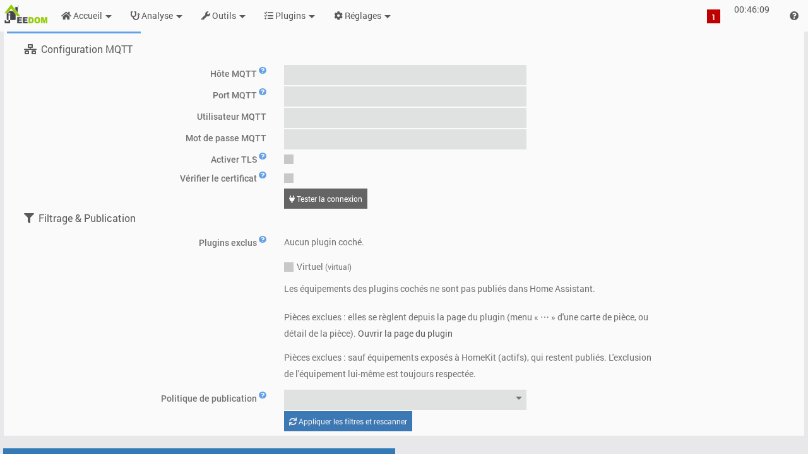
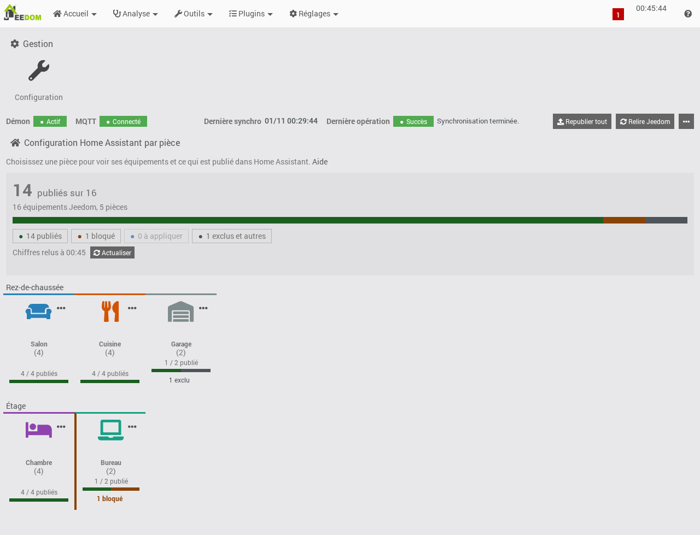
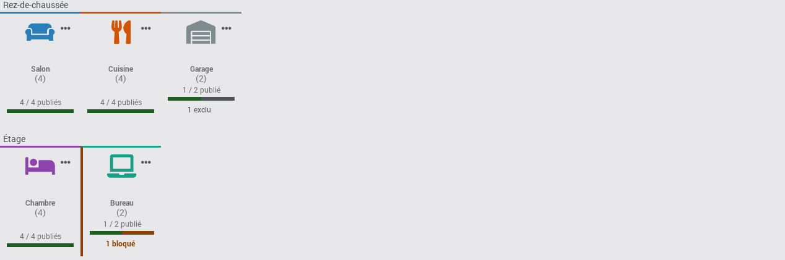
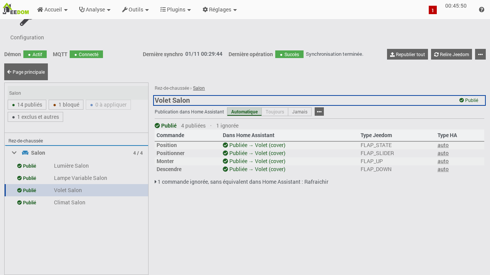
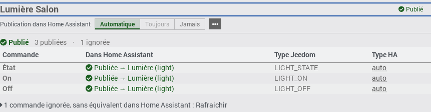
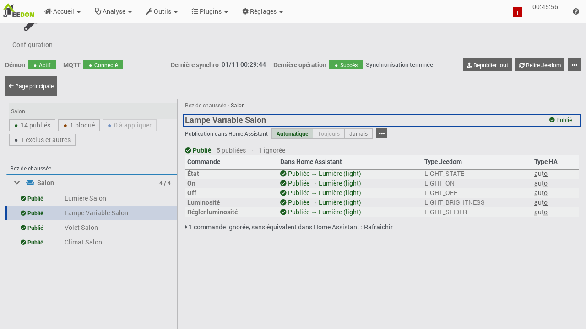

# Jeedom2HA — Documentation

**jeedom2ha publie vos équipements Jeedom dans Home Assistant.** Jeedom reste la source : rien n'y est modifié.

> **Vous découvrez le plugin ?** Commencez par **[Premiers pas](premiers-pas.md)** : une page, de l'installation à votre premier équipement dans Home Assistant.

Cette documentation décrit chaque écran du plugin tel que vous le voyez, avec les mots que l'écran emploie.

---

## Sommaire

1. [Premiers pas](premiers-pas.md) — une page pour démarrer.
2. [Présentation et mots du plugin](#présentation) — dont [À savoir avant tout](#à-savoir-avant-tout).
3. [Prérequis et installation](#prérequis-et-installation) — et [Installer depuis GitHub (beta)](installation-github.md).
4. [Configuration du plugin](#configuration)
   - [Connexion au broker MQTT](#connexion-au-broker-mqtt) · [Ce qui est publié](#ce-qui-est-publié) · [Avancé et tâche planifiée](#avancé-et-tâche-planifiée)
5. [Première publication : le guide de démarrage](#première-publication--le-guide-de-démarrage)
6. [La page du plugin](#la-page-du-plugin)
   - [La barre d'état](#la-barre-détat) · [Ses actions](#les-actions-de-la-barre-détat) · [Relire Jeedom ou Republier tout ?](#relire-jeedom-ou-republier-tout-) · [Relire Jeedom](#relire-jeedom)
   - [Choisir ce qui est publié](#choisir-ce-qui-est-publié) · [Exclure une pièce](#exclure-une-pièce) · [Vérifier l'installation](#vérifier-linstallation)
7. [Ce que Jeedom publie dans Home Assistant](#ce-que-jeedom-publie-dans-home-assistant) (maison, pièces, équipements)
   - [Le bloc de la maison](#le-bloc-de-la-maison) · [Les cartes de pièce](#les-cartes-de-pièce) · [La vue de travail](#la-vue-de-travail)
   - [Le détail d'un équipement](#le-détail-dun-équipement) · [Le tableau des commandes](#le-tableau-des-commandes) · [Corriger le type d'une commande](#corriger-le-type-dune-commande)
   - [Deux familles de réglages](#deux-familles-de-réglages--type-et-publication) · [Réglages en attente](#réglages-en-attente-et-appliquer) · [Les actions de publication](#les-actions-de-publication)
8. [Ce que le plugin publie, ce qu'il ne publie pas, et pourquoi](#ce-que-le-plugin-publie-ce-quil-ne-publie-pas-et-pourquoi)
   - [Ce que le plugin sait publier](#ce-que-le-plugin-sait-publier) · [Limites](#limites--état-réel-des-lumières-et-des-volets) · [Portails](#portails-et-portes-de-garage) · [Vannes](#vannes-darrosage) · [Thermostats](#thermostats) · [Serrures](#serrures)
   - [Les badges de synthèse](#les-badges-de-synthèse) · [Les causes de blocage](#les-causes-de-blocage) · [Les conseils](#les-conseils)
9. [Les états et les compteurs](compteurs.md) — le détail des chiffres (page séparée).
10. [Dépannage](#dépannage)
11. [Annexes](#annexes)
    - [Pièces dans Home Assistant](#annexe--pièces-dans-home-assistant-zone-suggérée) · [Noms et identifiants](#annexe--noms-et-identifiants-dans-home-assistant) · [Nommage des équipements](#annexe--nommage-des-équipements)
    - [Durée des actions](#annexe--durée-des-actions) · [Mots techniques encore affichés](#annexe--mots-techniques-encore-affichés) · [Changelog](changelog.md)

**Par écran** (ce que vous avez sous les yeux, et où il est décrit) :

| Écran | Section |
|---|---|
| Barre d'état (en haut de la page du plugin) | [La barre d'état](#la-barre-détat) |
| Guide de démarrage | [Première publication : le guide de démarrage](#première-publication--le-guide-de-démarrage) |
| Maison (chiffres, puces, « À faire », cartes de pièce) | [Le bloc de la maison](#le-bloc-de-la-maison) |
| Pièce (arbre et recherche) | [La vue de travail](#la-vue-de-travail) |
| Fiche d'un équipement | [Le détail d'un équipement](#le-détail-dun-équipement) |
| Corriger le type | [Corriger le type d'une commande](#corriger-le-type-dune-commande) |
| Choisir ce qui est publié | [Choisir ce qui est publié](#choisir-ce-qui-est-publié) |
| Exclure une pièce | [Exclure une pièce](#exclure-une-pièce) |
| Vérifier l'installation | [Vérifier l'installation](#vérifier-linstallation) |
| Configuration du plugin | [Configuration du plugin](#configuration) |
| Causes et conseils | [Les causes de blocage](#les-causes-de-blocage) et [Les conseils](#les-conseils) |

---

## Présentation

Un petit programme du plugin, le **démon**, tourne en arrière-plan : il lit votre installation Jeedom, décide quels équipements peuvent exister dans Home Assistant, puis les y publie par l'intermédiaire du **broker MQTT** (le serveur de messages que Home Assistant écoute aussi). Home Assistant les découvre alors tout seul : c'est la découverte MQTT (*MQTT Discovery*).

Les mots du plugin, un mot par chose, utilisés partout dans l'écran et dans cette documentation :

| Mot | Ce que cela désigne |
|---|---|
| **Publier** / **Publié** | Rendre un équipement visible et utilisable dans Home Assistant. |
| **Relire Jeedom** | Relire toute la configuration Jeedom, puis mettre Home Assistant à jour. L'indicateur « Dernière relecture » de la barre d'état en donne la date. |
| **Republier** | Renvoyer à Home Assistant ce qui est déjà publié, sans relire Jeedom (« Republier tout », « Republier la pièce », « Republier »). |
| **Appliquer** | Envoyer à Home Assistant un réglage enregistré qui attend. |
| **Exclure** / **Exclu** | Ne pas publier, par choix : un plugin, une pièce ou un équipement. Le retour se dit « Ne plus exclure ». |
| **Automatique**, **Toujours**, **Jamais** | Le réglage de publication d'un équipement ou d'une entité : le plugin décide, publier même si le plugin hésite, ne jamais publier. |
| **Réglage** | Un choix que vous posez et que le plugin conserve : le type Home Assistant d'une commande, ou « Automatique », « Toujours » ou « Jamais ». Un type choisi par vous s'affiche « Personnalisé ». |
| **Type générique** | Le rôle d'une commande dans Jeedom (par exemple « Lumière État », « Lumière Bouton On »), colonne « Rôle dans Jeedom ». C'est lui qui permet au plugin de comprendre à quoi sert la commande. Le plugin ne le modifie jamais. |
| **Type HA** | Ce que devient la commande dans Home Assistant, toujours écrit en français avec le terme technique entre parenthèses : « Lumière (light) ». |
| **Entité** | Une ligne pilotable ou lisible dans Home Assistant. Un équipement Jeedom peut en donner plusieurs (par exemple une prise et la mesure de sa consommation). Son identifiant ressemble à `light.jeedom2ha_142`. |
| **Pilotable** / **Lecture seule** | Home Assistant peut agir sur l'entité (allumer, éteindre, régler…), ou seulement afficher son état. |
| **Conseil** | Un équipement publié qui pourrait faire mieux (en lecture seule alors que des ordres existent, par exemple). Ce n'est pas un état. |
| **État** | Ce que dit le badge d'un équipement : Publié, À appliquer, Bloqué, Exclu, Désactivé ou Rien à publier. Un équipement n'a toujours qu'un seul état (voir [Les états et les compteurs](compteurs.md)). |
| **Pièce** | Un objet de votre arborescence Jeedom (« objet » dans Jeedom, « zone » dans Home Assistant). Les équipements qui n'ont pas de pièce sont regroupés sous « Sans pièce ». |
| **Maison** | Toute votre installation. |
| **Démon** | Le programme du plugin qui tourne en arrière-plan. Son indicateur se lit dans la barre d'état de la page du plugin. |
| **Barre d'état** | Le bandeau en haut de la page du plugin : démon, MQTT, Home Assistant, dernière relecture, et les boutons « Relire Jeedom », « Republier tout » et « ⋯ » (« Autres actions »). |

Le plugin ne modifie jamais vos équipements, vos commandes ni vos types Jeedom. Si vous utilisez aussi le plugin Homebridge, rien ne change pour lui : l'écran du plugin le rappelle par le message « Aucun impact Homebridge : cet écran ne modifie que la sortie Home Assistant de jeedom2ha. »

### À savoir avant tout

Quatre règles qui surprennent, rappelées chacune en tête de la section qui la concerne :

- **Une seule installation jeedom2ha par broker MQTT.** Une deuxième installation branchée sur le même broker (box de test, sauvegarde restaurée ailleurs) retire les boutons de scénario de la première, et inversement. Voir [Connexion au broker MQTT](#connexion-au-broker-mqtt).
- **Certains mots du nom d'un équipement écartent un type** (« garage », « eau », « portail » ou « prise » écartent le type Lumière, par exemple) : l'équipement est alors **Bloqué**. Voir [Nommage des équipements](#annexe--nommage-des-équipements).
- **La pièce dans Home Assistant est fixée à la création** de l'appareil : déplacer ensuite l'équipement dans Jeedom ne le déplace pas dans Home Assistant. Voir [Pièces dans Home Assistant](#annexe--pièces-dans-home-assistant-zone-suggérée).
- **Chaque scénario Jeedom est publié comme un bouton**, qu'il soit actif ou non (désactivé, son bouton est grisé). Voir [Relire Jeedom](#relire-jeedom).

---

## Prérequis et installation

**Prérequis**

- Jeedom en version 4.5 ou supérieure.
- Un système Debian 12.
- Python 3, que Jeedom gère pour le plugin (si Python 3 est introuvable, Jeedom affiche le message « Python3 introuvable pour le plugin »).
- Un broker MQTT : le plugin **MQTT Manager** (recommandé) ou un broker externe (Mosquitto, par exemple).
- Home Assistant avec l'intégration MQTT en service et la découverte automatique (*discovery*) activée.

**Installation**

1. Installez le plugin depuis le Market Jeedom. Pour une installation hors Market à partir d'une archive GitHub, suivez plutôt [Installer depuis GitHub (beta)](installation-github.md).
2. Sur la page du plugin, lancez l'installation des dépendances et attendez la fin de l'opération (suivie dans le journal `jeedom2ha`).
3. Ouvrez la page du plugin : le [guide de démarrage](#première-publication--le-guide-de-démarrage) vous accompagne jusqu'à la première publication. La connexion au broker se règle dans la [configuration du plugin](#configuration), avec le bouton « Tester, enregistrer et redémarrer le démon » : le démon ne lit les réglages MQTT qu'à son démarrage, et ce bouton le redémarre pour vous.

---

## Configuration

La **configuration du plugin** s'ouvre par la vignette **« Configuration »** (bloc « Gestion » de la page du plugin) ou, depuis le guide de démarrage, par « Ouvrir la configuration MQTT ». Les liens « Retour à la page du plugin », en haut et en bas, ramènent à la page du plugin.
<!-- CAPTURE: page de configuration -->

**Un bouton par bloc.** Chaque bloc de la configuration a son bouton bleu, qui dit ce qu'il fait : « Tester, enregistrer et redémarrer le démon » pour le broker, « Enregistrer et relire Jeedom » pour ce qui est publié. Les autres gestes sont des liens. Le bouton « Sauvegarder » de Jeedom enregistre aussi les champs de la page, mais sans tester le broker, sans redémarrer le démon et sans relire Jeedom : préférez le bouton de chaque bloc.

### Connexion au broker MQTT

> **Une seule installation jeedom2ha par broker MQTT.** Le plugin considère le broker comme la référence des boutons de scénario : une deuxième installation branchée sur le même broker (box de test, sauvegarde restaurée ailleurs) retirerait les boutons de scénario de la première, et inversement. Branchez une box de test sur un autre broker. La page de configuration le rappelle sous le titre du bloc.

« Indiquez le broker que Home Assistant utilise déjà : le broker MQTT est le serveur de messages que Home Assistant écoute aussi. »

| Champ | Rôle |
|---|---|
| **Hôte MQTT** | Adresse IP ou nom d'hôte du broker. |
| **Port MQTT** | 1883 par défaut, 8883 pour une connexion chiffrée (TLS). Laissé vide, il vaut 1883. |
| **Utilisateur MQTT** | Identifiant du broker, si une authentification est requise. |
| **Mot de passe MQTT** | Laisser vide pour conserver le mot de passe actuel. Le message « Mot de passe déjà configuré » indique qu'un mot de passe est enregistré. |
| **Activer TLS** | Active le chiffrement de la connexion au broker. |
| **Vérifier le certificat** | Contrôle le certificat du broker. À décocher pour un certificat auto-signé. |

Un bandeau, au-dessus, dit d'où viennent les valeurs : « MQTT Manager détecté — configuration pré-remplie » (le plugin MQTT Manager est installé et les champs vides ont été remplis avec ses réglages), « Broker déjà configuré : les réglages enregistrés sont affichés ci-dessous. » (un hôte est déjà enregistré), ou « Aucun broker MQTT détecté. Installez MQTT Manager ou saisissez les paramètres manuellement ci-dessous. ».

**« Tester, enregistrer et redémarrer le démon »** est le bouton principal. Il enchaîne trois étapes, cochées l'une après l'autre sous le bouton :

1. « Connexion testée » : le démon essaie la connexion avec les valeurs saisies à l'écran. **Si le test échoue, rien n'est enregistré** et le message dit pourquoi, avec le remède :

   | Message | Que faire |
   |---|---|
   | « Ce nom ou cette adresse ne répond pas. » | « Vérifiez l'adresse du broker. » |
   | « Le broker refuse la connexion sur ce port. » | « 1883 en général, 8883 avec TLS. » |
   | « Identifiant ou mot de passe refusé. » | « Vérifiez l'utilisateur MQTT créé pour Jeedom. » |
   | « La connexion chiffrée a échoué. » | « Décochez « Vérifier le certificat » pour un certificat auto-signé. » |
   | « Le broker n'a pas répondu à temps. » | « Vérifiez le réseau et le pare-feu. » |
   | « Adresse manquante » ou « Port invalide » | Complétez le champ (vérifié sur la page, sans appeler le démon). |

2. « Réglages enregistrés » : les réglages du broker sont enregistrés (le mot de passe saisi quitte alors le champ).
3. « Démon redémarré » : le démon redémarre avec ces réglages. Le message final est « Le démon a redémarré avec ces réglages. » : la page du plugin affiche « MQTT Connecté » dans quelques secondes.

Les autres gestes de ce bloc :

- **« Tester seulement »** (lien) essaie la connexion sans rien enregistrer ; le message « Connexion réussie. » ou la cause s'affiche sous le bouton.
- Si le démon ne répond pas, le test est impossible (« Le démon ne répond pas : le test de connexion passe par lui. ») : démarrez-le dans le bloc « Démon » de Jeedom, ou utilisez le lien **« Enregistrer et redémarrer le démon sans tester »**, qui demande une confirmation.
- Si l'enregistrement ou le redémarrage échoue, le message dit quoi faire à la main (par exemple « Réglages enregistrés. Redémarrez le démon ci-dessus. »), et le bouton **« Aller au bloc Démon »** y mène.
- **« Récupérer depuis MQTT Manager »** n'apparaît que si MQTT Manager est installé et actif. Après une confirmation (bouton « Remplacer »), il remplace l'adresse, le port, l'utilisateur, le mot de passe et le réglage TLS par ceux de MQTT Manager et **les enregistre aussitôt**. Cliquez ensuite sur « Tester, enregistrer et redémarrer le démon » pour que le démon les utilise.

### Ce qui est publié

| Champ | Rôle |
|---|---|
| **Plugins exclus** | Une **liste à cocher** des plugins qui ont au moins un équipement dans Jeedom (le plugin jeedom2ha lui-même n'y figure pas). Chaque case porte le nom du plugin affiché par Jeedom, suivi de son identifiant technique en gris. Cochez les plugins dont les équipements ne doivent pas être publiés dans Home Assistant. Un plugin exclu mais **absent de Jeedom** (désinstallé) reste affiché, coché, avec la mention « (absent de Jeedom) » : décochez-le pour le retirer. L'ordre des cases n'a pas d'importance ; la liste défile si elle est longue. Rien de coché = aucune exclusion de plugin. |
| **En cas de doute sur un équipement** | « Publier quand même (recommandé) » ou « Ne publier que les équipements reconnus avec certitude ». |

**Les pièces** ne s'excluent pas ici : « Pièces exclues : elles se règlent depuis la page du plugin (menu « ⋯ » d'une carte de pièce, ou détail de la pièce). » La phrase suivante rappelle que le panneau « Choisir ce qui est publié… » de la page du plugin règle aussi, au même endroit, les plugins, les pièces et les équipements. Le lien « Ouvrir la page du plugin » y mène. Quand au moins une pièce est exclue, leur nombre est rappelé dessous (par exemple « 2 pièces exclues », sans leurs noms) ; sinon, rien n'est affiché. Voir [Exclure une pièce](#exclure-une-pièce). Si le plugin Homebridge est présent, une phrase rappelle l'exception HomeKit : un équipement actif exposé à HomeKit (réglage de Homebridge lu par le plugin) n'est pas écarté par l'exclusion de sa pièce ; il reste publié, comme dans Apple Maison. L'exclusion de l'équipement lui-même, l'exclusion de son plugin et un équipement désactivé dans Jeedom restent respectés, ainsi que l'état global « exclure ».

« En cas de doute » concerne seulement les équipements que le plugin reconnaît avec un léger doute : « Publier quand même » les publie, « Ne publier que les équipements reconnus avec certitude » les met de côté (leur fiche dit pourquoi, et « Corriger le type… » permet de trancher équipement par équipement). **Un doute n'est pas un blocage** : un équipement dont le nom contredit ses types Jeedom (« le nom dit « lampe », les types Jeedom disent « prise » ») est bloqué quel que soit ce réglage, et sa fiche dit comment faire. La page le rappelle sous la liste.

**« Enregistrer et relire Jeedom »** enregistre les plugins exclus et le réglage « En cas de doute », puis relit Jeedom, après une confirmation (« Une relecture complète peut publier ou retirer des entités Home Assistant et applique les réglages enregistrés. Confirmer ? », bouton « Relire »). Il affiche l'avancement (« Enregistrement en cours… », puis « Relecture en cours… ») et le résultat (« Relecture terminée », suivi du nombre d'équipements publiés). Il n'enregistre pas la connexion au broker. Le bouton « Sauvegarder » de Jeedom enregistre aussi la liste des plugins exclus, au même format, mais ne relit pas Jeedom : lancez alors « Relire Jeedom ». La page le rappelle sous le bouton.

Les exclusions de cette page sont **distinctes** de celles que vous posez avec le réglage « Jamais » d'un équipement : voir [Ce que le plugin publie…](#ce-que-le-plugin-publie-ce-quil-ne-publie-pas-et-pourquoi), famille « Exclusions volontaires ».

### Avancé et tâche planifiée

- Le bloc replié **« Avancé »** contient **« Réinitialiser le formulaire »**, qui vide les champs du broker sur cette page, sans rien enregistrer.
- « Dans le bloc « Fonctionnalités » de Jeedom, ne décochez pas cron5 : il maintient la publication à jour. » cron5 est la tâche que Jeedom lance toutes les 5 minutes : elle republie ce qui a changé sans relecture de votre part (scénario ou équipement activé ou désactivé, exclusion). Décochée, rien ne casse, mais ces changements attendent un « Relire Jeedom ». Voir la [réévaluation automatique](#relire-jeedom).

---

## Première publication : le guide de démarrage

Tant que rien n'a encore été publié avec succès, la page du plugin affiche, à la place de la maison, le **guide de démarrage** : « Bienvenue dans jeedom2ha », puis quatre étapes. Chaque étape se coche seule quand elle est faite (« Fait ») ; l'étape en cours est marquée « À faire » (« À corriger » si une cause l'arrête, avec son remède) ; les suivantes sont grisées, avec « Terminez l'étape N d'abord. ». Le pas-à-pas complet, avec des captures, est dans [Premiers pas](premiers-pas.md).

| Étape | Ce qu'on vous demande | Faite quand |
|---|---|---|
| 1. « Connecter le broker MQTT » | « Ouvrir la configuration MQTT », puis [« Tester, enregistrer et redémarrer le démon »](#connexion-au-broker-mqtt). | Le démon tourne et le broker est connecté. |
| 2. « Vérifier que Home Assistant écoute » | Dans Home Assistant : Paramètres › Appareils et services › MQTT, l'appareil « Jeedom (jeedom2ha) » avec l'entité « État du pont ». Boutons « Je l'ai vu » et « Je ne le vois pas » (trois causes : intégration MQTT absente, autre broker, découverte désactivée). | Home Assistant s'est signalé sur le broker, ou vous avez cliqué sur « Je l'ai vu » (« Fait (vu par vous) »). |
| 3. « Choisir ce qui est publié » | « Tout publier (recommandé) » ou « Choisir… », qui ouvre le panneau [Choisir ce qui est publié](#choisir-ce-qui-est-publié). | Au premier choix. |
| 4. « Publier dans Home Assistant » | Le bouton « Publier dans Home Assistant » lit Jeedom et publie ce que le plugin reconnaît (« Publication en cours… »). En cas d'échec, la cause s'affiche et le bouton devient « Réessayer de publier ». | La première publication a réussi. |

L'écran de fin dit combien d'équipements sont dans Home Assistant et où les trouver (« Où les trouver : dans Home Assistant, Paramètres › Appareils et services › MQTT. »), avec quelques exemples ; « Voir ma maison » ferme le guide, et un second bouton liste les équipements qui ont besoin de vous. Si Jeedom ne contient aucun équipement, l'étape 4 le dit : « Jeedom ne contient encore aucun équipement à publier. Ajoutez des équipements dans Jeedom, puis revenez ici. »

« Fermer » cache le guide pour cette visite ; « Ne plus afficher ce guide » l'empêche de revenir seul. Il se rouvre à tout moment par le menu « ⋯ » de la barre d'état, **« Guide de démarrage »**. Une installation qui a déjà publié n'affiche jamais le guide d'elle-même, même en cas de panne : la barre d'état et [« Vérifier l'installation… »](#vérifier-linstallation) suffisent.

Si un équipement manque ensuite, ouvrez sa pièce dans la page du plugin : sa fiche dit son état et, s'il n'est pas publié, pourquoi.

---

## La page du plugin

La page du plugin (**Plugins › Communication › jeedom2ha**) contient, de haut en bas : le bloc « Gestion » (vignette « Configuration »), la barre d'état et ses actions, puis la section « Ce que Jeedom publie dans Home Assistant » (la maison et les cartes de pièce). Tant que rien n'est publié, le [guide de démarrage](#première-publication--le-guide-de-démarrage) prend la place de la maison.
<!-- CAPTURE: page principale du plugin -->

### La barre d'état

La barre tient sur une ligne (elle se replie sur les petits écrans) : quatre indicateurs, chacun avec un point d'état et un mot, puis les actions à droite. Elle est lue **à l'ouverture de la page**, puis **relue toute seule toutes les 30 secondes** tant que l'onglet est visible, et aussi après « Republier tout », « Appliquer » et « Supprimer de Home Assistant » (à toutes les portées, **y compris quand l'action échoue**) et après « Relire Jeedom ». Les indicateurs :

| Indicateur | Valeurs possibles |
|---|---|
| **Démon** | « Actif » (vert) ; « Arrêté » (rouge : le démon ne répond pas) ; « Erreur Jeedom » ou « Erreur de communication » (rouge). |
| **MQTT** (la liaison avec le broker) | « Connecté » (vert) ; « Reconnexion... » ou « Connexion... » (orange) ; « Déconnecté » (rouge) ; « Non configuré » ; « Inconnu » (démon arrêté ou erreur). L'adresse du broker s'affiche à côté. |
| **Home Assistant** | « Vu à 21:04 » (vert, « Vu le 13/11 à 21:04 » si ce n'est pas aujourd'hui) ; « Confirmé par vous » (vert pâle) quand vous avez indiqué avoir vu l'appareil « Jeedom (jeedom2ha) » dans Home Assistant (« Je l'ai vu », dans le guide ou dans « Vérifier l'installation… ») ; sinon « Non confirmé » (gris). Home Assistant ne se signale sur le broker qu'à son démarrage : s'il tourne déjà, « Non confirmé » est normal et ne veut pas dire que rien ne marche. Pour en avoir le cœur net, vérifiez qu'il voit l'appareil « Jeedom (jeedom2ha) ». Affiché seulement si le démon fournit cette information. |
| **Dernière relecture** | La date et l'heure (jour/mois et heures:minutes) de la dernière lecture complète, suivie de son résultat (« Réussie », « Partielle » ou « Échouée ») quand c'est la dernière opération ; « Jamais » si aucune n'a eu lieu, « Inconnue » si le démon est arrêté. |
| **Dernière opération** | Affichée seulement quand la dernière opération n'est pas la relecture (par exemple « Republier tout ») : « Succès » (vert) ; « Partiel » ou « Échec » (orange : c'est un problème de configuration, pas une panne d'infrastructure) ; « Aucune » ; « Inconnue » si le démon est arrêté. Le message de l'opération s'affiche à côté. |

### Les actions de la barre d'état

Deux boutons de poids normal agissent sur **toute la maison** ; les actions moins courantes sont rangées dans le menu « ⋯ » (« Autres actions »), à droite. Une ligne d'aide, sous les boutons, rappelle lequel choisir : « **Relire Jeedom** : j'ai changé quelque chose dans Jeedom. **Republier tout** : Home Assistant a perdu ses appareils. »

| Action | Ce qu'elle fait |
|---|---|
| **« Republier tout »** | Renvoie à Home Assistant les équipements publiés, sans relire Jeedom, et applique leurs réglages en attente. La confirmation « Republier tout » est chiffrée d'après la dernière lecture : « Renvoie les … équipements publiés à Home Assistant, sans relire Jeedom. Utile si Home Assistant a perdu ses appareils. », avec, s'il y en a, le nombre de réglages en attente qui seront aussi appliqués ; le bouton dit « Republier N équipements » (« Republier tout » si la lecture n'est pas disponible). « Republier tout » travaille sur ce que la dernière lecture complète a lu : il ne relit pas Jeedom. |
| **« Relire Jeedom »** | Relit tout Jeedom. Voir [Relire Jeedom](#relire-jeedom). |
| **« Choisir ce qui est publié… »** (menu « ⋯ », et bouton à droite du titre de la maison) | Ouvre le panneau qui exclut ou reprend, au même endroit, des plugins, des pièces et des équipements. Voir [Choisir ce qui est publié](#choisir-ce-qui-est-publié). |
| **« Vérifier l'installation… »** (menu « ⋯ ») | Ouvre une boîte qui déroule les contrôles dans l'ordre (le démon tourne, le broker MQTT répond, Home Assistant a été vu, dernière relecture réussie, équipements bloqués), s'arrête au premier point « À corriger » et propose son remède. Elle porte aussi le téléchargement du diagnostic support. Voir [Vérifier l'installation](#vérifier-linstallation). |
| **« Guide de démarrage »** (menu « ⋯ ») | Rouvre le guide en quatre étapes affiché au premier lancement (connecter le broker, vérifier que Home Assistant écoute, choisir ce qui est publié, publier). |
| **« Supprimer tout de Home Assistant… »** (menu « ⋯ », en rouge, séparé par un trait) | Retire de Home Assistant tout ce qui est publié, après une confirmation forte et chiffrée : « Supprimer tout de Home Assistant » annonce le nombre d'équipements et d'entités qui seront retirés, prévient que « L'historique, les tableaux de bord et les automatisations qui les utilisent seront touchés. » et que « Rien n'est recréé automatiquement : utilisez « Republier tout » pour les remettre. Cette action ne s'annule pas. ». Le bouton rouge dit « Supprimer N entités » (« Supprimer tout » si le nombre n'est pas connu). |

Le menu « ⋯ » s'ouvre au clic ou au clavier, se ferme par Échap ou par un clic à l'extérieur, et rend le focus à son bouton. Aucune action destructrice n'est visible hors de ce menu.

**Quand certains boutons sont grisés.** « Republier tout », « Relire Jeedom » et « Supprimer tout de Home Assistant… », ainsi que « Appliquer » et les entrées « Republier » et « Supprimer de Home Assistant… » des menus « ⋯ » (de la pièce et de chaque équipement), ne sont utilisables que si le démon tourne **et** que MQTT est connecté. Sinon, ils sont grisés et une ligne d'explication s'affiche :

- « Démon arrêté — actions Home Assistant bloquées. » (le démon est arrêté) ;
- « MQTT déconnecté — actions Home Assistant bloquées. » ;
- « Démon ou MQTT indisponible — actions Home Assistant bloquées. » (état impossible à lire).

Pendant une relecture de Jeedom, ces mêmes boutons sont aussi grisés. Le réglage de publication (« Automatique », « Toujours », « Jamais ») et le « Type HA » des commandes ne sont **pas** concernés : ils restent actifs, mais si le démon ne répond pas, leur action échoue avec un message d'erreur.

### Relire Jeedom ou Republier tout ?

| J'ai… | Bouton | Ce qui se passe |
|---|---|---|
| changé quelque chose dans Jeedom (un équipement, un type générique, un nom, une pièce) | **« Relire Jeedom »** | Le plugin relit Jeedom, publie ou retire ce qui a changé et applique les réglages en attente. |
| perdu mes appareils dans Home Assistant (broker redémarré sans mémoire, par exemple) | **« Republier tout »** | Le plugin renvoie à Home Assistant ce qui est déjà publié, sans relire Jeedom. |
| besoin de renvoyer un seul équipement ou une seule pièce, sans rien avoir changé dans Jeedom | « Republier » ou « Republier la pièce » (menus « ⋯ ») | Comme « Republier tout », pour cette portée : rien n'est relu dans Jeedom. Une modification faite dans Jeedom (nom, types génériques, pièce), même sur un seul équipement, demande « Relire Jeedom ». |

Vous n'avez rien à relancer quand un scénario ou un équipement est activé ou désactivé, ou quand une exclusion change : la [réévaluation automatique](#relire-jeedom) s'en charge toutes les 5 minutes.

### Relire Jeedom

« Relire Jeedom » ouvre d'abord une confirmation, « Relire Jeedom » : « Le plugin relit vos équipements et met Home Assistant à jour. », suivi, s'il y en a, du nombre de réglages en attente (« D'après la dernière lecture : … »), puis « Rien n'est supprimé sans que vous l'ayez exclu. ». Le bouton de la confirmation s'appelle aussi « Relire Jeedom ». Cette phrase vise vos choix de publication ; un équipement qui ne peut plus être publié après une modification faite dans Jeedom (type générique retiré, équipement supprimé) est, lui, retiré de Home Assistant à cette relecture.

- **Ce qu'il fait** : relit tous les équipements de Jeedom, publie ou retire des entités Home Assistant en conséquence, et **applique d'un coup tous les réglages en attente** (types Home Assistant choisis, publication « Toujours » ou « Jamais ») de tous les équipements.
- **Ce qu'il ne fait pas** : il ne modifie rien dans Jeedom.
- **Scénarios** : chaque scénario Jeedom a son bouton dans Home Assistant, qu'il soit actif ou non. Un scénario **désactivé** garde son bouton, **grisé** (« indisponible ») : l'appui est refusé et rien n'est lancé dans Jeedom ; le bouton redevient utilisable dès que le scénario est réactivé. L'entité, son identifiant et ses réglages dans Home Assistant ne changent pas, et les automatisations qui la citent restent valides. Seul un scénario **supprimé** de Jeedom voit son bouton retiré. Les scénarios n'apparaissent pas dans les pièces ni dans « Choisir ce qui est publié » : seul leur nombre est rappelé sous le chiffre de la maison. Rappel : une seule installation jeedom2ha par broker MQTT (voir [Connexion au broker MQTT](#connexion-au-broker-mqtt)).
- **Réévaluation automatique** : vous n'avez pas besoin de relire Jeedom quand un scénario est activé ou désactivé, quand un équipement est activé ou désactivé, ou quand une exclusion change (par exemple par un agenda, un mode ou un autre scénario). Toutes les 5 minutes, le plugin vérifie si cet état a changé et, seulement dans ce cas, relit Jeedom et met Home Assistant à jour (bouton de scénario grisé ou non, équipement publié ou retiré, raison affichée). Rien n'est relu si rien n'a changé, si le démon n'est pas démarré ou si une autre opération est en cours (nouvel essai 5 minutes plus tard). Comme une relecture, cette réévaluation applique aussi les réglages en attente (voir [Réglages en attente](#réglages-en-attente-et-appliquer)). Cette tâche apparaît dans la page du plugin (« Fonctionnalités », `cron5`) et peut y être désactivée.
- **Pendant l'opération** : le bouton affiche « Relecture en cours… » et les autres boutons d'action sont grisés.
- **Résultat** : un message « Relecture terminée. » (vert), « Relecture terminée avec avertissements. » (orange) ou « Relecture échouée. » (rouge) — remplacé par le message précis du démon quand il en fournit un autre. « Une opération est déjà en cours ou la relecture a échoué. » n'est qu'un message de repli : le démon renvoie le plus souvent son propre message, affiché à la place ; « Erreur de communication : vérifiez « Dernière relecture » avant de relancer. » indique que la réponse n'est pas arrivée. La barre d'état est ensuite relue.

### Choisir ce qui est publié

**« Choisir ce qui est publié… »** ouvre le panneau **« Choisir ce qui est publié dans Home Assistant »**. Il s'ouvre depuis le bouton à droite du titre de la maison, le menu « ⋯ » de la barre d'état, l'étape 3 du guide de démarrage (« Choisir… ») ou le menu « ⋯ » d'une carte de pièce (il est alors déplié sur cette pièce). Rien n'est écrit tant que vous n'avez pas cliqué sur le bouton d'application.

- « Tout est publié par défaut. Décochez ce que vous ne voulez pas voir dans Home Assistant. »
- La bascule **« Par pièce | Par plugin »** range les équipements par pièce ou par plugin. Chaque groupe a une case (cochée, décochée, ou mixte quand une partie seulement de ses équipements est exclue), son nombre d'équipements et le nombre de non exclus ; un groupe se déplie pour cocher ou décocher ses équipements un à un.
- La règle est dite en une ligne : « Un équipement est publié s'il n'est exclu ni lui-même, ni par sa pièce, ni par son plugin. » **« Non exclu » ne veut pas dire « publié »** : le panneau compte les équipements non exclus, mais un équipement non exclu peut rester hors de Home Assistant parce qu'il est désactivé dans Jeedom, bloqué ou sans rien à publier. Une pièce peut donc afficher « 4 non exclus » ici et moins de publiés sur sa carte ; le badge de chaque équipement dit pourquoi. Chaque équipement montre son état et, s'il est exclu, pourquoi : « Exclu : pièce Garage exclue », « Exclu : plugin Virtuel exclu », « Exclu : réglage « Jamais » de l'équipement », « Désactivé dans Jeedom : jamais publié », ou « Reste publié : exposé à HomeKit » (un équipement actif exposé à HomeKit n'est pas écarté par sa pièce). Un équipement exclu par sa pièce ou son plugin ne se coche pas seul : reprenez la pièce ou le plugin.
- Précisions dites au bon endroit : « Exclure une pièce n'exclut pas ses sous-pièces », « Sans pièce ne peut pas être exclue en bloc ».
- **Le pied compte en direct**, d'après la dernière lecture : le nombre de changements, le nombre d'équipements qui seront retirés de Home Assistant (avec leurs entités), ceux qui seront exclus sans rien retirer, et ceux qui ne seront plus exclus. Sans changement : « Aucun changement. » (« Rien n'est exclu : tout ce que le plugin reconnaît est publié. » quand rien ne l'est). Si la lecture des états n'est pas disponible, le panneau le dit et ne chiffre pas les entités.
- **Le bouton d'application** dit ce qu'il fera : « Appliquer — retirer N entités » (rouge), « Appliquer — exclure N équipements » (rouge, nombre d'entités inconnu), « Appliquer — publier N équipements » (vert) ou « Appliquer ». « Annuler », la croix et la touche Échap ferment sans rien écrire.

**Après le clic**, les changements sont enregistrés un à un (plugins exclus, pièces, puis équipements, comme le feraient la configuration du plugin, le menu d'une pièce et le réglage « Jamais »), puis **une seule** relecture de Jeedom les applique tous en même temps. Un bandeau dit le résultat (le nombre d'équipements exclus ou repris, puis « Home Assistant est à jour. ») et propose **« Annuler »** pendant 10 secondes, qui rétablit les réglages précédents puis relit Jeedom (un équipement dont le réglage précédent ne peut pas être repris est annoncé, à rétablir depuis sa fiche). Si un enregistrement est refusé, la suite n'est pas envoyée et rien n'est relu : le message dit combien de changements ont été enregistrés (« Rien n'a été relu : vérifiez vos choix, puis lancez « Relire Jeedom ». »). Si la relecture échoue : « Changements enregistrés, mais la relecture a échoué : relancez « Relire Jeedom ». ». Le panneau ne s'applique pas pendant une autre opération ni quand le démon ou MQTT est indisponible.

### Exclure une pièce

Une pièce entière peut être exclue de Home Assistant **depuis sa carte** (menu « ⋯ » en haut à droite de la carte, entrée **« Exclure la pièce… »**) ou **depuis le détail de la pièce** dans la vue de travail (même entrée dans le menu « ⋯ », avant « Supprimer de Home Assistant… »). Ouvrir ce menu n'ouvre pas la pièce. La carte « Sans pièce » n'a pas de menu : elle ne peut pas être exclue.

- **La confirmation est chiffrée.** « Exclure la pièce « Nom » de Home Assistant ? » annonce le nombre d'entités concernées : « 5 entités seront retirées de Home Assistant. », « 1 entité sera retirée… » ou « Aucune entité n'est publiée dans cette pièce. » Si la lecture des états n'est pas disponible, la confirmation le dit (« Nombre d'entités inconnu : la lecture des états n'est pas disponible. ») et reste possible. Si des réglages attendent d'être appliqués, elle ajoute « La relecture appliquera aussi les M réglages en attente de la maison. » Le bouton « Exclure la pièce » est rouge, car il retire des entités de Home Assistant ; « Annuler », la croix et la touche Échap ferment sans rien écrire.
- **L'effet est immédiat.** Après la confirmation, le plugin enregistre l'exclusion puis lance **une relecture complète de Jeedom** (celle de « Relire Jeedom », sans seconde confirmation), puis relit les chiffres. Pendant ce temps, « Relire Jeedom » et les entrées d'exclusion de toutes les pièces sont grisés (« Une opération est déjà en cours. »). Si l'enregistrement échoue, rien n'est relu ni changé. Si la relecture échoue, l'exclusion reste enregistrée et le message est suivi de « Relancez « Relire Jeedom » pour retirer les entités. » Exclure une pièce déjà exclue ne change rien mais relance quand même la relecture.
- **La carte** affiche **« Pièce exclue »** (icône œil barré) à la place de « n / t publiés » ; la jauge et les repères restent, et « N pas encore retirés » s'affiche tant que la relecture n'a pas retiré tous les équipements. Dans la vue de travail, la ligne de la pièce porte la même mention, et le détail de la pièce affiche « Pièce exclue : ses équipements ne sont pas publiés dans Home Assistant. » avec le bouton **« Ne plus exclure la pièce… »**.
- **« Ne plus exclure la pièce… »** demande une confirmation sans nombre (« Ses équipements seront relus et publiés s'ils sont publiables. ») ; le bouton « Ne plus exclure » n'est pas rouge, car rien n'est retiré.
- **La pièce prime sur « Toujours ».** Sauf équipements exposés à HomeKit (actifs), qui ne sont pas écartés par la pièce, un équipement réglé « Toujours » dans une pièce exclue n'est pas publié : « Toujours » reste affiché comme réglage posé, mais les positions grisées disent « Pièce exclue : elle prime sur ce réglage. »
- **Pas de cascade.** Seule la pièce choisie est exclue, pas ses sous-pièces : excluez-les aussi, une à une.

### Vérifier l'installation

**« Vérifier l'installation… »** (menu « ⋯ » de la barre d'état) ouvre une boîte « Vérifier l'installation » qui passe les contrôles dans l'ordre. Chaque contrôle porte l'un de ces quatre mots :

- **« OK »** : rien à faire ;
- **« À corriger »** : quelque chose ne va pas ; la liste s'arrête là ;
- **« À vérifier »** : le plugin ne peut pas conclure seul et vous demande un contrôle ; la liste continue ;
- **« En attente »** : pas encore contrôlé, parce qu'un point « À corriger » le précède.

| Contrôle | Si ça ne va pas |
|---|---|
| « Le démon tourne » | « Le démon est arrêté. » — bouton « Ouvrir la configuration du plugin ». |
| « Le broker MQTT répond » | La cause (« Le broker MQTT ne répond pas : vérifiez son adresse, son port et l'utilisateur MQTT. », « Aucun broker MQTT n'est configuré. »…) — bouton « Ouvrir la configuration MQTT ». |
| « Home Assistant sur le broker » | « OK » quand Home Assistant s'est signalé depuis le dernier démarrage du démon, ou quand vous avez confirmé l'avoir vu (« Confirmé par vous »). Sinon « À vérifier », qui n'est pas une erreur (Home Assistant qui tourne déjà ne se signale pas de nouveau) : regardez dans Home Assistant s'il voit l'appareil « Jeedom (jeedom2ha) », puis cliquez sur « Je l'ai vu ». S'il n'y est pas, « Je ne vois pas l'appareil dans Home Assistant » déplie les trois causes habituelles (intégration MQTT absente, autre broker, découverte désactivée). Ce contrôle n'apparaît que si le démon fournit cette information. |
| « Dernière relecture réussie » | « Aucune relecture pour l'instant. » ou « Échouée. » — bouton « Relire Jeedom » ; « Partielle : des équipements n'ont pas pu être publiés. » — bouton « Voir lesquels ». |
| « Aucun équipement bloqué », ou le nombre d'équipements bloqués | « Ils ne sont pas publiés : chaque fiche dit pourquoi. » — bouton « Voir les équipements bloqués ». |

Le premier point « À corriger » arrête la liste : les suivants sont « En attente », avec « Corrigez d'abord le point ci-dessus. ». Chaque bouton ferme la boîte et mène au remède.

**Pour le support.** « Un fichier qui décrit votre installation jeedom2ha. À joindre à votre message sur le forum. » Le bouton **« Télécharger le diagnostic support »** produit un fichier `jeedom2ha-diagnostic-AAAA-MM-JJ.json`. Fermer la boîte n'envoie rien.

- La case **« Pseudonymiser les noms d'équipements »** remplace les noms d'équipements par « Équipement_N », les noms de pièces par « Pièce_M » et les noms de commandes par « Cmd_ » suivi de leur numéro, et masque l'adresse du broker.
- Messages : « Export en cours... », puis « Diagnostic téléchargé » ; en cas de problème, « Erreur export » ou « Erreur de communication », ou le message d'erreur renvoyé par le plugin.

**Avancé** (replié) :

- **« Télécharger l'export de décision »** : « Fichier JSON des décisions du plugin : identifiants seulement, aucun nom d'équipement, de pièce, de commande ni de scénario ». Il dit, pour chaque équipement et chaque commande, ce que le plugin a décidé et pourquoi, sous forme de codes : c'est l'outil du support pour une analyse fine. Message : « Export de décision téléchargé ».
- « Journaux du plugin : » `jeedom2ha` (le plugin), `jeedom2ha_daemon` (les ordres reçus de Home Assistant et les refus), `jeedom2ha_packages` (l'installation). Chaque nom ouvre le journal dans Jeedom.

Ces fichiers sont des outils d'assistance. Pour comprendre l'état d'un équipement, ouvrez sa fiche.

---

## Ce que Jeedom publie dans Home Assistant

Sous la barre d'état, la section **« Ce que Jeedom publie dans Home Assistant »** commence par la phrase « jeedom2ha publie vos équipements Jeedom dans Home Assistant. Jeedom reste la source : rien n'y est modifié. » et une ligne d'aide discrète, avec un lien **« Aide »** vers cette documentation. Le type natif Jeedom (partagé avec Homebridge) n'est jamais modifié par le plugin. Elle se lit à trois niveaux : la **maison**, la **pièce** (la vue de travail) et l'**équipement** (sa fiche).

### Le bloc de la maison

Le bloc de la maison donne, dès le premier écran, le chiffre qui compte : un grand nombre suivi de « publiés sur » le total des équipements Jeedom, avec le nombre de pièces. Dessous, une **jauge** segmentée (publiés en vert, à appliquer en bleu, bloqués en orange, exclus ou inactifs en gris, non lus en hachuré) et une **légende en puces**. Si le démon fournit le nombre, la ligne du total ajoute « + N scénarios publiés comme boutons ».

- **Chaque puce (et chaque segment de la jauge) est un filtre** qui s'applique à toutes les pièces (« Cliquez sur un chiffre pour voir la liste. ») : un clic affiche, **sur place**, sous le bloc, la liste des équipements dans cet état avec leur pièce, et les cartes de pièce sans équipement concerné sont atténuées (jamais masquées). Un clic sur une ligne de cette liste ouvre la [vue de travail](#la-vue-de-travail) sur l'équipement. Un second clic sur la puce, la touche Échap ou « Tout afficher » retire le filtre. Un filtre ne fait aucune requête : il lit les chiffres déjà affichés.
- Les puces à zéro ne sont pas affichées. La puce « exclus ou inactifs » regroupe les équipements exclus, désactivés et sans rien à publier ; chaque ligne garde son propre mot d'état.
- Le bloc **« À faire »** (absent s'il n'y a rien à faire) liste les cinq premières lignes : d'abord les équipements bloqués, avec leur pièce, leur cause en clair et l'action qui la corrige (« Ouvrir les types génériques », « Corriger le type… », « Ouvrir l'équipement dans Jeedom » ou « Voir »), puis les équipements qui ont un [conseil](#les-conseils). « Voir les N bloqués » affiche la liste complète des bloqués.
- La légende **« Que veulent dire ces mots ? »** dit en une ligne ce que veut dire chacun des six états, puis « Pilotable », « Lecture seule » et « Conseil ».
- **« Actualiser »** relit les chiffres en contournant la mémoire du démon, et « Chiffres relus à HH:MM » indique l'heure de la dernière lecture. Les chiffres sont relus à l'ouverture de la page, après chaque action (« Republier tout », « Relire Jeedom », « Supprimer tout de Home Assistant… », et chaque action de la vue de travail, qu'elle réussisse ou échoue) et quand vous revenez sur l'onglet du navigateur après plus d'une minute. Il n'y a pas de relecture périodique.
- Pendant une opération du plugin, une mention « Opération en cours : ces chiffres peuvent changer » s'affiche ; le plugin relit alors trois fois au plus, puis laisse la mention en place. Avant la première relecture, la page indique « Aucune synchronisation n'a encore eu lieu » ; si la lecture échoue, « Chiffres indisponibles » (les derniers chiffres valides restent affichés, atténués).

Le détail des chiffres est dans [Les états et les compteurs](compteurs.md#la-jauge-de-la-maison).

### Les cartes de pièce

Chaque pièce qui contient au moins un équipement a une carte. Elle porte :

- l'icône et la couleur choisies dans Jeedom pour l'objet, son nom et « n / t publiés », avec une petite jauge segmentée ;
- seulement s'ils ne sont pas nuls, les repères « N bloqués » (orange), « N à appliquer » (bleu), « N non lus » (gris) et « N exclus » (gris, après les autres : l'infobulle et le nom accessible de la carte donnent la ventilation par cause, comme dans le détail de la pièce) ;
- un liseré orange si au moins un équipement est bloqué.

Les cartes sont **regroupées par objet parent** (sous-titre du groupe, ordre de Jeedom conservé). La carte **« Sans pièce »** rassemble les équipements qui n'ont pas de pièce, en dernier. Les équipements **désactivés dans Jeedom sont comptés et listés**. Les équipements du plugin jeedom2ha lui-même sont écartés. S'il n'y a aucune pièce avec équipement, la page affiche « Aucune pièce avec équipement trouvée. »

Chaque carte (sauf « Sans pièce ») a un menu « ⋯ » (« Autres actions ») :

- « Choisir ce qui est publié… » (le panneau, ouvert sur cette pièce) ;
- « Republier la pièce » (confirmation chiffrée : « Renvoie les … équipements publiés de cette pièce à Home Assistant, sans relire Jeedom. », bouton « Republier N équipements ») ;
- après un trait, « Exclure la pièce… » ou « Ne plus exclure la pièce… » (voir [Exclure une pièce](#exclure-une-pièce)) ; une pièce exclue affiche « Pièce exclue » à la place de « n / t publiés ».

« Supprimer de Home Assistant… » pour une pièce se trouve dans le menu « ⋯ » du détail de la pièce, dans la vue de travail.

Les cartes sont opérables au clavier (Entrée ou Espace ouvre la vue de travail sur la pièce, seule dans l'arbre). Un équipement dont la lecture a échoué, ou que le démon ne connaît pas encore, est compté **« non lu »** : il n'est jamais compté publié, bloqué, exclu ni désactivé.
<!-- CAPTURE: cartes de pièce -->

### La vue de travail

Cliquer sur une carte de pièce ou sur une ligne de la liste filtrée ouvre la **vue de travail**, dans la page du plugin, **sans ouvrir de boîte de dialogue** : la barre d'état reste affichée au-dessus, le bloc de la maison, la liste filtrée et les cartes sont masqués (ils retrouvent leur état au retour). La vue occupe la hauteur de l'écran : à gauche l'arbre des pièces et de leurs équipements, à droite le détail de ce que vous avez choisi ; chaque colonne défile seule.

- **La portée.** Depuis **une carte de pièce**, l'arbre n'affiche que **cette pièce** (dépliée et choisie) : elle est tout de suite visible, même dans une maison de plus de vingt pièces. La bascule **« Cette pièce | Toute la maison »**, en tête de l'arbre (dans le tiroir « Pièces » sur tablette), change la portée : le choix est conservé, la ligne choisie reste visible et reçoit le focus. Depuis une ligne de la liste filtrée, la vue s'ouvre directement sur **toute la maison**, pour garder le contexte du filtre. Dans la pièce seule, les filtres ne portent que sur cette pièce ; la recherche, elle, cherche toujours partout.
- **Le retour.** « Page principale » (ou le bouton « Précédent » du navigateur) revient à la page du plugin telle que vous l'avez laissée (filtre, position de défilement), sans rien relire. La touche Échap ne quitte pas la vue : elle ferme d'abord un menu ou une confirmation ouverts.
- **L'adresse de la page** garde votre sélection (elle se termine par `#j2ha-vue=…`) : copiée dans un autre onglet, elle rouvre la même pièce et le même équipement. Une adresse qui se termine par `seule:1` rouvre la pièce seule ; sans `seule:1`, elle rouvre toutes les pièces. Élargir remplace l'entrée de l'historique au lieu d'en ajouter une : « Précédent » remonte d'un niveau (équipement, puis pièce, puis page du plugin) et rouvre chaque niveau avec la portée qu'il avait. La recherche n'est pas mémorisée.
- **L'arbre** reprend, en portée « toutes », toutes les pièces, regroupées comme les cartes (sous-titre du groupe, ordre de Jeedom conservé), « Sans pièce » comprise. Chaque pièce porte l'icône et la couleur choisies dans Jeedom, son nom, « n / t » et, seulement s'ils ne sont pas nuls, les repères « N bloqués » (orange) et « N à appliquer » (bleu). Déplier une pièce montre ses équipements : l'état avant le nom (le même mot que partout), la mention « (désactivé dans Jeedom) » le cas échéant, « N bloquées » pour un équipement publié qui en comporte, et « non lu » pour un équipement dont les chiffres n'ont pas pu être lus. La pièce choisie est dépliée ; les autres sont repliées. L'arbre se parcourt au clavier : flèches haut et bas, flèches droite et gauche pour déplier ou replier, Entrée ou Espace pour choisir, Début et Fin.
- **La cause d'exclusion** d'un équipement « Exclu » est une mention grise après son nom (« par le plugin X », « par la pièce », « individuelle »), tronquée avant le nom si la place manque. Le détail d'une pièce affiche, sous ses compteurs, la ligne « Exclus : » avec la ventilation par cause.
- **La recherche** (« Rechercher dans toute la maison ») porte sur les noms de pièce et d'équipement seulement, sans tenir compte de la casse ni des accents, dans toute la maison : dans la pièce seule, les résultats des autres pièces sont groupés sous « Dans les autres pièces ». « Aucun résultat » s'affiche quand rien ne correspond dans toute la maison. Une pièce dont le nom correspond montre tous ses équipements. Elle ne fait aucune requête.
- **Les filtres** sont les mêmes puces que sur la page du plugin, avec les mêmes libellés ; les effectifs sont ceux de la maison, ou ceux de la pièce quand la vue est limitée à une pièce (le nombre de lignes de l'arbre est toujours égal au chiffre de la puce). Le filtre est **partagé** avec la page du plugin : celui que vous avez choisi y est repris, et un changement fait dans la vue se retrouve au retour. Une puce à zéro n'est pas affichée. Choisir un filtre ne fait aucune requête et ne désélectionne rien : l'équipement affiché reste affiché même s'il sort du filtre.

**Le détail d'une pièce** montre, de haut en bas :

- le fil d'Ariane (parent puis pièce), le nom, le bouton **« Republier la pièce »** et le menu « ⋯ » (**« Exclure la pièce… »** ou **« Ne plus exclure la pièce… »**, puis **« Supprimer de Home Assistant… »**, en rouge, dans le menu seulement ; une pièce exclue affiche aussi l'encart « Pièce exclue : ses équipements ne sont pas publiés dans Home Assistant. ») ;
- les **compteurs de la pièce** (un chiffre et un mot court par état d'équipement : publié, à appliquer, bloqué, exclu, désactivé, rien à publier ; les états à zéro sont masqués ; un clic sur un compteur filtre l'arbre — voir [Les états et les compteurs](compteurs.md)) ;
- une zone de résultat : le résultat de la dernière action (vert : succès ; orange : succès partiel ; rouge : échec) ;
- la liste **« À traiter dans cette pièce »** : une ligne par équipement bloqué ou à appliquer, avec son état, son nom, le nombre de commandes concernées et la cause dite une seule fois. L'action de la ligne est unique : **« Ouvrir les types génériques »** quand le blocage se corrige dans Jeedom, **« Appliquer »** pour un équipement à appliquer (le résultat s'affiche dans la zone de résultat). Un clic sur le reste de la ligne affiche l'équipement. Quand il n'y a rien à faire, la vue dit « Rien à traiter dans cette pièce » et rappelle combien d'équipements n'appellent aucune action.

Pour « Sans pièce », il n'y a ni « Republier la pièce » ni menu : la vue indique « Republication et suppression de pièce indisponibles pour les équipements sans pièce : utilisez les actions de chaque équipement. »

**Le détail d'un équipement** s'affiche quand vous choisissez un équipement dans l'arbre ou dans la liste « À traiter dans cette pièce ». Le plugin ne lit la configuration **que de cet équipement** et seulement à ce moment (« Chargement… » s'affiche) ; choisir de nouveau le même équipement la relit. Si la lecture échoue, le détail indique « Impossible de lire la configuration de cet équipement. » ou « Impossible de charger la configuration HA (démon indisponible). » et n'offre aucune action. Un seul équipement est affiché à la fois ; son en-tête (nom, badge, réglage de publication, « Appliquer » et menu « ⋯ ») reste collé en haut pendant que vous faites défiler le tableau, sans autre barre de défilement dans le détail. Son contenu est décrit ci-dessous.

**Sur tablette et petit écran** (en dessous de 980 pixels de large), l'arbre devient un **tiroir** : le bouton **« Pièces »** l'ouvre au-dessus du détail, un autre clic ou le choix d'une pièce ou d'un équipement le referme ; le tiroir est ouvert tant que rien n'est choisi. Le détail occupe toute la largeur, sans défilement horizontal. Tourner la tablette ne perd ni la sélection, ni le filtre, ni la recherche, ni votre position, et ne refait aucune requête. Les lignes, les puces et les boutons sont assez grands pour le doigt.
<!-- CAPTURE: vue de travail -->

### Le détail d'un équipement

La fiche d'un équipement répond aux trois questions du plugin : est-ce publié, qu'est-ce que ça donne dans Home Assistant, peut-on faire mieux.

**L'en-tête**, qui reste visible, comporte :

- **Le nom**, suivi de « (désactivé dans Jeedom) » le cas échéant, puis **le badge d'état** (« Publié », « À appliquer », « Bloqué », « Exclu », « Désactivé » ou « Rien à publier ») et, quand l'équipement est publié ou à appliquer, la **mention orange** du nombre de commandes bloquées (« 2 bloquées »), la capacité (**« Pilotable »**, avec ce que Home Assistant peut commander, par exemple « Pilotable (allumer, éteindre) », ou **« Lecture seule »**) et la mention **« Conseil »** s'il y en a un.
- **La cause d'exclusion**, sous le badge, quand l'état est « Exclu » (jamais pour un équipement « Désactivé ») : une phrase grise dit pourquoi et où agir — « Exclu par le plugin X (configuration du plugin, « Plugins exclus ») » avec le bouton « Ouvrir la configuration du plugin » ; « Exclu par la pièce : toute la pièce est exclue » ; « Exclusion individuelle : réglage « Jamais » », « Exclusion individuelle : « Jamais » sur ses entités » ou « Exclusion individuelle : réglage de l'équipement dans Jeedom ». Le bouton n'écrit rien : il ouvre seulement la configuration.
- **Le réglage « Publication dans Home Assistant »**, un contrôle à trois positions **« Automatique », « Toujours », « Jamais »**, avec une ligne qui dit ce que fait la position courante : « Automatique : le plugin décide » (suivi de l'état, par exemple « ici : publié »), « Toujours : publier même si le plugin hésite. » ou « Jamais : exclure cet équipement de Home Assistant. ». La position courante est toujours montrée : « Jamais » pour un équipement exclu, « Toujours » pour un équipement publié par votre réglage, « Automatique » sinon. Choisir une position enregistre le réglage (voir [Les actions de publication](#les-actions-de-publication)) ; il n'est pas publié tout de suite. Une position indisponible est grisée et son infobulle dit pourquoi. Au clavier, les flèches déplacent le choix, Espace ou Entrée le valident.
- **Le bouton « Appliquer »**, affiché **seulement quand l'état est « À appliquer »** (voir [Réglages en attente](#réglages-en-attente-et-appliquer)).
- **Le menu « ⋯ »** (« Autres actions », touche Échap pour le fermer) : « Republier », « Tout remettre en automatique… », « Ouvrir l'équipement dans Jeedom » (nouvel onglet), puis, séparée par un trait, « Supprimer de Home Assistant… » en rouge.

Dessous, de haut en bas :

- **La ligne de l'équipement** : son état, puis le détail de ses commandes par catégorie (publiées, à appliquer, bloquées, ignorées, exclues). Voir [Les états et les compteurs](compteurs.md).
- **Les deux côtés**, face à face : **« Dans Jeedom »** (le nom, le plugin, la pièce, le nombre de commandes, et le lien « Ouvrir l'équipement dans Jeedom ») → **« Dans Home Assistant »** (voir ci-dessous).
- **Les encarts de cause** (équipement bloqué ou commandes bloquées) et **les conseils** (équipement publié qui pourrait faire mieux), au même gabarit : voir [Les fiches de cause et de conseil](#les-fiches-de-cause-et-de-conseil).
- **Le tableau des commandes**, regroupé par entité.
- **Une ligne repliée pour les commandes ignorées** : « 5 commandes ignorées, sans équivalent dans Home Assistant : … ». Elle se déplie au clic ou au clavier. Pour une commande qui n'est pas prise en charge par le plugin, la ligne ajoute « non pris en charge par le plugin ».

Un équipement sans commande affiche « Aucune commande à configurer pour cet équipement. »
<!-- CAPTURE: détail d'un équipement -->

#### Le côté « Dans Home Assistant »

Quand l'équipement est publié (ou à appliquer), ce côté liste ses entités : un titre (« 1 entité, pilotable », « 3 entités, en lecture seule »…), puis une ligne par entité avec son type en français (« Lumière (light) », « Capteur binaire (binary_sensor) »…), son nom ou les commandes dont elle vient, **« Pilotable »** et ce qu'on peut faire (allumer, éteindre, ouvrir, fermer, régler la position…, plus « lire l'état » quand Home Assistant lit aussi l'état réel) ou **« Lecture seule »**, et son **identifiant** dans Home Assistant (par exemple `light.jeedom2ha_142`), avec le bouton « copier ».

- L'en-tête de la fiche ne liste que ce que Home Assistant peut **commander** ; la ligne de chaque entité ajoute « lire l'état » quand l'état réel remonte. Les deux disent donc la même capacité : « Pilotable (allumer, éteindre) » dans l'en-tête, « Pilotable (allumer, éteindre, lire l'état) » sur la ligne de l'entité.
- L'identifiant est technique (`light.jeedom2ha_142`, numéro de l'équipement Jeedom) et ne change pas si vous renommez l'équipement : voir [Noms et identifiants](#annexe--noms-et-identifiants-dans-home-assistant). « Home Assistant peut ajuster cet identifiant ; vous pouvez le renommer là-bas. » L'identifiant n'est affiché que si le démon le fournit : il n'est jamais deviné.
- **« Où le trouver dans Home Assistant ? »** déplie le chemin : Paramètres › Appareils et services › MQTT, puis l'appareil qui porte le nom de l'équipement.
- **« Détails techniques »** (replié) donne le numéro de l'équipement Jeedom et les identifiants uniques des entités, utiles au support.

Quand rien n'est publié, une phrase le dit selon l'état : « Rien n'est publié pour l'instant : la cause est expliquée ci-dessous. », « Rien n'est publié : l'équipement est exclu. », « Rien n'est publié : l'équipement est désactivé dans Jeedom. », « Aucune commande n'a d'équivalent dans Home Assistant. » ou, pour un réglage pas encore appliqué, « Les entités apparaîtront ici une fois le réglage appliqué. ».

#### Les fiches de cause et de conseil

Une cause de blocage est dite **une seule fois**, avec le nombre de commandes concernées (« 11 commandes bloquées : types génériques non configurés dans Jeedom ») : s'il y a plusieurs causes, il y a une fiche par cause, jamais une par commande. Chaque fiche suit le même gabarit :

- **ce qui se passe** (en gras, par exemple « Non publié : Jeedom ne sait pas à quoi servent ces commandes. ») ;
- **pourquoi**, en une ou deux phrases ;
- **« Comment faire : »**, le geste à faire ;
- les boutons d'action : **« Ouvrir les types génériques »** (l'écran des types d'équipement de Jeedom, dans un nouvel onglet ; il n'écrit rien), **« Corriger le type… »** (voir [Corriger le type d'une commande](#corriger-le-type-dune-commande)), **« Ouvrir l'équipement dans Jeedom »**, **« Ouvrir la configuration du plugin »** ou **« Republier »**, selon la cause ;
- **« En savoir plus »**, qui ouvre cette documentation, et **« Détails techniques »** (replié : le code de la cause et les numéros des commandes, pour le support).

Le lien **« Voir la première commande bloquée »**, sous la première fiche de cause, fait défiler le tableau jusqu'à elle et la met en évidence quelques secondes. Il n'apparaît que si l'équipement a aussi d'autres commandes (publiées, ignorées ou exclues, par exemple une commande « Rafraîchir » ignorée) : quand chacune de ses commandes est bloquée, il n'y a rien d'autre à montrer et le lien est absent. Une cause que la page ne connaît pas (démon plus récent) s'affiche « Cause non répertoriée. », avec son code dans « Détails techniques ».

Un **conseil** (icône d'information, jamais orange) se lit de la même façon, sur un équipement publié qui pourrait faire mieux : voir [Les conseils](#les-conseils).

### Le tableau des commandes

Le tableau a **quatre colonnes**, une ligne par commande, dans l'ordre de Jeedom au sein de chaque groupe :

| Colonne | Contenu |
|---|---|
| **Commande** | Le nom de la commande. |
| **Dans Home Assistant** | Ce que devient la commande : « Publiée → Lumière (light) », « À appliquer → Capteur (sensor) » (publiable, pas encore dans Home Assistant), « Bloquée » (la cause est dans la fiche de l'équipement, pas répétée sur chaque ligne), « Exclue », ou « — ». |
| **Rôle dans Jeedom** | Le type générique de la commande, en français (« Lumière État »), le code Jeedom en infobulle. Vide, il s'affiche « non renseigné » (en orange) : Jeedom ne dit pas à quoi sert cette commande. Lecture seule : le plugin ne le modifie jamais. |
| **Type HA** | « Automatique » (le plugin choisit seul) ou « Personnalisé : Lumière (light) » (votre choix, surligné). Ce mot est un lien : un clic ouvre le panneau [Corriger le type](#corriger-le-type-dune-commande). |

**Regroupement par entité.** Quand l'équipement a plusieurs entités Home Assistant, chaque entité forme un groupe : une ligne d'en-tête (le type en français avec le terme technique en petit, par exemple « Lumière *light* », le nombre de commandes, le contrôle « Automatique | Toujours | Jamais » de **cette entité**), puis ses commandes. Les types sont traduits : Lumière (`light`), Interrupteur (`switch`), Capteur (`sensor`), Capteur binaire (`binary_sensor`), Volet (`cover`), Thermostat (`climate`), Bouton (`button`), Alarme (`alarm_control_panel`), Vanne (`valve`), Serrure (`lock`). Sur un équipement qui n'a qu'une seule entité, il n'y a pas d'en-tête de groupe : le réglage de l'équipement suffit. L'en-tête reste affiché si un réglage a été posé sur la commande de cette seule entité. Les commandes qui ne servent à aucune entité sont groupées sous « Sans entité Home Assistant ».

Les commandes **ignorées** (qu'aucun type Home Assistant ne prend en charge) n'apparaissent pas dans le tableau : elles sont repliées sous lui.
<!-- CAPTURE: tableau des commandes -->

### Corriger le type d'une commande

Par défaut le plugin choisit seul le type Home Assistant (« Automatique » dans la colonne « Type HA »). Quand il hésite ou se trompe, deux voies existent : **dans Jeedom** (durable, recommandé : corriger les types génériques, puis « Relire Jeedom ») ou **ici**, pour Home Assistant seulement.

**Ce que vous choisissez, c'est le type de l'entité, pas d'une commande seule.** Le lien est posé sur une commande, mais le type choisi vaut pour toute l'entité Home Assistant qui porte cette commande : choisir « Bouton (button) » depuis la commande d'état d'une lumière change toute la lumière en bouton. Toutes les commandes de l'entité mènent donc au même choix, et l'aperçu montre l'entité entière.

Le panneau « Type dans Home Assistant de « Nom » » s'ouvre sous la ligne de la commande, par le lien de la colonne « Type HA » ou par le bouton « Corriger le type… » d'une fiche de cause. Échap ou « Annuler » le referme sans rien écrire.

1. Il dit à quelles commandes le choix s'applique et rappelle les deux voies : « Le plus durable est de corriger les types génériques dans Jeedom. Ici, vous réglez seulement ce que voit Home Assistant. », avec le lien « Ouvrir les types génériques ».
2. **Les choix**, en français : « Automatique » (laisser le plugin décider, avec ce qu'il fait aujourd'hui), puis les types que le plugin accepte pour cette commande (« Lumière (light) », « Interrupteur (switch) »…). Les types qui ne peuvent pas convenir à cet équipement sont repliés à part, grisés, sous « Types impossibles pour cet équipement (N) » : ils ne sont pas proposés, seulement listés pour que vous sachiez qu'ils existent.
3. **L'aperçu**, calculé par le plugin dès que vous choisissez (« Calcul de l'aperçu… ») : **« Avant »** et **« Après »**, en entités, avec pour chacune son type, « pilotable » ou « lecture seule » et son identifiant. Rien n'est enregistré à ce stade : « Aperçu calculé par le plugin. Rien n'est enregistré tant que vous n'avez pas validé. »
   - Si un identifiant change : « Attention : l'identifiant passe de … à … » — « Les automatisations et tableaux de bord Home Assistant qui utilisent l'ancien seront à reprendre. ».
   - Si le choix ne peut pas être publié : « Ce choix ne peut pas être publié : » suivi de la raison, et le bouton d'enregistrement reste grisé.
   - Choisir le réglage déjà en place affiche « C'est le réglage actuel : rien ne change. ».
4. **« Enregistrer et publier »** enregistre le type, puis publie l'équipement dans la foulée (« Enregistrement… »). Un bandeau, en tête de la fiche, dit le résultat (par exemple « Lampe Chevet est maintenant une lumière dans Home Assistant. ») et propose **« Annuler »** pendant 10 secondes, qui rétablit le réglage précédent puis republie (« Réglage précédent rétabli. »).

Si l'enregistrement échoue, rien n'est publié et le panneau reste ouvert (« Le réglage n'a pas été enregistré : … »). Si l'enregistrement réussit mais pas la publication : « Réglage enregistré, mais la publication n'a pas abouti : … Utilisez « Republier » pour réessayer. ».

**Revenir au choix du plugin** : rouvrez le panneau et choisissez « Automatique », ou cliquez sur l'icône de retour à côté du lien « Personnalisé : … » (infobulle « Revenir au type automatique »). Cette icône ne retire que le choix de **type** de cette commande ; le changement attend alors d'être appliqué (« Appliquer »).

Le lien est **grisé avec une infobulle** quand le réglage n'a pas de sens :

- « Commande exclue de Jeedom2HA : son type HA ne peut pas être réglé ici. »
- « Équipement désactivé dans Jeedom : son type HA ne peut pas être réglé ici. »
- « Aucun type Home Assistant ne couvre cette commande : son type HA ne peut pas être réglé ici. »
- « Cette commande est portée par plusieurs entités : le type Home Assistant choisi ne s’appliquerait qu’à l’entité principale de l’équipement. Réglage indisponible ici. » (par exemple une commande d'état publiée par un capteur secondaire alors que l'entité principale est refusée). Si un type avait déjà été choisi pour cette commande, l'icône de retour reste disponible.
- « Aucun type Home Assistant ne peut aboutir pour cette commande en l’état : précisez les types génériques dans Jeedom. » (aucun type n'est valide pour cette commande ; la voie normale est de préciser les types génériques dans Jeedom)

Quand une vérification fait apparaître une commande bloquée, un bandeau d'avertissement rappelle, une fois par ouverture de la vue de travail : « Aucun impact Homebridge : cet écran ne modifie que la sortie Home Assistant de jeedom2ha. »

### Deux familles de réglages : type et publication

Le plugin distingue deux sortes de réglages manuels :

| | Réglage de **type** | Réglage de **publication** |
|---|---|---|
| **Ce que c'est** | Le « Type HA » d'une entité, choisi depuis l'une de ses commandes (« Automatique » ou « Personnalisé : … »). | « Automatique », « Toujours » ou « Jamais » pour une entité ou un équipement. |
| **Où** | Panneau « Corriger le type », ouvert depuis la colonne « Type HA » ou une fiche de cause. | Contrôle à trois positions de l'équipement et de chaque groupe d'entité. |
| **Enregistrement** | Au clic sur « Enregistrer et publier », après l'aperçu ; l'équipement est publié dans la foulée. | Au clic (avec confirmation dans certains cas). |
| **Annulation** | « Annuler » du bandeau de résultat, « Automatique » dans le panneau, ou l'icône de retour du lien (cette commande seulement). | « Automatique » (voir plus bas ce qu'il retire selon la portée). |

Un type enregistré par « Enregistrer et publier » est aussitôt publié. Un réglage de publication, ou un type retiré par l'icône de retour, n'est visible dans Home Assistant qu'après avoir été appliqué.

### Réglages en attente et Appliquer

Un réglage de publication enregistré n'est pas publié immédiatement. Tant qu'il attend, l'écran le signale :

- sur l'équipement : le badge passe à **« À appliquer »** (bleu) et le bouton **« Appliquer »** apparaît dans son en-tête ;
- sur l'entité concernée (équipement à plusieurs entités) : la mention « À appliquer » dans son en-tête de groupe.

Un équipement est aussi « À appliquer » quand sa publication est due mais n'a pas eu lieu (jamais publié alors qu'il le devrait), ou quand le démon ne dit pas s'il est présent dans Home Assistant : il n'est alors jamais affiché « Publié ». Voir [Les états et les compteurs](compteurs.md).

Pour l'appliquer à **un équipement**, cliquez sur son bouton **« Appliquer »**. « Republier la pièce » et « Republier tout » appliquent aussi les réglages en attente des équipements concernés. « [Relire Jeedom](#relire-jeedom) » applique d'un coup ceux de **tous** les équipements, de même que la [réévaluation automatique](#relire-jeedom) quand un scénario ou un équipement change d'état actif ou qu'une exclusion change. « Appliquer » ne demande pas de confirmation ; son résultat s'affiche dans la zone de résultat du détail, et en cas d'échec le bouton reste affiché avec le message d'erreur.

### Les actions de publication

**Le réglage de publication** (contrôle « Automatique | Toujours | Jamais ») existe à la portée de l'**équipement entier** (en-tête de l'équipement) et de **chaque entité** (en-tête de son groupe, quand l'équipement a plusieurs entités). Dans les paragraphes ci-dessous, « Jamais », « Toujours » et « Automatique » désignent ces positions, quelle que soit leur portée.

**Jamais**

- *Ce que ça fait* : l'équipement n'est plus publié dans Home Assistant, ou l'entité n'y est plus publiée.
- *Confirmation* : seulement si le réglage fait **quitter Home Assistant** une entité publiée selon le diagnostic. La confirmation demande « Régler cet équipement sur « Jamais » (exclu de Home Assistant) ? » (avec la liste « Entités qui quitteront Home Assistant : … ») ou « Régler cette entité sur « Jamais » (exclue de Home Assistant) ? ». Boutons « Annuler » et « Confirmer ». Sinon le réglage est enregistré directement.
- *Ensuite* : comme tout réglage, il attend d'être appliqué (« Appliquer », « Republier » ou « Relire Jeedom »).

**Toujours**

- *Ce que ça fait* : demande au plugin de publier une entité qu'il aurait refusé de publier.
- *Confirmation* : toujours précédée d'un **aperçu** calculé par le démon, avant toute écriture. Il dit :
  - le type Home Assistant retenu (« Type HA : … ») ;
  - si l'équipement a ce qu'il faut pour ce type (oui ou non) ;
  - les commandes qui recevront les ordres de Home Assistant (« Commandes qui recevront les ordres : … ») ;
  - à la portée équipement, les entités concernées, et que le réglage publiera au moins une entité.
- *Si le réglage serait refusé* : l'aperçu dit pourquoi et le bouton « Confirmer » est grisé. Si le démon ne répond pas : « Aperçu indisponible — le démon ne répond pas. »
- Les mots exacts de cet aperçu sont expliqués dans l'[annexe des mots techniques](#annexe--mots-techniques-encore-affichés).

**Automatique**

- *Équipement* : choisir « Automatique » retire le réglage de publication de l'équipement. Cliquer sur la position déjà courante n'écrit rien. Pour retirer **d'un coup les deux sortes** de réglages de l'équipement (types choisis pour ses commandes, « Jamais » ou « Toujours » de l'équipement et de ses entités), utilisez « Tout remettre en automatique… » du menu « ⋯ » : une confirmation précède le retrait.
- *Entité* : retire « Jamais » ou « Toujours » de l'entité **et** les types Home Assistant choisis pour ses commandes.
- Pas de confirmation.
- *Ensuite* : comme « Jamais », le retour en automatique attend d'être appliqué (« Appliquer », « Republier » ou « Relire Jeedom »).

**Republier / Appliquer**

- *Équipement* : « Appliquer » (bouton bleu, seulement quand l'état est « À appliquer ») et « Republier » (menu « ⋯ ») utilisent la même route. Sans confirmation.
- *Pièce* : « Republier la pièce » demande « <nom de la pièce> — republier les équipements inclus de cette pièce. Confirmer ? » (bouton « Republier »). Elle applique aussi les réglages en attente de la pièce.
- *Dans tous les cas*, « Republier » ne relit pas Jeedom : il travaille sur ce que la dernière lecture complète a lue.
- *Toute la maison* : voir [les actions de la barre d'état](#les-actions-de-la-barre-détat).

**Supprimer de Home Assistant…**

- *Ce que ça fait* : retire de Home Assistant les entités **publiées** de l'équipement, de la pièce ou de toute la maison. L'entrée est en rouge dans le menu « ⋯ » seulement ; l'ellipse annonce une confirmation.
- *Ce que ça ne fait pas* : cette action **supprime seulement** ; elle ne republie pas. Pour recréer les entités, utilisez ensuite « Republier » à la même portée, ou lancez « Relire Jeedom ».
- *Confirmation forte* (bouton rouge), intitulée « Supprimer de Home Assistant ». Son texte annonce ce qui sera supprimé : « Supprimer "<nom>" de Home Assistant. » (équipement), « … de Home Assistant : tous les équipements publiés de cette pièce. » (pièce) ; pour toute la maison, voir [« Supprimer tout de Home Assistant… »](#les-actions-de-la-barre-détat).
- *Mise en garde* : **« Attention »** : l'historique, les tableaux de bord, les automatisations et l'identifiant (`entity_id`) liés à ces entités peuvent être touchés. Elle rappelle aussi : **« Rien n'est recréé automatiquement : utilisez « Republier » pour remettre dans Home Assistant ce qui a été supprimé. »**
- *Boutons* : « Supprimer 1 équipement », « Supprimer la pièce » ou « Supprimer ».
- *Résultat* : un message tel que « 2 équipements supprimés de Home Assistant. » ou « Configuration déjà à jour dans Home Assistant. ».

**Pendant une action**, l'entrée ou le bouton affiche « Confirmation en cours… », puis « En cours... » (publication) ou « Suppression... ». Le message de résultat est précédé du nom de la portée (l'équipement, la pièce ou toute la maison). Messages d'erreur possibles : « Le démon ne répond pas. », ou un message qui dit que la réponse du plugin n'est pas arrivée ou est incomplète (rechargez la page, puis vérifiez le démon). Les délais d'attente sont décrits en [annexe](#annexe--durée-des-actions).

#### Quand un bouton est grisé

Un bouton ou une position grisés affichent **leur propre motif** dans une infobulle (survolez-les). Les motifs possibles :

| Bouton | Motifs affichés |
|---|---|
| Appliquer, Republier, Supprimer de Home Assistant… (toutes portées) et Relire Jeedom | Voir [les actions de la barre d'état](#les-actions-de-la-barre-détat) (démon arrêté, MQTT déconnecté, relecture en cours). Les positions « Automatique », « Toujours » et « Jamais » ne sont pas concernées. |
| Jamais | toutes les commandes de cette entité servent aussi à une autre entité (voir plus bas) ; « Équipement non éligible : l’action serait sans effet. » |
| Toujours | « Déjà publiée : « Toujours » n’aurait pas d’effet. » (l'entité est déjà dans Home Assistant) ; « Aucun type Home Assistant identifié pour cette entité. » ; « Type HA hors périmètre de ce plugin. » ; l'équipement n'a pas ce qu'il faut pour ce type ; « Exclusion posée sur l’équipement : la retirer depuis l’équipement. » ; toutes les commandes de cette entité servent aussi à une autre entité ; « Équipement non éligible : l’action serait sans effet. » |
| Automatique | « Aucun réglage de publication à retirer. » ; « Exclusion posée sur l’équipement : la retirer depuis l’équipement. » ; toutes les commandes de cette entité servent aussi à une autre entité. |
| Republier (équipement) | « Équipement désactivé dans Jeedom : rien à republier. » ; « Équipement exclu : rien à republier. » (sauf si un réglage est en attente) |
| Supprimer de Home Assistant… (équipement) | « Équipement non publié dans Home Assistant : rien à supprimer. » Ce grisé reflète la présence **réelle** dans Home Assistant, pas le badge d'état : un équipement peut afficher « À appliquer » et avoir cette entrée grisée tant qu'il n'a pas été publié. |
| Republier (pièce) | « Aucun équipement à publier dans cette pièce. » |
| Supprimer de Home Assistant… (pièce) | « Aucun équipement publié dans cette pièce. » (même logique : présence réelle dans Home Assistant) |

Une position déjà choisie reste la position courante du contrôle : elle n'est pas grisée. Un bouton grisé sans motif particulier affiche « Cette action est sans effet dans l’état courant. »

Quand toutes les commandes d'une entité servent aussi à une autre entité, le plugin ne peut pas régler cette entité seule : « Automatique », « Toujours » et « Jamais » sont grisés pour elle. Les mots exacts de ces infobulles sont dans l'[annexe des mots techniques](#annexe--mots-techniques-encore-affichés).

---

## Ce que le plugin publie, ce qu'il ne publie pas, et pourquoi

### Ce que le plugin sait publier

Le plugin publie dix types d'entités Home Assistant. Le type est choisi à partir des types génériques des commandes de l'équipement.

| Type Home Assistant | Ce que le plugin en fait |
|---|---|
| Lumière (`light`) | Lumières : allumer/éteindre et variation de luminosité, avec l'état réel quand Jeedom le fournit (voir [Limites](#limites--état-réel-des-lumières-et-des-volets)). La couleur n'est pas reprise, et une lumière qui n'a que des commandes de couleur n'est pas prise en charge. |
| Volet (`cover`) | Volets et stores : ouverture/fermeture, arrêt et position quand ils existent, avec l'état et la position réels quand Jeedom les fournit. Portails et portes de garage : ouverture et fermeture, avec l'état réel (voir [Portails et portes de garage](#portails-et-portes-de-garage)). |
| Interrupteur (`switch`) | Prises et interrupteurs (commandes d'énergie On/Off, familles « interrupteur » et « ventilateur » de Jeedom), ainsi que les équipements de présence actionnables (information de présence + actions pour l'activer et la désactiver). |
| Capteur (`sensor`) | Informations numériques. |
| Capteur binaire (`binary_sensor`) | Informations binaires (ouvert/fermé, présence, fumée…). |
| Bouton (`button`) | Actions ponctuelles sans valeur, et **scénarios Jeedom** (un bouton par scénario, grisé quand le scénario est désactivé). |
| Thermostat (`climate`) | Thermostats : température, consigne, mode, presets et chauffe en cours ; consigne, arrêt et presets pilotables (voir [Thermostats](#thermostats)). |
| Alarme (`alarm_control_panel`) | Alarmes : état armé/désarmé et commandes pour armer et désarmer. |
| Vanne (`valve`) | Vannes d'arrosage et robinets : ouvrir, fermer et état réel, une vanne par zone (voir [Vannes d'arrosage](#vannes-darrosage)). |
| Serrure (`lock`) | Serrures : verrouiller, déverrouiller et état réel (voir [Serrures](#serrures)). |

Le plugin ne publie pas les équipements sans type générique reconnu : il l'indique alors dans l'encart de cause de l'équipement.

### Limites : état réel des lumières et des volets

Le plugin remonte l'état **réel** d'une lumière ou d'un volet seulement si l'équipement Jeedom a une **commande d'information** correspondante. Sans elle, Home Assistant affiche un état **supposé** : celui de la dernière commande envoyée, qui peut différer de la réalité.

| Équipement | Commande d'information Jeedom | Ce que Home Assistant affiche |
|---|---|---|
| Lumière | état (marche/arrêt) | l'état réel allumée/éteinte |
| Lumière variable | état **et** luminosité (ou un état numérique, qui donne alors aussi la luminosité) | l'état réel et la luminosité réelle (0 à 100) |
| Lumière variable | état binaire seul, sans luminosité | l'état réel ; la luminosité reste supposée par Home Assistant |
| Lumière variable | luminosité seule, sans état | l'état allumée/éteinte reste supposé : le plugin ne le déduit jamais de la luminosité |
| Lumière sans commande d'état | aucune | état supposé |
| Volet | état d'ouverture (binaire) | ouvert ou fermé réel |
| Volet positionnable | état numérique (0 à 100) | ouvert/fermé et position réels ; une position intermédiaire s'affiche « ouvert » |
| Volet avec curseur de position | état binaire seul | ouvert/fermé réel ; la **position n'est pas remontée** (pas de valeur numérique à lire) |
| Volet sans commande d'état | aucune | état supposé |

Autres limites à connaître :

- **Aucune inversion de position.** Le plugin reprend la valeur de Jeedom telle quelle (0 = fermé, 100 = ouvert). Si un plugin Jeedom inverse cette échelle, la position affichée est inversée.
- **Pas d'état intermédiaire** « en ouverture », « en fermeture » ou « arrêté » : seuls ouvert et fermé sont remontés.
- **Valeur illisible ou hors de 0 à 100 :** rien n'est publié, Home Assistant garde la dernière valeur connue.
- **Retrait d'une commande d'information :** le plugin garde la liste des états qu'il a lui-même publiés (fichier du démon). À la relecture ou à la republication suivante, il efface l'état mémorisé par le broker pour ce canal, afin que Home Assistant ne le relise pas.
- La couleur d'une lumière et les alarmes ne sont pas concernées par cette remontée d'état. Les thermostats ont leur propre remontée (voir [Thermostats](#thermostats)).

### Portails et portes de garage

Un équipement Jeedom qui porte les types « Portail ou garage » est publié comme un **ouvrant** (`cover`) de classe **portail** (`gate`) ou **porte de garage** (`garage`), au lieu d'un simple bouton, seulement s'il a un **état numérique** (« Portail (ouvrant) Etat » ou « Garage (ouvrant) Etat ») et :

| Commandes de l'équipement Jeedom | Ce que Home Assistant reçoit |
|---|---|
| un bouton de bascule (toggle), avec ou sans boutons d'ouverture et de fermeture | un ouvrant piloté **par la bascule seule** : « Ouvrir » ne l'envoie que si le portail est **fermé**, « Fermer » que s'il est **ouvert**. Les boutons d'ouverture et de fermeture sont ignorés (sur un équipement virtuel, ils peuvent n'écrire que l'état, sans rien actionner). |
| des boutons d'ouverture **et** de fermeture, sans bascule | un ouvrant dont « Ouvrir » et « Fermer » appellent ces boutons, sauf vers la position déjà atteinte ou en cours d'atteinte (« Ouvrir » refusé s'il est ouvert ou en ouverture, « Fermer » s'il est fermé ou en fermeture) et sauf état inconnu |

La classe vient de la commande d'état : « Garage (ouvrant) Etat » donne une porte de garage, « Portail (ouvrant) Etat » un portail. Les commandes de l'équipement sont toutes reprises par l'ouvrant : il n'y a pas de bouton ni de capteur en double.

L'état numérique suit la convention « barrière » (celle de Z-Wave et du plugin Homebridge de Jeedom) :

| Valeur Jeedom | État dans Home Assistant |
|---|---|
| 0 | fermé |
| 252 | en fermeture |
| 253 | arrêté (Home Assistant l'affiche « ouvert », ou « fermé » s'il était en fermeture) |
| 254 | en ouverture |
| 255 | ouvert |

Limites à connaître :

- **Jamais de bascule à l'aveugle.** Juste avant d'envoyer la bascule, le plugin **relit l'état dans Jeedom** ; c'est cette valeur qui décide. L'ordre est **refusé** si la relecture échoue, si l'état est inconnu ou hors de la table, ou si le portail est déjà dans la position demandée. Chaque refus est écrit dans le journal du démon.
- **Refus pendant un mouvement** (252, 254) : une bascule à ce moment arrêterait le moteur au lieu de l'inverser.
- **Refus quand le portail est arrêté** (253), dans les deux sens : le sens que prendrait la bascule dépend de la mémoire du scénario Jeedom, que le plugin ne voit pas. Ouvrez ou fermez depuis Jeedom ou la télécommande pour le ramener en position ouverte ou fermée.
- **Une bascule à la fois.** Après l'envoi d'une bascule (ou un échec de l'envoi vers Jeedom), toute nouvelle bascule du même équipement est refusée jusqu'à ce que Jeedom signale **le mouvement attendu** : en ouverture ou ouvert après « Ouvrir », en fermeture ou fermé après « Fermer ». Une autre valeur (ancienne valeur arrivée en retard, valeur illisible) ne débloque rien. Deux appuis rapides n'envoient donc qu'une impulsion.
- **Sans mouvement après 60 secondes**, le plugin considère que la bascule n'a pas eu d'effet : les ordres restent refusés (raison « sans effet » dans le journal) jusqu'à ce que Jeedom signale un état différent de celui lu à l'envoi, par exemple après une manœuvre depuis Jeedom ou la télécommande. Ce blocage est gardé en mémoire par le démon : un redémarrage du démon le lève.
- Un refus n'est **pas mis en attente** : quand l'état change ensuite, rien n'est envoyé ; il faut redonner l'ordre depuis Home Assistant.
- **Commandes retenues ignorées** : un ordre resté mémorisé par le broker MQTT (message « retenu ») n'est jamais exécuté, pour aucun équipement ; le démon l'écrit dans son journal.
- **Pas d'arrêt** : aucun type générique « arrêt » n'existe pour un portail ; Home Assistant n'affiche pas de bouton Stop. **Pas de position.**
- Sans état, ou avec un état **binaire** (0/1), l'équipement ne devient pas un ouvrant : il garde son comportement précédent (bouton, ou capteur d'ouverture de classe « porte de garage »).
- Au passage du bouton à l'ouvrant, le bouton disparaît de Home Assistant et l'ouvrant apparaît avec un nouvel identifiant (`cover.jeedom2ha_<id>` au lieu de `button.jeedom2ha_<id>`) : les automatisations et tableaux de bord qui visaient le bouton sont à reprendre. Choisir le type « Bouton (button) » pour une commande de l'équipement (voir [Corriger le type d'une commande](#corriger-le-type-dune-commande)) permet de garder le bouton.

### Vannes d'arrosage

Un équipement Jeedom qui porte les types de vanne du plugin Homebridge (« Arrosage » `IRRIG_STATE` / `IRRIG_ON` / `IRRIG_OFF`, « Robinet » `FAUCET_*`, « Vanne générique » `VALVE_*`) est publié avec une **vanne** (`valve`) par trio complet : une information d'état, une action pour ouvrir, une action pour fermer.

- **Une vanne par zone** : un programmateur à deux zones (deux trios) donne deux vannes. Les actions sont rattachées à leur état par le champ « Valeur » de l'action dans Jeedom (la commande d'état liée).
  - Un seul trio dans la famille : la vanne est publiée même si ce champ est vide ; s'il désigne une autre commande, aucune vanne.
  - Plusieurs trios : **chaque** action d'ouverture et de fermeture doit désigner l'état de sa zone (une ouverture et une fermeture par état). Sinon, aucune vanne pour cette famille (le journal du démon le dit) : le plugin ne devine jamais quelle action pilote quelle zone.
- **Trio incomplet, pas de vanne** : sans l'état, sans l'ouverture ou sans la fermeture, ou si les nombres d'états et d'actions d'une même famille diffèrent, aucune vanne n'est publiée ; l'équipement garde exactement ce qu'il avait.
- **La vanne remplace les entités qui utilisaient ses commandes** : une entité publiée avant sur une commande du trio (par exemple un bouton sur l'action d'ouverture) est retirée et remplacée par la vanne ; pensez à reprendre les automatisations qui l'utilisaient. Les autres entités de l'équipement (par exemple une mesure) restent publiées comme avant, avec les mêmes identifiants.
- **État réel** : 1 ou toute valeur positive ouvert, 0 fermé (inversé si l'option « Inverser » est cochée sur la commande d'état dans Jeedom) ; toute autre valeur ne change rien dans Home Assistant. Pas d'état supposé (`optimistic: false`).
- Classe « eau » (`water`) pour l'arrosage et le robinet, aucune classe pour la vanne générique. **Pas de position, pas de minuterie, pas de programme d'arrosage** : les durées (`VALVE_SET_DURATION`, `VALVE_REMAINING_DURATION`) ne sont pas reprises.
- Identifiant de l'entité : `valve.jeedom2ha_<équipement>_<commande d'état>`.

### Thermostats

Un équipement Jeedom qui porte l'ordre de consigne `THERMOSTAT_SET_SETPOINT` (celui du plugin « Thermostat ») est publié comme un **thermostat** (`climate`). Le plugin lit les autres types génériques du thermostat ; ce qui manque n'est simplement pas affiché, jamais inventé.

| Dans Home Assistant | Commande Jeedom lue | Détail |
|---|---|---|
| Température mesurée | `THERMOSTAT_TEMPERATURE` (info) | |
| Consigne | `THERMOSTAT_SETPOINT` (info) | réglable par pas de 0,5 ; bornes reprises de l'ordre de consigne (« Min » et « Max ») |
| Mode : chauffe ou arrêt | `THERMOSTAT_MODE` (info) | « arrêt » seulement si le mode est celui de l'ordre d'arrêt du thermostat |
| Presets | `THERMOSTAT_SET_MODE` (actions) | un preset par mode du thermostat, avec son nom exact |
| Chauffe en cours | `THERMOSTAT_STATE` (info) | « chauffe » (1) ou « au repos » (0) ; « arrêt » quand le thermostat est arrêté |
| Verrouillage | `THERMOSTAT_LOCK`, `THERMOSTAT_SET_LOCK`, `THERMOSTAT_SET_UNLOCK` | interrupteur séparé « Verrouillage » sur le même appareil |

- **Arrêt ou chauffe** : Home Assistant propose deux modes, « chauffe » (`heat`) et « arrêt » (`off`). L'ordre d'arrêt est reconnu par son identifiant interne dans le plugin « Thermostat » (`off`), **jamais par son nom** : vous pouvez le renommer. Un thermostat dont la chauffe est coupée parce que la consigne est atteinte, ou en mode nuit, reste en mode « chauffe » (et « au repos ») : seul l'arrêt du thermostat donne « arrêt ». Sans ordre d'arrêt, seul « chauffe » est proposé.
- **Presets** : chaque mode du thermostat (par exemple confort ou éco, selon votre configuration) devient un preset, avec son nom exact (majuscules et accents compris). Choisir un preset envoie l'ordre de ce mode. Le preset affiché est « aucun » quand le thermostat suit une consigne réglée à la main ou qu'il est arrêté. Sans information de mode (`THERMOSTAT_MODE`), ni mode, ni arrêt, ni preset ne sont proposés.
- **Régler la consigne** : la valeur est arrondie au pas de 0,5 et envoyée à l'ordre de consigne. Une valeur hors des bornes du thermostat est **refusée** (rien n'est envoyé, le journal du démon le dit), jamais ramenée dans les bornes. Comme dans Jeedom, régler une consigne fait passer le thermostat en consigne manuelle : le preset affiché devient « aucun ».
- **Reprendre la chauffe depuis l'arrêt** : choisir « chauffe » renvoie la consigne courante au thermostat, qui reprend en consigne manuelle. Choisir « chauffe » sur un thermostat qui chauffe déjà n'envoie rien (le mode en cours n'est pas écrasé).
- **Verrouillage** : l'interrupteur « Verrouillage » (catégorie configuration) affiche l'état du verrou et le pilote. **Un thermostat verrouillé ignore tous les ordres** (consigne, modes, arrêt) sans erreur : si un réglage reste sans effet, vérifiez ce verrou.
- **Non repris** : la température extérieure (`THERMOSTAT_TEMPERATURE_OUTDOOR`, en général déjà publiée par sa propre sonde) et le statut en texte (`THERMOSTAT_STATE_NAME`).
- Pas d'état supposé (`optimistic: false`) : Home Assistant affiche ce que Jeedom remonte. Les états sont publiés dès la relecture, puis à chaque changement.
- Identifiants : `climate.jeedom2ha_<équipement>` (inchangé) et `switch.jeedom2ha_<équipement>_<commande de verrou>` pour le verrouillage.

### Serrures

Un équipement Jeedom qui porte les types « Serrure » du cœur (`LOCK_STATE` pour l'état, `LOCK_CLOSE` pour verrouiller, `LOCK_OPEN` pour déverrouiller) est publié comme une **serrure** (`lock`) s'il a **un** état et **au moins une** des deux actions.

- **État réel uniquement**, lu comme le plugin Homebridge (parité avec HomeKit) :
  - cas général : 1 (ou `true`, `on`) **verrouillé**, 0 (ou `false`, `off`) **déverrouillé** ;
  - équipements du plugin `nuki` : 0 verrouillé, 1 déverrouillé, 2 **bloqué** ;
  - toute autre valeur ne change rien dans Home Assistant. Pas d'état supposé (`optimistic: false`).
- **Pas de serrure** (l'équipement garde exactement ce qu'il avait, par exemple un capteur binaire de classe « serrure » en lecture seule) quand : l'état manque, aucune action n'existe, il y a plusieurs états ou plusieurs actions de même sens, une action est liée (champ « Valeur ») à une autre commande que l'état, ou la lecture de l'état n'est pas établie (plugin `jeelink`, dont Homebridge lit l'état selon l'équipement relayé). Le journal du démon dit pourquoi. Le sens n'est jamais déduit d'un nom.
- **Ordres** : « Verrouiller » envoie `LOCK_CLOSE`, « Déverrouiller » envoie `LOCK_OPEN`. Sans action `LOCK_OPEN`, aucun ordre de déverrouillage n'est jamais envoyé. Pas de code, pas d'ordre « ouvrir la porte ».
- **La serrure remplace les entités qui utilisaient ses commandes** : le capteur binaire de classe « serrure » (`binary_sensor`) ou un bouton sur `LOCK_OPEN` / `LOCK_CLOSE` est retiré et remplacé par la serrure, sous un nouvel identifiant ; pensez à reprendre les automatisations qui l'utilisaient. Les autres entités de l'équipement restent publiées comme avant, avec les mêmes identifiants.
- **Assist et commande vocale** : le plugin ne règle jamais l'exposition des entités à Assist. Exposer la serrure à Assist, et donc permettre de la déverrouiller à la voix, est un choix que vous faites dans Home Assistant (Paramètres > Assistants vocaux > Exposer) ; aucune valeur par défaut du plugin ne l'expose.
- Identifiant de l'entité : `lock.jeedom2ha_<équipement>_<commande d'état>`.

### Les badges de synthèse

Le badge à droite du nom de chaque équipement dit son **état**. Un équipement n'en a qu'un, toujours dit avec le même mot et la même teinte dans l'arbre, le badge du détail et les compteurs de la pièce (le détail des règles est dans [Les états et les compteurs](compteurs.md)).

| État | Teinte | Ce que cela veut dire |
|---|---|---|
| **Publié** | vert (discret) | L'équipement est présent dans Home Assistant. |
| **À appliquer** | bleu | Un réglage attend d'être appliqué, ou la publication due n'a pas encore eu lieu. |
| **Bloqué** | orange (le plus visible) | Rien n'est dans Home Assistant et au moins une commande est bloquée par une cause corrigeable. |
| **Exclu** | gris | L'équipement est volontairement écarté. La **cause** est dite à côté du mot : « par le plugin X », « par la pièce » ou « individuelle » (voir [Exclusions volontaires](#ce-que-le-plugin-publie-ce-quil-ne-publie-pas-et-pourquoi)). Ce n'est pas un état de plus. |
| **Désactivé** | gris, en italique | L'équipement est désactivé dans Jeedom. Il l'emporte sur « Exclu ». |
| **Rien à publier** | gris | Aucune commande n'est publiable ni bloquée. |

Quand l'équipement est « Publié » ou « À appliquer » et que certaines commandes sont bloquées, le badge est suivi de la **mention orange** du nombre de commandes bloquées (« 1 bloquée », « 2 bloquées ») : ce n'est pas un état, il n'existe pas d'état « partiel ».

Vocabulaire :

- Une commande **publiée** est dans Home Assistant (portée par au moins une entité présente).
- Une commande **bloquée** devrait pouvoir être publiée mais ne l'est pas ; la cause est dite dans l'encart de l'équipement. Certaines causes se corrigent (voir les familles ci-dessous), d'autres non.
- Une commande **ignorée** n'a aucun équivalent dans Home Assistant : il n'y a rien à faire, et elle n'est jamais comptée comme un défaut.
- Une commande **exclue** est écartée par un réglage.
- Une **entité Home Assistant** est ce qui apparaît dans Home Assistant ; un équipement peut en produire plusieurs.
- Un équipement **exclu** est volontairement écarté : par vous (« Jamais »), par la configuration du plugin (plugins, pièces) ou par un réglage d'exclusion propre à l'équipement dans Jeedom.

Le badge dit ce qui est dans Home Assistant **maintenant** ou ce qui reste à appliquer ; la présence réelle dépend de l'application des réglages (voir [Réglages en attente](#réglages-en-attente-et-appliquer)).

### Les causes de blocage

Quand des commandes sont bloquées, l'équipement affiche une fiche par cause (voir [Les fiches de cause et de conseil](#les-fiches-de-cause-et-de-conseil)) ; la ligne de compte de la fiche reprend la cause courte ci-dessous (« 11 commandes bloquées : types génériques non configurés dans Jeedom »), le code Jeedom en infobulle. Les lignes du tableau montrent seulement « Bloquée ». Les causes sont regroupées ici par ce que vous pouvez en faire.

**1. Corrections possibles côté Jeedom (types génériques ou nom de l'équipement)**

| Cause affichée | Pour agir |
|---|---|
| type Home Assistant ambigu — précisez les types génériques dans Jeedom | Précisez les types génériques des commandes dans Jeedom (bouton « Ouvrir les types génériques »), ou choisissez le type ici (« Corriger le type… »). |
| types génériques en conflit — précisez-les dans Jeedom | Idem. |
| types génériques en double | Deux commandes portent le même type : retirez le doublon. |
| un mot du nom de l’équipement écarte ce type | La fiche le dit en clair (« le nom dit « lampe », les types Jeedom disent « prise » »). Renommez l'équipement dans Jeedom puis « Relire Jeedom », ou publiez-le quand même : réglage de publication « Toujours », puis « Appliquer » (voir [Nommage des équipements](#annexe--nommage-des-équipements)). Corriger le type ne suffit pas pour cette cause. |
| état sans ordre On/Off — rien à piloter ; choisissez le type binary_sensor dans « Type HA », puis « Toujours » | L'équipement n'a qu'une commande d'état, sans commandes On/Off : il n'y a rien à piloter. Avec « Corriger le type… », choisissez « Capteur binaire (binary_sensor) » pour cette commande (l'aperçu dit s'il sera publié ; sinon, réglez aussi la publication sur « Toujours »), ou ajoutez les ordres dans Jeedom. |

**2. Blocages tels que l'équipement est configuré**

| Cause affichée | Signification |
|---|---|
| types génériques non configurés dans Jeedom | Aucune commande n'a de type générique (bouton « Ouvrir les types génériques »). |
| aucune commande Info/Action exploitable | L'équipement n'a pas de commande utilisable. |

**3. Publication impossible : il manque une capacité**

| Cause affichée | Signification |
|---|---|
| commande non pilotable (pas d’ordre On/Off) | Home Assistant ne pourrait pas envoyer d'ordre. |
| pas de retour d’état exploitable | Home Assistant ne pourrait pas lire l'état. |

**4. Réglage « En cas de doute sur un équipement »**

| Ce que cela veut dire | Pour agir |
|---|---|
| L'équipement est reconnu avec un léger doute, et la configuration est réglée sur « Ne publier que les équipements reconnus avec certitude ». | Dans la configuration du plugin, réglez « En cas de doute sur un équipement » sur « Publier quand même (recommandé) », ou utilisez « Corriger le type… ». |
| La reconnaissance est trop incertaine pour le réglage choisi. | Idem. |

Les mots exacts de ces deux causes à l'écran sont dans l'[annexe des mots techniques](#annexe--mots-techniques-encore-affichés).

**5. Type non publiable**

Ces causes s'affichent avec un triangle d'avertissement, comptent comme **bloquées** et sont la cible du lien « Voir la première commande bloquée ».

| Cause affichée | Pour agir |
|---|---|
| aucun type Home Assistant identifié pour cette commande | Avec « Corriger le type… », choisissez un autre type, ou revenez à « Automatique ». |
| aucun type Home Assistant candidat à valider | Idem. |

**6. Commandes ignorées** (jamais comptées comme des défauts)

Ces commandes n'ont aucun équivalent dans Home Assistant ; il n'y a rien à faire. Elles sont repliées sous le tableau, pas dans des encarts.

| Cause | Signification |
|---|---|
| sans équivalent dans Home Assistant | Aucun type Home Assistant ne prend cette commande en charge. |
| type non pris en charge par cette version du plugin (mots exacts dans l'[annexe](#annexe--mots-techniques-encore-affichés)) | Aucun des types Jeedom de la commande n'est reconnu par le plugin (la liste des types pris en charge est donnée plus haut). |
| non pris en charge par le plugin | Le type Home Assistant demandé n'est pas ouvert par le plugin : la ligne repliée le précise. |

**7. Exclusions volontaires** (jamais comptées comme des problèmes)

| Cause (infobulle de la ligne « Exclue ») | Origine |
|---|---|
| exclu manuellement (équipement) | Réglage « Jamais » de l'équipement. |
| exclu manuellement (commande) | Réglage « Jamais » d'une entité. |
| exclu de Jeedom2HA (équipement dans la liste d’exclusions) | Réglage d'exclusion propre à l'équipement, posé dans Jeedom hors du plugin (par un script, par exemple). Aucun bouton du plugin ne le pose. |
| exclu de Jeedom2HA (plugin source dans la liste d’exclusions) | Plugin coché dans la liste « Plugins exclus » de la configuration. |
| exclu de Jeedom2HA (pièce dans la liste d’exclusions) | Exclusion de la pièce, posée depuis sa carte ou son détail (voir [Exclure une pièce](#exclure-une-pièce)). Sauf équipements exposés à HomeKit (actifs) : ils ne sont pas écartés par leur pièce. |

Dans la vue de travail, la **cause** d'un équipement « Exclu » est dite en clair, sans ouvrir la configuration : sur sa ligne de l'arbre (« par le plugin X », « par la pièce », « individuelle »), dans son détail (la phrase complète et l'endroit où agir) et, pour toute la pièce, dans la ligne « Exclus : » du détail de pièce (par exemple « 2 par le plugin X, 1 individuelle »). Le nom du plugin est celui affiché par Jeedom ; s'il est introuvable, c'est « par son plugin ». « par la pièce » correspond à l'exclusion de la pièce, « par le plugin » à la liste « Plugins exclus », « individuelle » au réglage « Jamais » ou au réglage propre à l'équipement dans Jeedom. Une seule cause est dite par équipement, dans l'ordre de priorité de Jeedom ; quand elle ne peut pas être déterminée (commandes exclues pour des raisons différentes), la ligne « Exclus : » compte l'équipement dans « autre ».

Pour reprendre un équipement exclu manuellement, choisissez « Automatique ». Pour une exclusion de plugin, décochez le plugin dans « Plugins exclus » puis cliquez sur « Enregistrer et relire Jeedom » ; pour une exclusion de pièce, utilisez « Ne plus exclure la pièce… ». Pour le réglage propre à l'équipement, retirez-le sur l'équipement dans Jeedom, puis lancez « Relire Jeedom ».

**8. État neutre**

| Cause | Signification |
|---|---|
| équipement désactivé dans Jeedom | Réactivez l'équipement dans Jeedom si vous le souhaitez. L'état « Désactivé » est en italique. |

**9. Incident à relire dans les journaux**

| Cause affichée | Signification |
|---|---|
| échec de publication MQTT lors du dernier envoi (mots exacts dans l'[annexe](#annexe--mots-techniques-encore-affichés)) | La publication vers le broker a échoué lors de la dernière relecture. Relancez une republication ; si le message persiste, consultez les journaux. |

Si un encart affiche un texte technique ou une liste de codes à la place d'une de ces phrases, téléchargez le diagnostic support ([Vérifier l'installation](#vérifier-linstallation)) et joignez-le à votre demande d'aide. Une cause inconnue du plugin (démon plus récent) classe la commande « Bloquée » : le code brut s'affiche en infobulle.

### Les conseils

Un **conseil** accompagne un équipement **publié** (ou à appliquer) qui pourrait faire mieux. Ce n'est pas un état : le badge reste « Publié », et la mention « Conseil » s'ajoute à côté. La fiche du conseil suit le même gabarit que les causes, avec une icône d'information.

| Ce que dit la fiche | Ce que vous pouvez faire |
|---|---|
| « 3 sorties pourraient être pilotables. » (ou « Cet équipement pourrait être pilotable. ») — les ordres On et Off existent, mais Jeedom ne dit pas à quel état chacun correspond : elles sont publiées en lecture seule. | « Ouvrir l'équipement dans Jeedom » : dans chaque ordre On / Off, renseignez le champ « Valeur » avec l'état de la même sortie, puis cliquez sur « Relire Jeedom ». |
| « Publié comme capteur d'ouverture. » — sans ordres Ouvrir et Fermer typés, Home Assistant peut seulement lire son état (portail, porte de garage). | « Ouvrir les types génériques » : donnez aux ordres d'ouverture et de fermeture leur type de portail ou de garage, puis « Relire Jeedom ». |
| « La vitesse n'est pas reprise. » — le plugin publie ce ventilateur comme un interrupteur (marche / arrêt) : les ventilateurs à vitesse ne sont pas encore pris en charge. | Rien : c'est une limite du plugin. |
| « Le nom dit « … », les types Jeedom disent « … ». » | « Corriger le type… », ou corrigez les types génériques dans Jeedom. |

Sur la page du plugin, les équipements qui ont un conseil apparaissent après les bloqués dans le bloc « À faire », et la puce « conseils » les filtre ; dans la vue de travail, ils sont listés sous « Conseils dans cette pièce ». Ces deux endroits ne s'affichent que si le nombre de conseils est connu sans lire chaque fiche : sinon, le conseil se découvre dans la fiche de l'équipement.

---

## Dépannage

| Symptôme | Où regarder | Action |
|---|---|---|
| Je ne sais pas par où commencer | Menu « ⋯ » de la barre d'état | Lancez « Vérifier l'installation… » : elle s'arrête au premier point « À corriger » et propose le remède. |
| Le démon ne démarre pas | Barre d'état, indicateur « Démon » : « Arrêté » | Relancez l'installation des dépendances, puis démarrez le démon. Consultez le journal `jeedom2ha`. |
| Le broker n'est pas joignable | Indicateur « MQTT » : « Déconnecté » | Dans la configuration du plugin, vérifiez les paramètres avec « Tester seulement », puis « Tester, enregistrer et redémarrer le démon ». |
| Home Assistant ne montre rien | Indicateur « Home Assistant » (« Non confirmé » n'est pas une erreur) ; dans Home Assistant, Paramètres › Appareils et services › MQTT | Vérifiez l'intégration MQTT de Home Assistant, son broker et sa découverte (voir [Vérifier l'installation](#vérifier-linstallation)). |
| Les boutons d'action sont grisés | Ligne d'explication sous la barre d'état | Corrigez le démon ou MQTT : voir [les actions de la barre d'état](#les-actions-de-la-barre-détat). |
| Un équipement manque dans Home Assistant | Puce « bloqués » ou recherche, puis la fiche de l'équipement | Suivez la fiche de cause : voir [Les causes de blocage](#les-causes-de-blocage). |
| Un équipement est en lecture seule alors qu'il devrait être pilotable | Mention « Conseil » de sa fiche | Suivez le conseil : voir [Les conseils](#les-conseils). |
| Un réglage n'a pas d'effet dans Home Assistant | Badge « À appliquer » et bouton « Appliquer » dans l'en-tête de l'équipement | Cliquez sur « Appliquer », ou lancez « Relire Jeedom ». |
| Home Assistant a perdu ses appareils | Paramètres › Appareils et services › MQTT, dans Home Assistant | « Republier tout ». |
| Les états ne se mettent pas à jour | Barre d'état | Vérifiez le démon et MQTT, puis le journal `jeedom2ha`. |
| La barre d'état semble figée | Elle est relue toutes les 30 secondes seulement quand l'onglet est visible, et après chaque action | Revenez sur l'onglet, ou rechargez la page. |

Journaux : **Jeedom → Analyse → Logs → `jeedom2ha`** (le plugin), `jeedom2ha_daemon` (les ordres reçus de Home Assistant et les refus), `jeedom2ha_packages` (l'installation). Pour signaler un problème : [github.com/alexsahut/jeedom2ha/issues](https://github.com/alexsahut/jeedom2ha/issues).

---

## Annexes

### Annexe : pièces dans Home Assistant (zone suggérée)

> **La zone Home Assistant est fixée à la création de l'appareil.** Déplacer ensuite un équipement d'une pièce à l'autre dans Jeedom ne le déplace pas dans Home Assistant.

Le plugin transmet à Home Assistant la **pièce Jeedom** de chaque équipement, comme « zone suggérée » (`suggested_area`). Si vous renommez la pièce dans Jeedom, le plugin met à jour cette information à la prochaine relecture de Jeedom.

Home Assistant n'utilise cette zone suggérée **qu'à la création** de l'appareil. Si vous déplacez ensuite un équipement d'une pièce à l'autre dans Jeedom, l'appareil reste dans son ancienne zone dans Home Assistant.

Pour le déplacer :

- **Option 1 — Supprimer de Home Assistant, puis relire Jeedom.** Utilisez « Supprimer de Home Assistant… » sur l'équipement, la pièce ou toute la maison, puis « Relire Jeedom » : la relecture lit la pièce actuelle et recrée les entités. (« Republier » seul ne suffit pas : il travaille sur ce que la dernière lecture complète a lu et ne relit pas Jeedom ; si vous venez de déplacer l'équipement, relisez Jeedom d'abord.) Les personnalisations faites dans Home Assistant (icônes, alias, historique, automatisations) peuvent être perdues : lisez l'avertissement de la confirmation.
- **Option 2 — Déplacement manuel.** Dans Home Assistant : **Paramètres › Appareils et services › MQTT**, ouvrez l'appareil (il porte le nom de l'équipement Jeedom) et modifiez sa zone.

### Annexe : noms et identifiants dans Home Assistant

**Le nom de l'appareil est le nom de l'équipement Jeedom**, accents compris, identique pour toutes les entités de cet équipement. Le nom d'une entité suit une règle simple :

- **équipement à une seule entité** : l'entité porte le nom de l'équipement (Home Assistant l'affiche comme l'appareil) ;
- **équipement à plusieurs entités** (par exemple une prise avec des mesures de puissance et d'énergie) : l'**entité principale** (lumière, interrupteur, volet…) porte le **nom de l'équipement**, et Home Assistant l'affiche sous le nom de l'appareil ; les **autres entités** portent le nom de leur **commande**, que Home Assistant affiche à la suite du nom de l'appareil.

Un bouton de scénario porte le nom du scénario.

**L'appareil « Jeedom (jeedom2ha) »** est le pont lui-même, et non un équipement Jeedom : tous vos appareils sont « Connectés via Jeedom (jeedom2ha) », et son entité « État du pont » indique « Connecté » quand le démon est en ligne, « Déconnecté » quand il est arrêté.

**Renommer dans Jeedom.** Le nouveau nom atteint Home Assistant à la **prochaine relecture de Jeedom**, ou au redémarrage du démon (qui relit Jeedom) ; « Republier » ne suffit pas, car il ne relit pas Jeedom. Le plugin n'agit pas à l'enregistrement de l'équipement dans Jeedom. Pensez à lancer « Relire Jeedom » après un renommage.

**Ce que le plugin ne touche pas.** Un nom d'appareil ou d'entité, ou une pièce, que vous avez choisis vous-même dans Home Assistant font foi : le plugin ne les écrase pas. Les `entity_id` et noms des entités déjà créées ne changent pas non plus : la mise à jour ne fait évoluer que les noms affichés par défaut. Pour la pièce, voir l'annexe précédente : Home Assistant ne l'applique qu'à la création de l'appareil.

**`entity_id` des entités créées ou recréées.** Le `entity_id` est l'identifiant technique cité par les automatisations, scripts et cartes de tableau de bord. Pour toute entité **nouvelle ou recréée**, le plugin demande à Home Assistant un `entity_id` technique et stable, de la forme `<domaine>.jeedom2ha_<numéro de l'équipement>` (suivi du numéro de la commande pour les entités propres à une commande), par exemple `sensor.jeedom2ha_579_5795`. Home Assistant ne l'utilise qu'**à la création** de l'entité, et il remplace alors un `entity_id` que vous auriez personnalisé avant de supprimer l'entité.

Conséquences :

- une entité **supprimée puis recréée reprend son `entity_id` technique** : les automatisations, scripts et cartes qui le citent continuent de fonctionner, même si vous avez renommé l'équipement ;
- une entité dont l'`entity_id` actuel est issu d'un nom lisible le **change une fois** vers la forme technique si vous la recréez ;
- les cartes de tableau de bord citent l'`entity_id`, pas le nom affiché : seule la voix (Assist) s'appuie sur le nom.

### Annexe : nommage des équipements

Pour les **lumières**, les **volets** et les **prises/interrupteurs**, le plugin lit aussi le **nom de l'équipement**. Si le nom contient l'un des mots ci-dessous, l'équipement est écarté pour ce type, avec la cause « un mot du nom de l’équipement écarte ce type ».

Le mot doit apparaître **en entier** dans le nom (la casse n'a pas d'importance) : « Lampe tableau » n'est pas écarté à cause du « eau » de « tableau », mais « Lampe prise 2 » l'est à cause de « prise ».

| Pour le type | Mots qui l'écartent |
|---|---|
| **Lumière** (`light`) | chauffage, radiateur, thermostat, heater, chaudiere, chaudière, poele, poêle ; chauffe-eau, eau, water, cumulus, ballon ; piscine, pool, filtration, filtre, pompe ; prise, plug, socket ; fumée, smoke, incendie, feu, fire, alarme, sirene, sirène ; volet, store, cover, blind, shutter, garage, portail |
| **Prise / interrupteur** (`switch`) | lumière, lumiere, light, lampe, ampoule ; volet, store, cover, blind, shutter, portail, garage ; chauffage, radiateur, thermostat, heater ; fumée, smoke, alarme, sirene |
| **Volet** (`cover`) | lumière, lumiere, light, lampe, ampoule ; chauffage, radiateur, thermostat, heater ; prise, plug, socket ; fumée, smoke, alarme, sirene |

Exemples : « Lumière garage », « Lampe salle d'eau » (« eau » est un mot entier après l'apostrophe) ou « Éclairage piscine » ne sont pas publiés comme lumières. Ce n'est pas un « doute » au sens du réglage « En cas de doute sur un équipement » : l'équipement reste bloqué quel que soit ce réglage.

Que faire : renommez l'équipement dans Jeedom puis lancez « Relire Jeedom », ou publiez-le quand même en réglant sa publication sur « Toujours », puis « Appliquer ». Corriger le type ne suffit pas dans ce cas : le nom continue d'écarter le type, et l'équipement reste bloqué tant que sa publication n'est pas réglée sur « Toujours ».

### Annexe : durée des actions

Les actions « Republier » et « Supprimer de Home Assistant » peuvent demander du temps sur une grande maison. Le démon ne s'arrête jamais en cours de route : c'est l'écran qui cesse d'attendre.

- Si l'action dépasse environ 60 secondes, le message suivant s'affiche : « L'action Home Assistant dure plus longtemps que prévu (plus de 60 s). Elle peut se poursuivre côté démon : actualisez la page dans un instant pour voir le résultat. » Attendez quelques secondes, rechargez la page : le bandeau et la pièce reflètent alors le résultat réel.
- Si le démon répond par une erreur immédiate : « Le démon a renvoyé une erreur pendant l'action Home Assistant — consultez les logs du plugin ». Consultez alors le journal `jeedom2ha`.
- Si le démon ne répond pas du tout : « Le démon ne répond pas (timeout API) — vérifiez qu'il est bien démarré ».
- Si une autre action est déjà en cours : « Une action Home Assistant est déjà en cours. » Attendez qu'elle se termine, rechargez la page, puis relancez.

### Annexe : mots techniques encore affichés

Quelques messages de l'écran emploient encore un mot technique. Voici ce que chacun veut dire, avec le message tel qu'il s'affiche.

| Mot | Ce qu'il veut dire | Où vous le verrez |
|---|---|---|
| **projection** | La façon dont le plugin transforme un équipement Jeedom en entité Home Assistant d'un type donné. Elle est « invalide » quand il manque à l'équipement ce dont ce type a besoin. | Aperçu du réglage « Toujours » : « Projection valide pour ce type. », « Projection invalide pour ce type. » ; infobulle de « Toujours » : « Projection invalide pour ce type HA. » |
| **forçage** | Le réglage « Toujours » : publier une entité que le plugin n'aurait pas publiée seul. | Aperçu du réglage « Toujours » : « Le forçage publie cette entité dans Home Assistant. », « Entités concernées par ce forçage : … », « Le forçage serait refusé : … » |
| **commande clé** | Une commande qui n'appartient qu'à une seule entité et sert à la désigner. Sans elle, l'entité ne peut pas être réglée seule. | Infobulle de « Automatique », « Toujours » ou « Jamais » : « Aucune commande clé propre à cette entité. » |
| **Parc global** | Toute la maison. | Devant le message de résultat d'une action sur toute la maison : « Parc global — … » |
| **backend** | La partie du plugin qui, dans Jeedom, transmet votre action au démon. | « Erreur de communication avec le backend Home Assistant. », « Réponse backend incomplète pour l'action Home Assistant. » |
| **dashboards** | Les tableaux de bord de Home Assistant. | Mise en garde de « Supprimer de Home Assistant… » |
| **sync** | La dernière relecture de Jeedom et l'envoi à Home Assistant qui la suit. | Cause « échec de publication MQTT au dernier sync » |
| **V1 du plugin** | La version actuelle du plugin. | Cause « type non couvert par la V1 du plugin » |
| **confiance « probable »**, **politique « sûr uniquement »** | « Probable » : reconnu avec un léger doute. « Sûr uniquement » : le réglage « Ne publier que les équipements reconnus avec certitude » de la configuration. | Causes « confiance « probable » exclue par la politique « sûr uniquement » » et « confiance insuffisante pour la politique active » |

### Annexe : historique des versions

Voir le [changelog](changelog.md).
