# Jeedom2HA — Documentation

**jeedom2ha publie vos équipements Jeedom dans Home Assistant.** Jeedom reste la source : rien n'y est modifié.

> **Vous découvrez le plugin ?** Commencez par **[Premiers pas](premiers-pas.md)** : une page, de l'installation à votre premier équipement dans Home Assistant.

L'écran du plugin ne porte pas de phrase d'aide : un état s'y lit à sa couleur, à son icône et à son mot, et chaque bouton a son info-bulle. Pour lire une aide, cliquez (ou touchez) **ⓘ**, une pastille ou une marque : la bulle s'ouvre, avec « En savoir plus » vers la section concernée ; un second clic, Échap ou un clic ailleurs la ferme. Cette documentation est le « En savoir plus » : une section par écran, avec les mots de l'écran.

---

## Sommaire

1. [Premiers pas](premiers-pas.md) — une page pour démarrer.
2. [Présentation et mots du plugin](#présentation) — dont [À savoir avant tout](#à-savoir-avant-tout).
3. [Glossaire des états](#glossaire-des-états) — couleur, icône, mot.
4. [Prérequis et installation](#prérequis-et-installation) — et [Installer depuis GitHub (beta)](installation-github.md).
5. [Les écrans](#les-écrans), un par section :
   - [La barre d'état](#la-barre-détat) · [La page maison et les puces](#la-page-maison-et-les-puces) · [À faire](#à-faire)
   - [La pièce et la fiche](#la-pièce-et-la-fiche) · [Corriger le type](#corriger-le-type) · [Choisir ce qui est publié](#choisir-ce-qui-est-publié) ([Exclure une pièce](#exclure-une-pièce))
   - [Les scénarios](#les-scénarios) · [Configuration](#configuration) · [Vérifier l'installation](#vérifier-linstallation) · [Le guide de démarrage](#le-guide-de-démarrage)
6. [Ce que le plugin publie, ce qu'il ne publie pas, et pourquoi](#ce-que-le-plugin-publie-ce-quil-ne-publie-pas-et-pourquoi)
   - [Ce que le plugin sait publier](#ce-que-le-plugin-sait-publier) · [Limites](#limites--état-réel-des-lumières-et-des-volets) · [Portails](#portails-et-portes-de-garage) · [Vannes](#vannes-darrosage) · [Thermostats](#thermostats) · [Serrures](#serrures)
   - [Les causes de blocage](#les-causes-de-blocage) · [Les conseils](#les-conseils)
7. [Les états et les compteurs](compteurs.md) — le détail des chiffres (page séparée).
8. [Dépannage](#dépannage)
9. [Annexes](#annexes)
   - [Pièces dans Home Assistant](#annexe--pièces-dans-home-assistant-zone-suggérée) · [Noms et identifiants](#annexe--noms-et-identifiants-dans-home-assistant) · [Nommage des équipements](#annexe--nommage-des-équipements)
   - [Durée des actions](#annexe--durée-des-actions) · [Changelog](changelog.md)

---

## Présentation

Un petit programme du plugin, le **démon**, tourne en arrière-plan : il lit votre installation Jeedom, décide quels équipements peuvent exister dans Home Assistant, puis les y publie par l'intermédiaire du **broker MQTT** (le serveur de messages que Home Assistant écoute aussi). Home Assistant les découvre alors tout seul : c'est la découverte MQTT (*MQTT Discovery*).

Les mots du plugin, un mot par chose, utilisés partout dans l'écran et dans cette documentation :

| Mot | Ce que cela désigne |
|---|---|
| **Publier** / **Publié** | Rendre un équipement visible et utilisable dans Home Assistant. |
| **Relire Jeedom** | Relire toute la configuration Jeedom, puis mettre Home Assistant à jour. L'heure « Relu HH:MM » de la barre d'état en donne la date. |
| **Republier** | Renvoyer à Home Assistant ce qui est déjà publié, sans relire Jeedom (« Republier tout », « Republier la pièce », « Republier »). |
| **Appliquer** | Envoyer à Home Assistant un réglage enregistré qui attend. |
| **Exclure** / **Exclu** | Ne pas publier, par choix : un plugin, une pièce ou un équipement. Le retour se dit « Ne plus exclure ». |
| **Automatique**, **Toujours**, **Jamais** | Le réglage de publication d'un équipement ou d'une entité : le plugin décide, publier même si le plugin hésite, ne jamais publier. |
| **Réglage** | Un choix que vous posez et que le plugin conserve : le type Home Assistant d'une commande, ou « Automatique », « Toujours » ou « Jamais ». Un type choisi par vous s'affiche « Personnalisé ». |
| **Type générique** | Le rôle d'une commande dans Jeedom (par exemple « Lumière État », « Lumière Bouton On »), colonne « Rôle dans Jeedom ». C'est lui qui permet au plugin de comprendre à quoi sert la commande. Le plugin ne le modifie jamais. |
| **Type HA** | Ce que devient la commande dans Home Assistant, toujours écrit en français avec le terme technique entre parenthèses : « Lumière (light) ». |
| **Entité** | Une ligne pilotable ou lisible dans Home Assistant. Un équipement Jeedom peut en donner plusieurs (par exemple une prise et la mesure de sa consommation). Son identifiant ressemble à `light.jeedom2ha_142`. |
| **Pilotable** / **Lecture seule** | Home Assistant peut agir sur l'entité (allumer, éteindre, régler…), ou seulement afficher son état. |
| **Conseil** | Un équipement publié qui pourrait faire mieux (en lecture seule alors que des ordres existent, par exemple). Ce n'est pas un état. |
| **État** | Ce que dit le badge d'un équipement : Publié, À appliquer, Bloqué, Exclu, Désactivé ou Rien à publier. Un équipement n'a toujours qu'un seul état (voir le [glossaire des états](#glossaire-des-états)). |
| **Pièce** | Un objet de votre arborescence Jeedom (« objet » dans Jeedom, « zone » dans Home Assistant). Les équipements qui n'ont pas de pièce sont regroupés sous « Sans pièce ». |
| **Maison** | Toute votre installation. |
| **Démon** | Le programme du plugin qui tourne en arrière-plan. Son indicateur se lit dans la barre d'état de la page du plugin. |
| **Barre d'état** | Le bandeau en haut de la page du plugin : les pastilles Démon, MQTT et Home Assistant, « Relu HH:MM », et les boutons « Appliquer (n) », « Relire Jeedom », ?, ⚙ et « ⋯ » (« Autres actions »). |

Le plugin ne modifie jamais vos équipements, vos commandes ni vos types Jeedom : le type natif Jeedom (le type générique, partagé avec Homebridge) reste tel quel, et si vous utilisez aussi ce plugin, rien ne change pour lui. L'écran le rappelle par le message « Aucun impact Homebridge : cet écran ne modifie que la sortie Home Assistant de jeedom2ha. »

### À savoir avant tout

Quatre règles qui surprennent :

- **Une seule installation jeedom2ha par broker MQTT.** Une deuxième installation branchée sur le même broker (box de test, sauvegarde restaurée ailleurs) retire les boutons de scénario de la première, et inversement. Voir [Connexion au broker MQTT](#connexion-au-broker-mqtt).
- **Certains mots du nom d'un équipement écartent un type** (« garage », « eau », « portail » ou « prise » écartent le type Lumière, par exemple) : l'équipement est alors **Bloqué**. Voir [Nommage des équipements](#annexe--nommage-des-équipements).
- **La pièce dans Home Assistant est fixée à la création** de l'appareil : déplacer ensuite l'équipement dans Jeedom ne le déplace pas dans Home Assistant. Voir [Pièces dans Home Assistant](#annexe--pièces-dans-home-assistant-zone-suggérée).
- **Un scénario Jeedom n'est publié comme bouton que si vous l'avez choisi.** Ceux déjà publiés avant la mise à jour le restent ; un nouveau scénario arrive non publié, marqué ✱. Voir [Les scénarios](#les-scénarios).

---

## Glossaire des états

Un état se lit toujours avec **une couleur, une icône et un mot**. La couleur ne porte jamais le sens seule ; la définition est dans l'info-bulle.

**L'équipement** (badge de la fiche, icône de l'arbre, puces et marques des tuiles) a un seul état à la fois :

| Mot | Couleur | Icône | Ce que cela veut dire | Que faire |
|---|---|---|---|---|
| **Publié** | vert | ✓ dans un rond | L'équipement est présent dans Home Assistant. | Rien. |
| **À appliquer** | bleu | horloge | Un réglage attend d'être envoyé, ou la publication due n'a pas encore eu lieu. | « Appliquer ». |
| **Bloqué** | orange | triangle ⚠ | Rien n'est dans Home Assistant et au moins une commande est bloquée par une cause corrigeable. | Lire la bande de cause de sa fiche : voir [Les causes de blocage](#les-causes-de-blocage). |
| **Exclu** | gris | œil barré | Écarté par choix : « Jamais », sa pièce ou son plugin. La cause est dite à côté du mot. | Rien, c'est un choix. |
| **Désactivé** | gris, italique | pause | Désactivé dans Jeedom. Il l'emporte sur « Exclu ». | Le réactiver dans Jeedom, si vous le souhaitez. |
| **Rien à publier** | gris | rond barré d'un trait | Aucune commande n'est publiable ni bloquée. | Rien. |

Sur la page maison, les trois derniers sont regroupés dans la puce **« exclus ou inactifs »** (œil barré). **Non lu** (gris, hachuré dans le liseré) n'est pas un état : le chiffre de cet équipement n'a pas pu être lu.

**Autour des états**, avec la même règle :

| Mot | Couleur | Icône | Où | Ce que cela veut dire |
|---|---|---|---|---|
| **Conseil** | bleu | ampoule | « À faire », fiche | Un équipement publié pourrait faire mieux. Ce n'est pas un état. |
| « 2 bloquées » | orange | triangle ⚠ | fiche, arbre | Des commandes d'un équipement publié sont bloquées. Ce n'est pas un état. |
| **Actif**, **Connecté**, « Vu à 21:04 » | point vert | — | barre d'état | Le démon, le broker ou Home Assistant répond. |
| **Non confirmé**, « Inconnu » | point gris, « ? » | — | barre d'état | Pas encore vérifié ; pas une panne. |
| **Arrêté**, **Déconnecté** | point rouge | — | barre d'état | Panne : les actions vers Home Assistant sont grisées. |
| **Rien à faire** | vert | ✓ | barre d'état, pièce | Tout est publié et vérifié par une relecture réussie de moins de 24 h. |
| **Non vérifié** | gris | ? | barre d'état | Le plugin ne peut pas l'affirmer : bouton « Relire ». |
| **Nouveau** | bleu | ✱ | onglet « Scénarios » | Scénario apparu depuis votre dernier choix, pas encore publié. |
| **Inactif** | gris | pause | onglet « Scénarios » | Scénario désactivé dans Jeedom ; publié, son bouton est « Indisponible ». |

Le détail des règles (priorités entre états, catégories de commande, chiffres) est dans [Les états et les compteurs](compteurs.md).

---

## Prérequis et installation

**Prérequis**

- Jeedom en version 4.5 ou supérieure.
- Un système Debian 12.
- Python 3, que Jeedom gère pour le plugin (si Python 3 est introuvable, Jeedom affiche le message « Python3 introuvable pour le plugin »).
- Un broker MQTT : le plugin **MQTT Manager** (recommandé) ou un broker externe (Mosquitto, par exemple).
- Home Assistant avec l'intégration MQTT en service et la découverte automatique (*discovery*) activée.

**Installation**

1. Installez le plugin depuis le Market Jeedom. Pour une installation hors Market à partir d'une archive GitHub, suivez plutôt [Installer depuis GitHub (beta)](installation-github.md).
2. Sur la page du plugin, lancez l'installation des dépendances et attendez la fin de l'opération (suivie dans le journal `jeedom2ha`).
3. Ouvrez la page du plugin : le [guide de démarrage](#le-guide-de-démarrage) vous accompagne jusqu'à la première publication.

---

## Les écrans

La page du plugin (**Plugins › Communication › jeedom2ha**) contient, de haut en bas : la barre d'état, puis deux onglets, **« Équipements »** (la maison et ses pièces) et **« Scénarios »**. Cliquer sur une pièce ouvre la pièce et la fiche de ses équipements, dans la même page.

### La barre d'état

<!-- CAPTURE: barre d'état -->
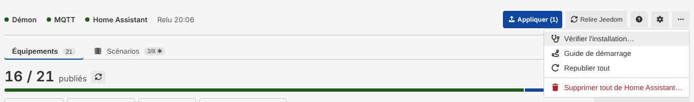

**À gauche, l'état.** Chaque pastille est un point de couleur et un mot ; le détail est dans l'info-bulle.

| Pastille | Point vert | Point gris (« ? ») | Point rouge |
|---|---|---|---|
| **Démon** | « Actif » | — | « Arrêté », « Erreur Jeedom », « Erreur de communication » |
| **MQTT** | « Connecté » (l'adresse du broker en info-bulle) | « Reconnexion... », « Connexion... », « Non configuré », « Inconnu » | « Déconnecté » |
| **Home Assistant** | « Vu à 21:04 », ou « Confirmé par vous » après « Je l'ai vu » | « Non confirmé » : Home Assistant ne se signale qu'à son démarrage ; s'il tourne déjà, c'est normal | — |

Puis **« Relu 15:58 »** : l'heure de la dernière relecture (« Relu le 12/11 » si ce n'est pas aujourd'hui, « Jamais relu » sinon), son résultat en info-bulle. Une pastille orange n'apparaît que si la dernière opération a échoué (« Relecture échouée », « Publication partielle »…). Enfin, **✓ « Rien à faire »** seulement si tout est publié et qu'une relecture réussie date de moins de 24 heures ; sinon **? « Non vérifié »** avec le bouton **« Relire »**.

**À droite, les actions.**

| Bouton | Ce qu'il fait |
|---|---|
| **« Appliquer »** suivi du nombre n (bleu) | Visible seulement quand n équipements sont « À appliquer » : envoie leurs réglages à Home Assistant, après une confirmation chiffrée. Jeedom n'est pas relu. |
| **« Relire Jeedom »** | Relit tout Jeedom, puis met Home Assistant à jour et applique les réglages en attente. |
| **?** (« Aide ») | Ouvre cette documentation. |
| **⚙** (« Configuration ») | Ouvre la [configuration](#configuration). |
| **« ⋯ »** (« Autres actions ») | **« Vérifier l'installation… »**, **« Guide de démarrage »**, **« Republier tout »**, puis, en rouge après un trait, **« Supprimer tout de Home Assistant… »**. |

« Supprimer tout de Home Assistant… » demande une confirmation forte et chiffrée (« Supprimer tout de Home Assistant ») : « L'historique, les tableaux de bord et les automatisations qui les utilisent seront touchés. » et « Rien n'est recréé automatiquement : utilisez « Republier tout » pour les remettre. Cette action ne s'annule pas. »

**Boutons grisés.** Les actions vers Home Assistant (« Appliquer (n) », « Relire Jeedom », les « Republier » et « Supprimer de Home Assistant… ») demandent un démon actif **et** MQTT connecté ; sinon elles sont grisées et une ligne dit pourquoi (« Démon arrêté — actions Home Assistant bloquées. », « MQTT déconnecté — actions Home Assistant bloquées. »). Elles le sont aussi pendant une relecture. Le réglage « Automatique | Toujours | Jamais » et le « Type HA » restent actifs.

#### Relire Jeedom ou Republier tout ?

| J'ai… | Bouton | Ce qui se passe |
|---|---|---|
| changé quelque chose dans Jeedom (un équipement, un type générique, un nom, une pièce) | **« Relire Jeedom »** | Le plugin relit Jeedom, publie ou retire ce qui a changé et applique les réglages en attente. |
| perdu mes appareils dans Home Assistant (broker redémarré sans mémoire, par exemple) | **« Republier tout »** | Le plugin renvoie à Home Assistant ce qui est déjà publié, sans relire Jeedom. |
| besoin de renvoyer un seul équipement ou une seule pièce | « Republier » ou « Republier la pièce » (menus « ⋯ ») | Comme « Republier tout », pour cette portée. |

« Relire Jeedom » demande une confirmation (« Le plugin relit vos équipements et met Home Assistant à jour. », puis « Rien n'est supprimé sans que vous l'ayez exclu. »). Le résultat s'affiche en une ligne : « Relecture terminée. », « Relecture terminée avec avertissements. » ou « Relecture échouée. ».

Vous n'avez rien à relancer quand un scénario ou un équipement est activé ou désactivé, ou quand une exclusion change : toutes les 5 minutes, la tâche cron5 de Jeedom le vérifie et, seulement si quelque chose a changé, relit Jeedom et met Home Assistant à jour.

### La page maison et les puces

<!-- CAPTURE: page principale du plugin -->
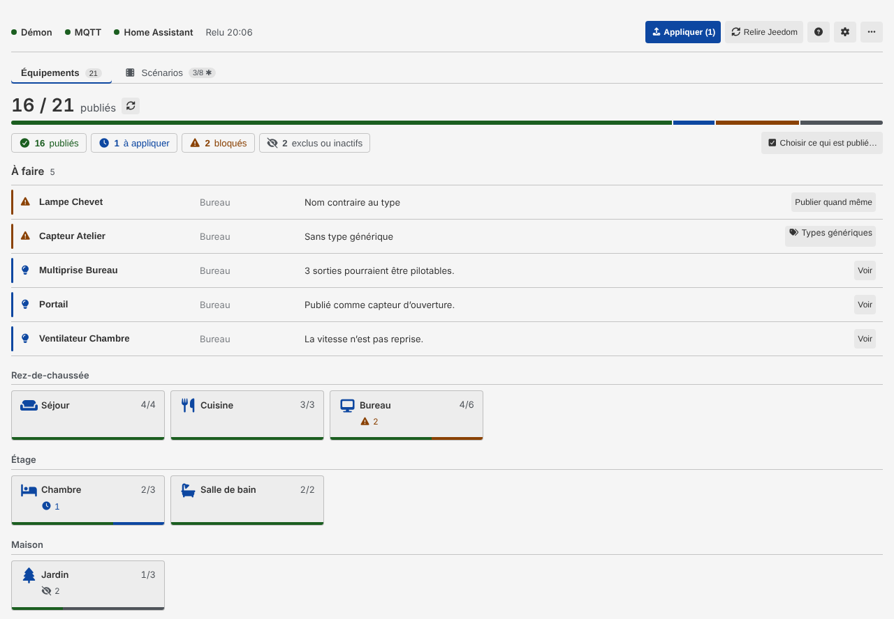

De haut en bas, sous la barre d'état :

- **Les onglets** « Équipements » et « Scénarios », chacun avec son nombre (« publiés/total », suivi de ✱ s'il y a des nouveaux).
- **Le chiffre de la maison** : « n / m publiés » (publiés sur le total), puis **↻** (« Actualiser » les chiffres, l'heure de la dernière lecture en info-bulle).
- **Le liseré** : un segment par état (publiés en vert, à appliquer en bleu, bloqués en orange, exclus ou inactifs en gris, non lus en hachuré) ; chaque segment donne son compte en info-bulle.
- **Les puces** : une icône, un nombre et un mot. Les puces à zéro ne sont pas affichées. **Chaque puce (et chaque segment du liseré) est un filtre** : un clic le pose, un second clic ou Échap le retire. « publiés », « à appliquer » et « exclus ou inactifs » filtrent les tuiles ; « bloqués » montre la liste [À faire](#à-faire) seule.
- **« Choisir ce qui est publié… »**, au bout de la ligne des puces : voir [Choisir ce qui est publié](#choisir-ce-qui-est-publié).
- **La liste [À faire](#à-faire)**, absente quand il n'y a rien à faire.
- **Les tuiles de pièce**, regroupées par objet parent.

<!-- CAPTURE: cartes de pièce -->
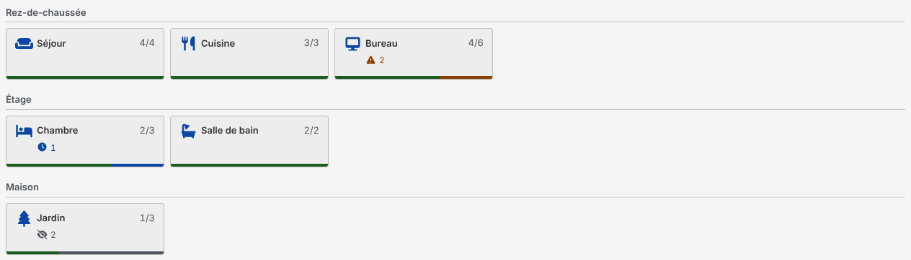

**Une tuile de pièce** porte l'icône et le nom de la pièce, « n/t » (publiés sur le total), et seulement s'ils ne sont pas nuls des **marques** : une icône et un nombre (bloqués, à appliquer, désactivés, rien à publier, non lus, exclus), le mot dans l'info-bulle. Un liseré de 4 px, en bas, reprend les couleurs de la maison. Un clic ouvre [la pièce](#la-pièce-et-la-fiche). Le menu « ⋯ », au survol, propose « Choisir ce qui est publié… », « Republier la pièce » et, après un trait, « Exclure la pièce… » (une pièce exclue affiche l'œil barré à la place de « n/t »). La tuile « Sans pièce » rassemble les équipements qui n'ont pas de pièce ; elle n'a pas de menu.

Les chiffres sont relus à l'ouverture de la page, après chaque action et au retour sur l'onglet du navigateur ; jamais en boucle. Pendant une opération, « Opération en cours : ces chiffres peuvent changer » ; avant la première relecture, « Aucune synchronisation n'a encore eu lieu » ; si la lecture échoue, « Chiffres indisponibles ». Un équipement dont le chiffre n'a pas pu être lu est compté « non lu ». Sans pièce avec équipement, la page dit « Aucune pièce avec équipement trouvée. » Le détail des chiffres est dans [Les états et les compteurs](compteurs.md#la-jauge-de-la-maison).

### À faire

<!-- CAPTURE: à faire -->
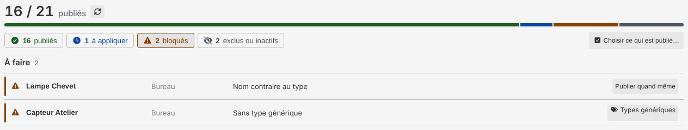

La liste **« À faire »** rassemble ce qui a besoin de vous, une ligne par équipement : d'abord les **bloqués** (triangle ⚠, liseré orange), puis ceux qui ont un **conseil** (ampoule, liseré bleu). Chaque ligne donne le nom, la pièce, la cause en quatre mots au plus (la phrase entière en info-bulle) et une seule action : « Types génériques » (« Ouvrir les types génériques »), « Corriger le type… », « Publier quand même », « Ouvrir l'équipement dans Jeedom » ou « Voir ». Le nom ouvre la fiche de l'équipement. Au-delà de cinq lignes, « Tout afficher » déplie le reste. La puce « bloqués » montre cette liste seule.

### La pièce et la fiche

<!-- CAPTURE: vue de travail -->
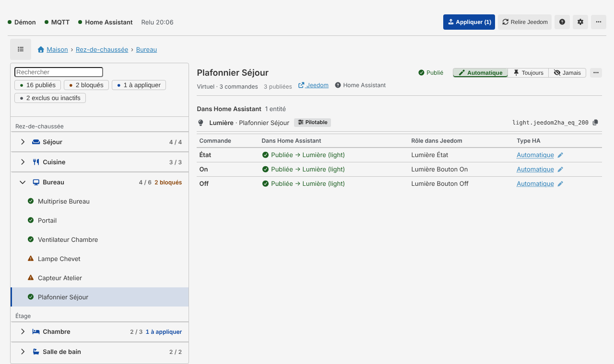

**Le fil d'Ariane** `Maison › Niveau › Pièce`, en haut : chaque niveau est cliquable. **« Maison »** (ou « Précédent » du navigateur) revient à la page maison telle que vous l'avez laissée. L'adresse de la page garde la pièce et l'équipement choisis ; une ancienne adresse qui se termine par `seule:1` s'ouvre de la même façon.

**Un seul arbre.** L'arbre contient toujours **toute la maison**, à gauche, avec une recherche (« Rechercher », sans tenir compte des accents) et les mêmes puces que la page maison. Une pièce porte « n / t » et ses repères non nuls ; un équipement porte **l'icône de son état** seule, le mot dans l'info-bulle. En dessous de 980 pixels de large, l'arbre devient un tiroir, ouvert par l'icône « Pièces » à gauche du fil d'Ariane. Pendant une recherche, le volet de droite dit « n résultats » (« Aucun résultat » sinon) ; l'info-bulle d'un équipement ajoute, s'il y a lieu, la cause d'exclusion, « désactivé dans Jeedom » ou « Non lu ». Échap ferme d'abord un menu ou une confirmation ouverts, jamais la pièce.

**Une pièce choisie** montre son nom, **« Republier la pièce »** et son menu « ⋯ » (« Exclure la pièce… », puis « Supprimer de Home Assistant… » en rouge), ses compteurs, puis **« À traiter dans cette pièce »** (ses bloqués et ses « à appliquer ») et « Conseils dans cette pièce ». Une pièce saine affiche ✓ « Rien à faire ». Pour « Sans pièce » : « Republication et suppression de pièce indisponibles pour les équipements sans pièce : utilisez les actions de chaque équipement. »

<!-- CAPTURE: détail d'un équipement -->
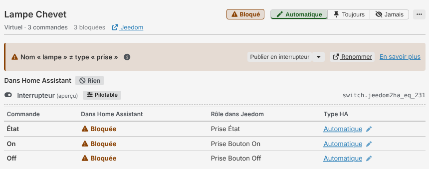

**La fiche d'un équipement** se lit au moment où vous la choisissez, et pour cet équipement seulement (« Chargement… » ; en cas d'échec, « Impossible de lire la configuration de cet équipement. » ou « Impossible de charger la configuration HA (démon indisponible). »). Elle tient en quatre blocs :

1. **L'en-tête**, collé en haut quand vous faites défiler, sur deux lignes.
   - Ligne 1 : le nom, le badge d'état, le réglage **« Automatique | Toujours | Jamais »** (« Le plugin décide », « Publier même si le plugin hésite, maintenant ou plus tard », « Ne jamais publier »), **« Appliquer »** quand l'état est « À appliquer », et le menu « ⋯ » : « Republier », « Tout remettre en automatique… », « Ouvrir l'équipement dans Jeedom », « Détails techniques », puis « Supprimer de Home Assistant… » en rouge. « Toujours » n'est jamais grisé sur un équipement publié : il le protège d'une décision future du plugin.
   - Ligne 2 : le plugin, le nombre de commandes et leur détail (publiées, bloquées, ignorées), le lien « Jeedom » et, pour un équipement publié, « Home Assistant » (où le trouver, en info-bulle).
2. **La bande de cause**, une ligne par cause, s'il y en a : un libellé court (« Sans type générique », « Type incertain », « Nom « lampe » ≠ type « prise » »…), ⓘ (ce qui se passe et pourquoi), au plus deux boutons et **« En savoir plus »**, qui mène à [Les causes de blocage](#les-causes-de-blocage). Le bouton principal dit sa conséquence : « Publier en interrupteur » règle l'équipement sur « Toujours » ; sa flèche ▾ propose les autres types possibles. Les autres boutons : « Types génériques », « Changer le type », « Renommer », « Ouvrir dans Jeedom », « Configuration » (« Ouvrir la configuration du plugin ») ou « Republier ». Un [conseil](#les-conseils) se lit de la même façon, en bleu. **La cause d'exclusion** remplace la bande quand l'état est « Exclu » (jamais pour un équipement « Désactivé ») : « Plugin exclu : X », « Exclu par la pièce : toute la pièce est exclue », « Exclusion individuelle : réglage « Jamais » », « Exclusion individuelle : « Jamais » sur ses entités » ou « Exclusion individuelle : réglage de l'équipement dans Jeedom », avec, pour le plugin et la pièce, le bouton « Choisir ce qui est publié ». Une flèche (« Voir la première commande bloquée ») fait défiler le tableau jusqu'à elle, sous la première fiche de cause ; quand chacune de ses commandes est bloquée, il n'y a rien d'autre à montrer et le lien est absent.
3. **« Dans Home Assistant »** : une ligne par entité — le type en français, son nom, **« Pilotable »** ou **« Lecture seule »**, et son identifiant (`light.jeedom2ha_142`) avec un bouton pour le copier. Au-delà de trois entités, les suivantes sont repliées (« + 2 autres »). Rien de publié : **« Rien »** ; pour un équipement bloqué, une ligne « (aperçu) » montre ce que publierait le bouton « Publier en ».
4. **Le tableau des commandes**, regroupé par entité.

<!-- CAPTURE: tableau des commandes -->
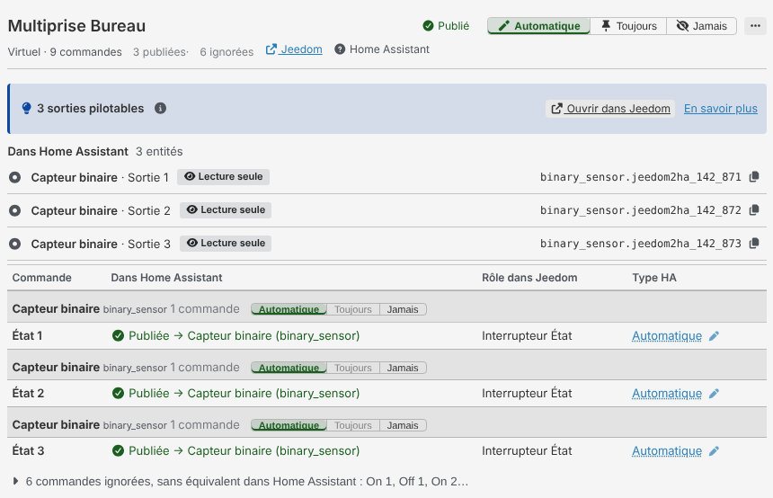

| Colonne | Contenu |
|---|---|
| **Commande** | Le nom de la commande. |
| **Dans Home Assistant** | « Publiée → Lumière (light) », « À appliquer → Capteur (sensor) », « Bloquée » (la cause est dans la bande), « Exclue » ou « — ». |
| **Rôle dans Jeedom** | Le type générique, en français ; vide, « non renseigné ». Le plugin ne le modifie jamais. |
| **Type HA** | « Automatique » (le plugin choisit) ou « Personnalisé : Lumière (light) » (votre choix). Le mot ouvre [Corriger le type](#corriger-le-type). |

Quand l'équipement a plusieurs entités, chacune a une ligne d'en-tête avec son propre « Automatique | Toujours | Jamais ». Les commandes **ignorées** (sans équivalent dans Home Assistant) ne sont pas des lignes : elles sont repliées sous le tableau.

**Réglage de publication.** « Jamais » retire l'équipement (ou l'entité) de Home Assistant ; une confirmation le demande s'il était publié. « Toujours » publie même si le plugin hésite, après un aperçu calculé par le démon (« Toujours » serait refusé s'il manque ce qu'il faut). « Automatique » rend la décision au plugin. Dans les trois cas, le réglage est enregistré puis **attend** : l'équipement passe « À appliquer », et « Appliquer » (fiche ou barre d'état), « Republier » ou « Relire Jeedom » l'envoie. « Supprimer de Home Assistant… » retire seulement : « Rien n'est recréé automatiquement : utilisez « Republier » pour remettre dans Home Assistant ce qui a été supprimé. »

Une erreur réseau s'affiche en une ligne : « Erreur de communication avec le démon du plugin. »

#### Quand un bouton est grisé

Un bouton ou une position grisés affichent **leur propre motif** dans une infobulle (survolez-les). Les motifs possibles :

| Bouton | Motifs affichés |
|---|---|
| Appliquer, Republier, Supprimer de Home Assistant… (toutes portées) et Relire Jeedom | Voir [la barre d'état](#la-barre-détat) (démon arrêté, MQTT déconnecté, relecture en cours). Les positions « Automatique », « Toujours » et « Jamais » ne sont pas concernées. |
| Jamais | « Cette entité ne se règle pas seule : réglez l’équipement entier. » ; « Équipement non éligible : l’action serait sans effet. » |
| Toujours | « Déjà publiée : « Toujours » n’aurait pas d’effet. » (l'entité est déjà dans Home Assistant) ; « Aucun type Home Assistant identifié pour cette entité. » ; « Type HA hors périmètre de ce plugin. » ; « Ce type Home Assistant est invalide pour cette entité. » ; « Exclusion posée sur l’équipement : la retirer depuis l’équipement. » ; « Cette entité ne se règle pas seule : réglez l’équipement entier. » ; « Équipement non éligible : l’action serait sans effet. » |
| Automatique | « Aucun réglage de publication à retirer. » ; « Exclusion posée sur l’équipement : la retirer depuis l’équipement. » ; « Cette entité ne se règle pas seule : réglez l’équipement entier. » |
| Republier (équipement) | « Équipement désactivé dans Jeedom : rien à republier. » ; « Équipement exclu : rien à republier. » (sauf si un réglage est en attente) |
| Supprimer de Home Assistant… (équipement) | « Équipement non publié dans Home Assistant : rien à supprimer. » Ce grisé reflète la présence **réelle** dans Home Assistant, pas le badge d'état : un équipement peut afficher « À appliquer » et avoir cette entrée grisée tant qu'il n'a pas été publié. |
| Republier (pièce) | « Aucun équipement à publier dans cette pièce. » |
| Supprimer de Home Assistant… (pièce) | « Aucun équipement publié dans cette pièce. » (même logique : présence réelle dans Home Assistant) |

Une position déjà choisie reste la position courante du contrôle : elle n'est pas grisée. Un bouton grisé sans motif particulier affiche « Cette action est sans effet dans l’état courant. »

« Cette entité ne se règle pas seule » : toutes ses commandes servent aussi à une autre entité ; « Automatique », « Toujours » et « Jamais » sont grisés pour elle, réglez l'équipement entier. « Ce type Home Assistant est invalide pour cette entité » : il manque à l'équipement ce dont ce type a besoin.

### Corriger le type

<!-- CAPTURE: corriger le type -->
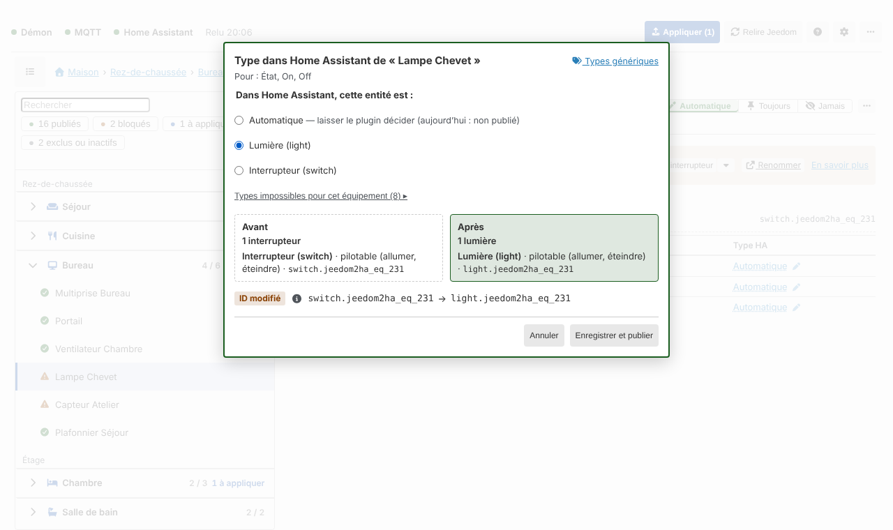

Le plugin choisit seul le type Home Assistant (« Automatique »). Quand il hésite ou se trompe, corrigez de préférence **dans Jeedom** (les types génériques, puis « Relire Jeedom ») ; sinon, ici, pour Home Assistant seulement.

Le panneau s'ouvre **par-dessus la page**, depuis le lien de la colonne « Type HA », le bouton « Corriger le type… » ou la flèche ▾ de « Publier en ». Échap ou « Annuler » le ferme sans rien écrire.

1. Le titre « Type dans Home Assistant de « Lampe Chevet » » ; dessous, « Pour : » liste les commandes de l'entité : **le type choisi vaut pour toute l'entité**. Le lien « Types génériques », dans le coin, mène à la voie durable.
2. **Les choix**, sous « Dans Home Assistant, cette entité est : » : « Automatique », puis les types possibles (« Lumière (light) », « Interrupteur (switch) »…). Les autres sont repliés sous « Types impossibles pour cet équipement (N) ».
3. **L'aperçu « Avant » / « Après »**, en entités. **« ID modifié »** (ⓘ) signale un identifiant qui change : les automatisations qui utilisent l'ancien seront à reprendre. Si le plugin hésite sur cet équipement, « Le type seul ne suffit pas » propose « Publier quand même », et le bouton devient « Enregistrer et publier quand même ».
4. **« Enregistrer et publier »** enregistre le type et publie l'équipement. Un bandeau dit le résultat et propose « Annuler » pendant 10 secondes.

La colonne « Type HA » affiche ensuite « Personnalisé : Lumière (light) ». Pour revenir au choix du plugin, rouvrez le panneau et choisissez « Automatique ».

### Choisir ce qui est publié

<!-- CAPTURE: choisir ce qui est publié -->
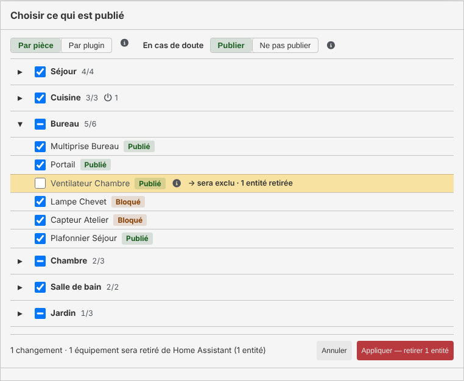

Un seul endroit règle ce qui est publié : le bouton **« Choisir ce qui est publié… »**, au bout des puces (aussi par l'étape 3 du guide, le menu « ⋯ » d'une tuile et le lien de la configuration). Rien n'est écrit avant le bouton d'application.

- **L'en-tête** : **« Par pièce | Par plugin »**, la règle en info-bulle (« Un équipement est publié s'il n'est exclu ni lui-même, ni par sa pièce, ni par son plugin. »), puis **« En cas de doute »** : **« Publier | Ne pas publier »** pour les équipements que le plugin reconnaît avec un léger doute. Un nom qui contredit les types n'est pas un doute : il reste bloqué.
- **Chaque groupe** a une case à trois états (cochée, décochée, mixte) et un compteur `n/m` (non exclus sur le total). **« Non exclu » ne veut pas dire « publié »** : un équipement désactivé dans Jeedom, bloqué ou sans rien à publier reste hors de Home Assistant ; l'info-bulle du compteur le précise (« dont 1 désactivé dans Jeedom »).
- **Le pied** compte en direct ce qui sera retiré de Home Assistant et ce qui y reviendra. **Le bouton** dit ce qu'il fera : « Appliquer — retirer N entités » (rouge), « Appliquer — publier N équipements » (vert)… « Annuler » ferme sans rien écrire.

Après le clic, le plugin relit Jeedom une seule fois, puis un bandeau propose « Annuler » pendant 10 secondes. Pour un seul équipement, « Jamais » dans sa fiche fait la même chose ; pour une pièce, voir ci-dessous.

#### Exclure une pièce

Une pièce entière s'exclut **depuis sa tuile** (menu « ⋯ », **« Exclure la pièce… »**) ou **depuis la pièce ouverte** (même entrée dans son menu « ⋯ », avant « Supprimer de Home Assistant… »). Ouvrir ce menu n'ouvre pas la pièce. La carte « Sans pièce » n'a pas de menu : elle ne peut pas être exclue.

- **La confirmation est chiffrée.** « Exclure la pièce « Nom » de Home Assistant ? » annonce le nombre d'entités concernées : « 5 entités seront retirées de Home Assistant. », « 1 entité sera retirée… » ou « Aucune entité n'est publiée dans cette pièce. » Si la lecture des états n'est pas disponible, la confirmation le dit (« Nombre d'entités inconnu : la lecture des états n'est pas disponible. ») et reste possible. Si des réglages attendent d'être appliqués, elle ajoute « La relecture appliquera aussi les M réglages en attente de la maison. » Le bouton « Exclure la pièce » est rouge, car il retire des entités de Home Assistant ; « Annuler », la croix et la touche Échap ferment sans rien écrire.
- **L'effet est immédiat.** Après la confirmation, le plugin enregistre l'exclusion puis lance **une relecture complète de Jeedom** (celle de « Relire Jeedom », sans seconde confirmation), puis relit les chiffres. Pendant ce temps, « Relire Jeedom » et les entrées d'exclusion de toutes les pièces sont grisés (« Une opération est déjà en cours. »). Si l'enregistrement échoue, rien n'est relu ni changé. Si la relecture échoue, l'exclusion reste enregistrée et le message est suivi de « Relancez « Relire Jeedom » pour retirer les entités. » Exclure une pièce déjà exclue ne change rien mais relance quand même la relecture.
- **La carte** affiche **« Pièce exclue »** (icône œil barré) à la place de « n / t publiés » ; le liseré et les marques restent, et « N pas encore retirés » s'affiche tant que la relecture n'a pas retiré tous les équipements. Dans l'arbre, la ligne de la pièce porte la même mention, et la pièce ouverte affiche « Pièce exclue : ses équipements ne sont pas publiés dans Home Assistant. » avec le bouton **« Ne plus exclure la pièce… »**.
- **« Ne plus exclure la pièce… »** demande une confirmation sans nombre (« Ses équipements seront relus et publiés s'ils sont publiables. ») ; le bouton « Ne plus exclure » n'est pas rouge, car rien n'est retiré.
- **La pièce prime sur « Toujours ».** Sauf équipements exposés à HomeKit (actifs), qui ne sont pas écartés par la pièce, un équipement réglé « Toujours » dans une pièce exclue n'est pas publié : « Toujours » reste affiché comme réglage posé, mais les positions grisées disent « Pièce exclue : elle prime sur ce réglage. »
- **Pas de cascade.** Seule la pièce choisie est exclue, pas ses sous-pièces : excluez-les aussi, une à une.

### Les scénarios

<!-- CAPTURE: scénarios -->
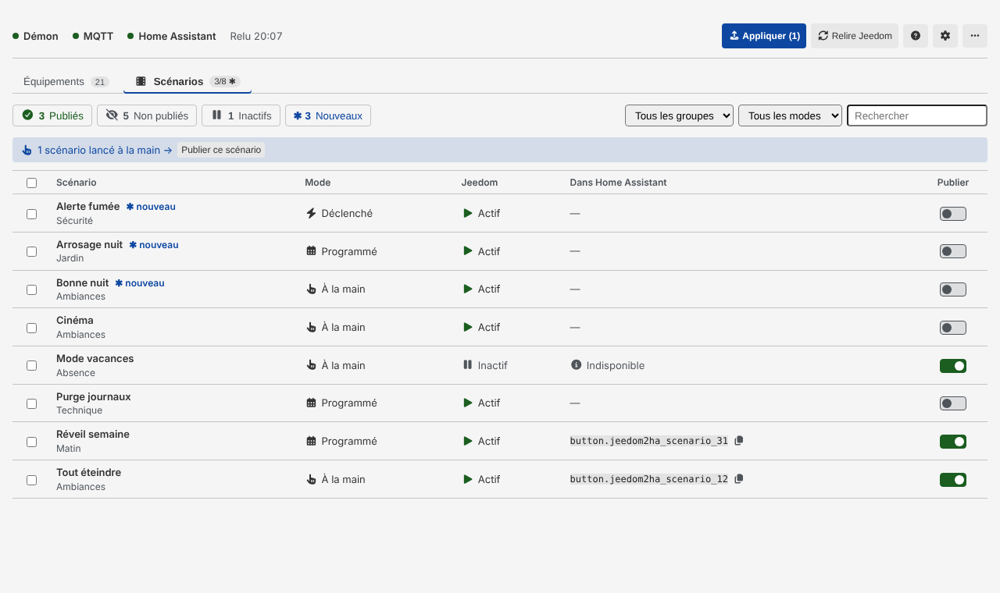

L'onglet **« Scénarios »** liste les scénarios de Jeedom et dit lesquels ont un bouton dans Home Assistant. **Rien n'est publié sans votre choix** : les scénarios déjà publiés avant la mise à jour le restent, les nouveaux arrivent non publiés, marqués ✱.

- **Puces** : « Publiés », « Non publiés », « Inactifs », ✱ « Nouveaux » (apparus depuis votre dernier choix). Un clic filtre, un second retire le filtre. **Filtres** : « Tous les groupes », « Tous les modes » (« Lancé à la main », « Programmé », « Déclenché ») et « Rechercher ».
- **Colonnes** : le scénario et son groupe, le mode (« À la main », « Programmé », « Déclenché »), l'état dans « Jeedom » (« Actif » ou « Inactif »), « Dans Home Assistant » (l'identifiant `button.…` avec son bouton copier ; « Indisponible » pour un scénario publié mais inactif ; ◷ « En attente de Home Assistant » tant que le bouton ne suit pas encore votre choix ; « — » s'il n'est pas publié) et l'interrupteur **« Publier »**, utilisable même pour un scénario inactif.
- **Préparer, puis appliquer** : un interrupteur changé marque la ligne ◷ « À appliquer ». Cochez plusieurs lignes pour « Publier (n) » ou « Ne pas publier (n) ». **« Appliquer (n) »** envoie le tout, puis le plugin relit Jeedom ; « Annuler » oublie les changements. Retirer des boutons demande confirmation : « Retirer n boutons de Home Assistant ? ». Si des boutons n'ont pas pu être mis à jour : « Choix enregistré · n boutons pas encore à jour dans Home Assistant · Réessayer ».
- **Suggestion** : « n scénarios lancés à la main → Publier ces n » prépare la publication des scénarios lancés à la main ; rien n'est envoyé avant « Appliquer ». Elle ne propose jamais un scénario programmé ou déclenché.
- **Liste vide** : « Aucun scénario dans Jeedom » ; « Liste indisponible · Relire » si le démon ne fournit pas la liste.

Un scénario publié puis désactivé garde son bouton, grisé dans Home Assistant : l'appui ne lance rien. Seul un scénario supprimé de Jeedom perd son bouton.

### Configuration

<!-- CAPTURE: page de configuration -->
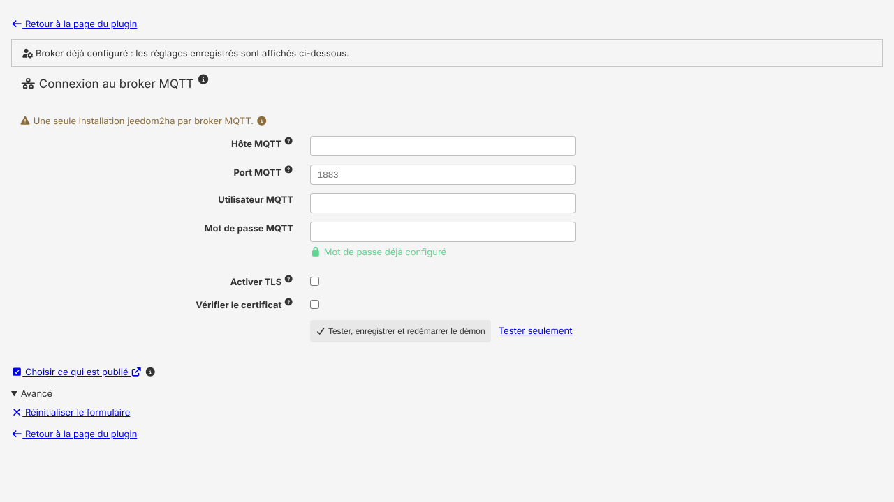

La configuration s'ouvre par **⚙** (« Configuration ») ou, depuis le guide, par « Ouvrir la configuration MQTT ». Elle ne règle que le broker et quelques réglages avancés ; chaque explication est dans l'info-bulle ⓘ. « Retour à la page du plugin », en haut et en bas, ramène à la page.

#### Connexion au broker MQTT

> **Une seule installation jeedom2ha par broker MQTT.** Une deuxième installation branchée sur le même broker (box de test, sauvegarde restaurée ailleurs) retirerait les boutons de scénario de celle-ci, et inversement. Branchez une box de test sur un autre broker.

Indiquez le broker que Home Assistant utilise déjà : « Hôte MQTT » (adresse ou nom), « Port MQTT » (1883 en général, 8883 avec TLS), « Utilisateur MQTT », « Mot de passe MQTT » (vide : l'actuel est conservé, « Mot de passe déjà configuré » le dit), « Activer TLS » et « Vérifier le certificat » (à décocher pour un certificat auto-signé). Un bandeau dit d'où viennent les valeurs (« MQTT Manager détecté — configuration pré-remplie », « Broker déjà configuré : les réglages enregistrés sont affichés ci-dessous. »).

**« Tester, enregistrer et redémarrer le démon »** est le seul bouton principal. Trois coches s'allument l'une après l'autre : « Connexion testée », « Réglages enregistrés », « Démon redémarré ». **Si le test échoue, rien n'est enregistré** et le message dit quoi vérifier (« Ce nom ou cette adresse ne répond pas. », « Identifiant ou mot de passe refusé. »…). « Tester seulement » essaie sans rien enregistrer. « Récupérer depuis MQTT Manager » n'apparaît que si ce plugin est actif. Le bouton « Sauvegarder » de Jeedom enregistre aussi ces champs, mais sans tester ni redémarrer le démon.

#### Ce qui est publié, Avancé

- La configuration ne règle pas ce qui est publié : le lien **« Choisir ce qui est publié »** (↗) ouvre la page du plugin sur le panneau [Choisir ce qui est publié](#choisir-ce-qui-est-publié).
- **« Avancé »** (replié) contient « Réinitialiser le formulaire », qui vide les champs du broker sans rien enregistrer.
- « cron5 désactivé : mises à jour manuelles » s'affiche seulement si la tâche cron5 est décochée dans le bloc « Fonctionnalités » de Jeedom : les changements d'activation et d'exclusion attendent alors un « Relire Jeedom ».

### Vérifier l'installation

<!-- CAPTURE: vérifier l'installation -->
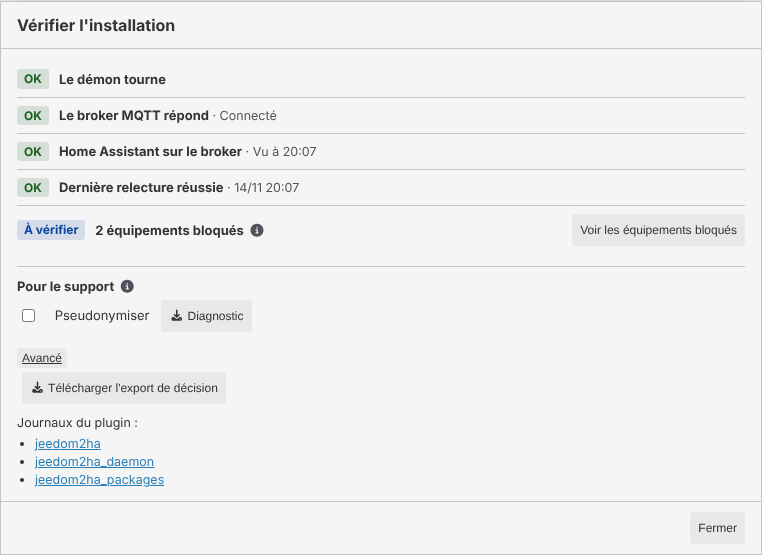

**« Vérifier l'installation… »** (menu « ⋯ » de la barre d'état) passe les contrôles dans l'ordre, une ligne chacun : « Le démon tourne », « Le broker MQTT répond », « Home Assistant sur le broker », « Dernière relecture réussie », puis les équipements bloqués (« Aucun équipement bloqué » ou leur nombre). Chaque ligne porte un mot :

- **« OK »** (vert) : rien à faire ;
- **« À corriger »** (rouge) : la liste s'arrête là, et le bouton du remède est proposé ;
- **« À vérifier »** (bleu) : un contrôle à faire vous-même, la liste continue. Pour Home Assistant, regardez s'il voit l'appareil « Jeedom (jeedom2ha) », puis **« Vu »** ; sinon **« Pas vu »** déplie les trois causes habituelles. « Non confirmé » n'est pas une erreur ;
- **« En attente »** (gris) : pas encore contrôlé, un point « À corriger » le précède.

**« Pour le support »** : **« Diagnostic »** (⬇) télécharge un fichier qui décrit votre installation, à joindre à votre message sur le forum ; la case **« Pseudonymiser »** remplace vos noms par des alias et masque l'adresse du broker. **Avancé** (replié) : « Télécharger l'export de décision » (identifiants seulement, pour une analyse fine par le support) et « Journaux du plugin : » `jeedom2ha`, `jeedom2ha_daemon`, `jeedom2ha_packages`.

### Le guide de démarrage

<!-- CAPTURE: guide de démarrage -->
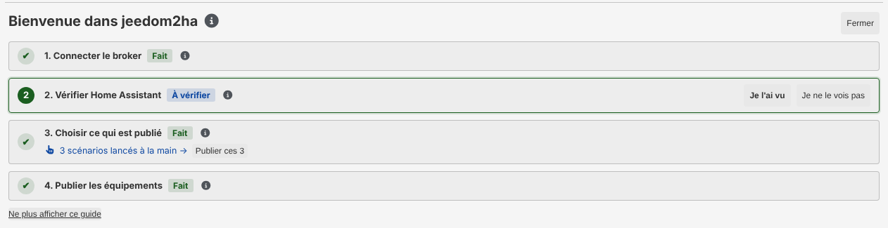

Tant que rien n'a été publié, la page affiche **« Bienvenue dans jeedom2ha »** et quatre étapes, une ligne chacune (numéro, titre, état, bouton, ⓘ). Une étape n'est **« Fait »** que si son signal a été observé ; sinon **« À vérifier »** avec un bouton, ou « À corriger » avec la cause en info-bulle.

| Étape | Ce qu'on vous demande | « Fait » quand |
|---|---|---|
| 1. « Connecter le broker » | « Ouvrir la configuration MQTT », puis « Tester, enregistrer et redémarrer le démon ». | Le démon tourne et le broker est connecté. |
| 2. « Vérifier Home Assistant » | Dans Home Assistant : Paramètres › Appareils et services › MQTT, l'appareil « Jeedom (jeedom2ha) ». « Je l'ai vu » ou « Je ne le vois pas » (trois causes : intégration MQTT absente, autre broker, découverte désactivée). | Home Assistant s'est signalé, ou vous avez cliqué « Je l'ai vu » (« Fait (vu par vous) »). |
| 3. « Choisir ce qui est publié » | « Tout publier (recommandé) » ou « Choisir… ». La suggestion « n scénarios lancés à la main → Publier ces n » y apparaît aussi. | Au premier choix. |
| 4. « Publier les équipements » | « Publier dans Home Assistant ». « Vérifier la publication » si le résultat n'a pas encore été observé (« Vérification en cours »). | La publication est confirmée. |

À la fin, une ligne : « C'est fait : vos équipements sont dans Home Assistant. », avec « Voir ma maison ». « Fermer » cache le guide ; « Ne plus afficher ce guide » l'empêche de revenir. **Une fois les quatre étapes faites, il ne revient plus de lui-même** ; il reste dans le menu « ⋯ », « Guide de démarrage ».

---

## Ce que le plugin publie, ce qu'il ne publie pas, et pourquoi

### Ce que le plugin sait publier

Le plugin publie dix types d'entités Home Assistant. Le type est choisi à partir des types génériques des commandes de l'équipement.

| Type Home Assistant | Ce que le plugin en fait |
|---|---|
| Lumière (`light`) | Lumières : allumer/éteindre et variation de luminosité, avec l'état réel quand Jeedom le fournit (voir [Limites](#limites--état-réel-des-lumières-et-des-volets)). La couleur n'est pas reprise, et une lumière qui n'a que des commandes de couleur n'est pas prise en charge. |
| Volet (`cover`) | Volets et stores : ouverture/fermeture, arrêt et position quand ils existent, avec l'état et la position réels quand Jeedom les fournit. Portails et portes de garage : ouverture et fermeture, avec l'état réel (voir [Portails et portes de garage](#portails-et-portes-de-garage)). |
| Interrupteur (`switch`) | Prises et interrupteurs (commandes d'énergie On/Off, familles « interrupteur » et « ventilateur » de Jeedom), ainsi que les équipements de présence actionnables (information de présence + actions pour l'activer et la désactiver). |
| Capteur (`sensor`) | Informations numériques. |
| Capteur binaire (`binary_sensor`) | Informations binaires (ouvert/fermé, présence, fumée…). |
| Bouton (`button`) | Actions ponctuelles sans valeur, et **scénarios Jeedom** (un bouton par scénario, grisé quand le scénario est désactivé). |
| Thermostat (`climate`) | Thermostats : température, consigne, mode, presets et chauffe en cours ; consigne, arrêt et presets pilotables (voir [Thermostats](#thermostats)). |
| Alarme (`alarm_control_panel`) | Alarmes : état armé/désarmé et commandes pour armer et désarmer. |
| Vanne (`valve`) | Vannes d'arrosage et robinets : ouvrir, fermer et état réel, une vanne par zone (voir [Vannes d'arrosage](#vannes-darrosage)). |
| Serrure (`lock`) | Serrures : verrouiller, déverrouiller et état réel (voir [Serrures](#serrures)). |

Le plugin ne publie pas les équipements sans type générique reconnu : il l'indique alors dans l'encart de cause de l'équipement.

### Limites : état réel des lumières et des volets

Le plugin remonte l'état **réel** d'une lumière ou d'un volet seulement si l'équipement Jeedom a une **commande d'information** correspondante. Sans elle, Home Assistant affiche un état **supposé** : celui de la dernière commande envoyée, qui peut différer de la réalité.

| Équipement | Commande d'information Jeedom | Ce que Home Assistant affiche |
|---|---|---|
| Lumière | état (marche/arrêt) | l'état réel allumée/éteinte |
| Lumière variable | état **et** luminosité (ou un état numérique, qui donne alors aussi la luminosité) | l'état réel et la luminosité réelle (0 à 100) |
| Lumière variable | état binaire seul, sans luminosité | l'état réel ; la luminosité reste supposée par Home Assistant |
| Lumière variable | luminosité seule, sans état | l'état allumée/éteinte reste supposé : le plugin ne le déduit jamais de la luminosité |
| Lumière sans commande d'état | aucune | état supposé |
| Volet | état d'ouverture (binaire) | ouvert ou fermé réel |
| Volet positionnable | état numérique (0 à 100) | ouvert/fermé et position réels ; une position intermédiaire s'affiche « ouvert » |
| Volet avec curseur de position | état binaire seul | ouvert/fermé réel ; la **position n'est pas remontée** (pas de valeur numérique à lire) |
| Volet sans commande d'état | aucune | état supposé |

Autres limites à connaître :

- **Aucune inversion de position.** Le plugin reprend la valeur de Jeedom telle quelle (0 = fermé, 100 = ouvert). Si un plugin Jeedom inverse cette échelle, la position affichée est inversée.
- **Pas d'état intermédiaire** « en ouverture », « en fermeture » ou « arrêté » : seuls ouvert et fermé sont remontés.
- **Valeur illisible ou hors de 0 à 100 :** rien n'est publié, Home Assistant garde la dernière valeur connue.
- **Retrait d'une commande d'information :** le plugin garde la liste des états qu'il a lui-même publiés (fichier du démon). À la relecture ou à la republication suivante, il efface l'état mémorisé par le broker pour ce canal, afin que Home Assistant ne le relise pas.
- La couleur d'une lumière et les alarmes ne sont pas concernées par cette remontée d'état. Les thermostats ont leur propre remontée (voir [Thermostats](#thermostats)).

### Portails et portes de garage

Un équipement Jeedom qui porte les types « Portail ou garage » est publié comme un **ouvrant** (`cover`) de classe **portail** (`gate`) ou **porte de garage** (`garage`), au lieu d'un simple bouton, seulement s'il a un **état numérique** (« Portail (ouvrant) Etat » ou « Garage (ouvrant) Etat ») et :

| Commandes de l'équipement Jeedom | Ce que Home Assistant reçoit |
|---|---|
| un bouton de bascule (toggle), avec ou sans boutons d'ouverture et de fermeture | un ouvrant piloté **par la bascule seule** : « Ouvrir » ne l'envoie que si le portail est **fermé**, « Fermer » que s'il est **ouvert**. Les boutons d'ouverture et de fermeture sont ignorés (sur un équipement virtuel, ils peuvent n'écrire que l'état, sans rien actionner). |
| des boutons d'ouverture **et** de fermeture, sans bascule | un ouvrant dont « Ouvrir » et « Fermer » appellent ces boutons, sauf vers la position déjà atteinte ou en cours d'atteinte (« Ouvrir » refusé s'il est ouvert ou en ouverture, « Fermer » s'il est fermé ou en fermeture) et sauf état inconnu |

La classe vient de la commande d'état : « Garage (ouvrant) Etat » donne une porte de garage, « Portail (ouvrant) Etat » un portail. Les commandes de l'équipement sont toutes reprises par l'ouvrant : il n'y a pas de bouton ni de capteur en double.

L'état numérique suit la convention « barrière » (celle de Z-Wave et du plugin Homebridge de Jeedom) :

| Valeur Jeedom | État dans Home Assistant |
|---|---|
| 0 | fermé |
| 252 | en fermeture |
| 253 | arrêté (Home Assistant l'affiche « ouvert », ou « fermé » s'il était en fermeture) |
| 254 | en ouverture |
| 255 | ouvert |

Limites à connaître :

- **Jamais de bascule à l'aveugle.** Juste avant d'envoyer la bascule, le plugin **relit l'état dans Jeedom** ; c'est cette valeur qui décide. L'ordre est **refusé** si la relecture échoue, si l'état est inconnu ou hors de la table, ou si le portail est déjà dans la position demandée. Chaque refus est écrit dans le journal du démon.
- **Refus pendant un mouvement** (252, 254) : une bascule à ce moment arrêterait le moteur au lieu de l'inverser.
- **Refus quand le portail est arrêté** (253), dans les deux sens : le sens que prendrait la bascule dépend de la mémoire du scénario Jeedom, que le plugin ne voit pas. Ouvrez ou fermez depuis Jeedom ou la télécommande pour le ramener en position ouverte ou fermée.
- **Une bascule à la fois.** Après l'envoi d'une bascule (ou un échec de l'envoi vers Jeedom), toute nouvelle bascule du même équipement est refusée jusqu'à ce que Jeedom signale **le mouvement attendu** : en ouverture ou ouvert après « Ouvrir », en fermeture ou fermé après « Fermer ». Une autre valeur (ancienne valeur arrivée en retard, valeur illisible) ne débloque rien. Deux appuis rapides n'envoient donc qu'une impulsion.
- **Sans mouvement après 60 secondes**, le plugin considère que la bascule n'a pas eu d'effet : les ordres restent refusés (raison « sans effet » dans le journal) jusqu'à ce que Jeedom signale un état différent de celui lu à l'envoi, par exemple après une manœuvre depuis Jeedom ou la télécommande. Ce blocage est gardé en mémoire par le démon : un redémarrage du démon le lève.
- Un refus n'est **pas mis en attente** : quand l'état change ensuite, rien n'est envoyé ; il faut redonner l'ordre depuis Home Assistant.
- **Commandes retenues ignorées** : un ordre resté mémorisé par le broker MQTT (message « retenu ») n'est jamais exécuté, pour aucun équipement ; le démon l'écrit dans son journal.
- **Pas d'arrêt** : aucun type générique « arrêt » n'existe pour un portail ; Home Assistant n'affiche pas de bouton Stop. **Pas de position.**
- Sans état, ou avec un état **binaire** (0/1), l'équipement ne devient pas un ouvrant : il garde son comportement précédent (bouton, ou capteur d'ouverture de classe « porte de garage »).
- Au passage du bouton à l'ouvrant, le bouton disparaît de Home Assistant et l'ouvrant apparaît avec un nouvel identifiant (`cover.jeedom2ha_<id>` au lieu de `button.jeedom2ha_<id>`) : les automatisations et tableaux de bord qui visaient le bouton sont à reprendre. Choisir le type « Bouton (button) » pour une commande de l'équipement (voir [Corriger le type d'une commande](#corriger-le-type)) permet de garder le bouton.

### Vannes d'arrosage

Un équipement Jeedom qui porte les types de vanne du plugin Homebridge (« Arrosage » `IRRIG_STATE` / `IRRIG_ON` / `IRRIG_OFF`, « Robinet » `FAUCET_*`, « Vanne générique » `VALVE_*`) est publié avec une **vanne** (`valve`) par trio complet : une information d'état, une action pour ouvrir, une action pour fermer.

- **Une vanne par zone** : un programmateur à deux zones (deux trios) donne deux vannes. Les actions sont rattachées à leur état par le champ « Valeur » de l'action dans Jeedom (la commande d'état liée).
  - Un seul trio dans la famille : la vanne est publiée même si ce champ est vide ; s'il désigne une autre commande, aucune vanne.
  - Plusieurs trios : **chaque** action d'ouverture et de fermeture doit désigner l'état de sa zone (une ouverture et une fermeture par état). Sinon, aucune vanne pour cette famille (le journal du démon le dit) : le plugin ne devine jamais quelle action pilote quelle zone.
- **Trio incomplet, pas de vanne** : sans l'état, sans l'ouverture ou sans la fermeture, ou si les nombres d'états et d'actions d'une même famille diffèrent, aucune vanne n'est publiée ; l'équipement garde exactement ce qu'il avait.
- **La vanne remplace les entités qui utilisaient ses commandes** : une entité publiée avant sur une commande du trio (par exemple un bouton sur l'action d'ouverture) est retirée et remplacée par la vanne ; pensez à reprendre les automatisations qui l'utilisaient. Les autres entités de l'équipement (par exemple une mesure) restent publiées comme avant, avec les mêmes identifiants.
- **État réel** : 1 ou toute valeur positive ouvert, 0 fermé (inversé si l'option « Inverser » est cochée sur la commande d'état dans Jeedom) ; toute autre valeur ne change rien dans Home Assistant. Pas d'état supposé (`optimistic: false`).
- Classe « eau » (`water`) pour l'arrosage et le robinet, aucune classe pour la vanne générique. **Pas de position, pas de minuterie, pas de programme d'arrosage** : les durées (`VALVE_SET_DURATION`, `VALVE_REMAINING_DURATION`) ne sont pas reprises.
- Identifiant de l'entité : `valve.jeedom2ha_<équipement>_<commande d'état>`.

### Thermostats

Un équipement Jeedom qui porte l'ordre de consigne `THERMOSTAT_SET_SETPOINT` (celui du plugin « Thermostat ») est publié comme un **thermostat** (`climate`). Le plugin lit les autres types génériques du thermostat ; ce qui manque n'est simplement pas affiché, jamais inventé.

| Dans Home Assistant | Commande Jeedom lue | Détail |
|---|---|---|
| Température mesurée | `THERMOSTAT_TEMPERATURE` (info) | |
| Consigne | `THERMOSTAT_SETPOINT` (info) | réglable par pas de 0,5 ; bornes reprises de l'ordre de consigne (« Min » et « Max ») |
| Mode : chauffe ou arrêt | `THERMOSTAT_MODE` (info) | « arrêt » seulement si le mode est celui de l'ordre d'arrêt du thermostat |
| Presets | `THERMOSTAT_SET_MODE` (actions) | un preset par mode du thermostat, avec son nom exact |
| Chauffe en cours | `THERMOSTAT_STATE` (info) | « chauffe » (1) ou « au repos » (0) ; « arrêt » quand le thermostat est arrêté |
| Verrouillage | `THERMOSTAT_LOCK`, `THERMOSTAT_SET_LOCK`, `THERMOSTAT_SET_UNLOCK` | interrupteur séparé « Verrouillage » sur le même appareil |

- **Arrêt ou chauffe** : Home Assistant propose deux modes, « chauffe » (`heat`) et « arrêt » (`off`). L'ordre d'arrêt est reconnu par son identifiant interne dans le plugin « Thermostat » (`off`), **jamais par son nom** : vous pouvez le renommer. Un thermostat dont la chauffe est coupée parce que la consigne est atteinte, ou en mode nuit, reste en mode « chauffe » (et « au repos ») : seul l'arrêt du thermostat donne « arrêt ». Sans ordre d'arrêt, seul « chauffe » est proposé.
- **Presets** : chaque mode du thermostat (par exemple confort ou éco, selon votre configuration) devient un preset, avec son nom exact (majuscules et accents compris). Choisir un preset envoie l'ordre de ce mode. Le preset affiché est « aucun » quand le thermostat suit une consigne réglée à la main ou qu'il est arrêté. Sans information de mode (`THERMOSTAT_MODE`), ni mode, ni arrêt, ni preset ne sont proposés.
- **Régler la consigne** : la valeur est arrondie au pas de 0,5 et envoyée à l'ordre de consigne. Une valeur hors des bornes du thermostat est **refusée** (rien n'est envoyé, le journal du démon le dit), jamais ramenée dans les bornes. Comme dans Jeedom, régler une consigne fait passer le thermostat en consigne manuelle : le preset affiché devient « aucun ».
- **Reprendre la chauffe depuis l'arrêt** : choisir « chauffe » renvoie la consigne courante au thermostat, qui reprend en consigne manuelle. Choisir « chauffe » sur un thermostat qui chauffe déjà n'envoie rien (le mode en cours n'est pas écrasé).
- **Verrouillage** : l'interrupteur « Verrouillage » (catégorie configuration) affiche l'état du verrou et le pilote. **Un thermostat verrouillé ignore tous les ordres** (consigne, modes, arrêt) sans erreur : si un réglage reste sans effet, vérifiez ce verrou.
- **Non repris** : la température extérieure (`THERMOSTAT_TEMPERATURE_OUTDOOR`, en général déjà publiée par sa propre sonde) et le statut en texte (`THERMOSTAT_STATE_NAME`).
- Pas d'état supposé (`optimistic: false`) : Home Assistant affiche ce que Jeedom remonte. Les états sont publiés dès la relecture, puis à chaque changement.
- Identifiants : `climate.jeedom2ha_<équipement>` (inchangé) et `switch.jeedom2ha_<équipement>_<commande de verrou>` pour le verrouillage.

### Serrures

Un équipement Jeedom qui porte les types « Serrure » du cœur (`LOCK_STATE` pour l'état, `LOCK_CLOSE` pour verrouiller, `LOCK_OPEN` pour déverrouiller) est publié comme une **serrure** (`lock`) s'il a **un** état et **au moins une** des deux actions.

- **État réel uniquement**, lu comme le plugin Homebridge (parité avec HomeKit) :
  - cas général : 1 (ou `true`, `on`) **verrouillé**, 0 (ou `false`, `off`) **déverrouillé** ;
  - équipements du plugin `nuki` : 0 verrouillé, 1 déverrouillé, 2 **bloqué** ;
  - toute autre valeur ne change rien dans Home Assistant. Pas d'état supposé (`optimistic: false`).
- **Pas de serrure** (l'équipement garde exactement ce qu'il avait, par exemple un capteur binaire de classe « serrure » en lecture seule) quand : l'état manque, aucune action n'existe, il y a plusieurs états ou plusieurs actions de même sens, une action est liée (champ « Valeur ») à une autre commande que l'état, ou la lecture de l'état n'est pas établie (plugin `jeelink`, dont Homebridge lit l'état selon l'équipement relayé). Le journal du démon dit pourquoi. Le sens n'est jamais déduit d'un nom.
- **Ordres** : « Verrouiller » envoie `LOCK_CLOSE`, « Déverrouiller » envoie `LOCK_OPEN`. Sans action `LOCK_OPEN`, aucun ordre de déverrouillage n'est jamais envoyé. Pas de code, pas d'ordre « ouvrir la porte ».
- **La serrure remplace les entités qui utilisaient ses commandes** : le capteur binaire de classe « serrure » (`binary_sensor`) ou un bouton sur `LOCK_OPEN` / `LOCK_CLOSE` est retiré et remplacé par la serrure, sous un nouvel identifiant ; pensez à reprendre les automatisations qui l'utilisaient. Les autres entités de l'équipement restent publiées comme avant, avec les mêmes identifiants.
- **Assist et commande vocale** : le plugin ne règle jamais l'exposition des entités à Assist. Exposer la serrure à Assist, et donc permettre de la déverrouiller à la voix, est un choix que vous faites dans Home Assistant (Paramètres > Assistants vocaux > Exposer) ; aucune valeur par défaut du plugin ne l'expose.
- Identifiant de l'entité : `lock.jeedom2ha_<équipement>_<commande d'état>`.

### Les causes de blocage

Quand des commandes sont bloquées, la fiche de l'équipement affiche une bande par cause, avec un libellé court (voir [La pièce et la fiche](#la-pièce-et-la-fiche)) ; son lien « En savoir plus » mène ici. « Détails techniques » (menu « ⋯ ») reprend la cause longue ci-dessous (« 11 commandes bloquées : types génériques non configurés dans Jeedom »). Les lignes du tableau montrent seulement « Bloquée ».

Libellés courts des bandes : « Sans type générique », « Type incertain », « Types incompatibles », « Type en double », « Nom « lampe » ≠ type « prise » » (ou « Nom ≠ type »), « État sans ordre », « Ordres On/Off en double », « Type pas assez sûr », « Aucun type possible », « Appareil non reconnu », « Commandes inutilisables », « Aucun ordre », « Pas d’état », « Envoi échoué ». Une cause que la page ne connaît pas (démon plus récent) s'affiche « Cause inconnue ».

Vocabulaire : une commande **publiée** est portée par au moins une entité présente dans Home Assistant ; **bloquée**, elle devrait pouvoir l'être mais ne l'est pas ; **ignorée**, elle n'a aucun équivalent dans Home Assistant (rien à faire, jamais un défaut) ; **exclue**, elle est écartée par un réglage. Les causes sont regroupées ici par ce que vous pouvez en faire.

**1. Corrections possibles côté Jeedom (types génériques ou nom de l'équipement)**

| Cause affichée | Pour agir |
|---|---|
| type Home Assistant ambigu — précisez les types génériques dans Jeedom | Précisez les types génériques des commandes dans Jeedom (bouton « Ouvrir les types génériques »), ou choisissez le type ici (« Corriger le type… »). |
| types génériques en conflit — précisez-les dans Jeedom | Idem. |
| types génériques en double | Deux commandes portent le même type : retirez le doublon. |
| un mot du nom de l’équipement écarte ce type | La fiche le dit en clair (« le nom dit « lampe », les types Jeedom disent « prise » »), puis : « Ce n’est pas un doute mais une contradiction : le réglage « En cas de doute » ne s’y applique pas, et le plugin ne publie pas cet équipement de lui-même. » Action principale **« Publier quand même »** (réglage « Toujours », puis « Appliquer ») ; action secondaire **« Renommer l’équipement dans Jeedom, puis Relire Jeedom »** (voir [Nommage des équipements](#annexe--nommage-des-équipements)). Corriger le type ne suffit pas pour cette cause. |
| état sans ordre On/Off — rien à piloter ; choisissez le type binary_sensor dans « Type HA », puis « Toujours » | L'équipement n'a qu'une commande d'état, sans commandes On/Off : il n'y a rien à piloter. Avec « Corriger le type… », choisissez « Capteur binaire (binary_sensor) » pour cette commande (l'aperçu dit s'il sera publié ; sinon, réglez aussi la publication sur « Toujours »), ou ajoutez les ordres dans Jeedom. |
| plusieurs ordres On/Off — reliez à l’état ceux qui pilotent l’appareil (champ « Valeur » dans Jeedom) | L'équipement porte plusieurs ordres On et Off (par exemple un chauffe-eau dont une paire pilote le relais et une autre change un mode). Le plugin garde la paire reliée à l'état ; ici, aucune ne l'est de façon sûre, il ne devine pas : pas d'interrupteur dans Home Assistant, les autres entités de l'équipement restent publiées. Dans Jeedom, reliez l'ordre On et l'ordre Off qui pilotent l'appareil à son état : champ « Valeur » de chaque action (pour un virtuel, l'info mise à jour par l'action convient aussi), sans toucher aux types génériques, puis « Relire Jeedom ». Forcer la publication ne lève pas ce blocage. |

**2. Blocages tels que l'équipement est configuré**

| Cause affichée | Signification |
|---|---|
| types génériques non configurés dans Jeedom | Aucune commande n'a de type générique (bouton « Ouvrir les types génériques »). |
| aucune commande Info/Action exploitable | L'équipement n'a pas de commande utilisable. |

**3. Publication impossible : il manque une capacité**

| Cause affichée | Signification |
|---|---|
| commande non pilotable (pas d’ordre On/Off) | Home Assistant ne pourrait pas envoyer d'ordre. |
| pas de retour d’état exploitable | Home Assistant ne pourrait pas lire l'état. |

**4. Réglage « En cas de doute »**

| Cause affichée | Pour agir |
|---|---|
| reconnu avec un léger doute, non publié avec le réglage « En cas de doute » sur « Ne pas publier » | « Publier quand même » sur la fiche (cet équipement seul), ou « En cas de doute » sur « Publier » dans le panneau « Choisir ce qui est publié » (tous les équipements dans ce cas). Changer le type ne lève pas ce blocage. |
| la reconnaissance est trop incertaine pour le réglage choisi | Idem. |

**5. Type non publiable**

Ces causes s'affichent avec un triangle d'avertissement, comptent comme **bloquées** et sont la cible du lien « Voir la première commande bloquée ».

| Cause affichée | Pour agir |
|---|---|
| aucun type Home Assistant identifié pour cette commande | Avec « Corriger le type… », choisissez un autre type, ou revenez à « Automatique ». |
| aucun type Home Assistant candidat à valider | Idem. |

**6. Commandes ignorées** (jamais comptées comme des défauts)

Ces commandes n'ont aucun équivalent dans Home Assistant ; il n'y a rien à faire. Elles sont repliées sous le tableau, pas dans des encarts.

| Cause | Signification |
|---|---|
| sans équivalent dans Home Assistant | Aucun type Home Assistant ne prend cette commande en charge. |
| type pas encore pris en charge par le plugin | Aucun des types Jeedom de la commande n'est reconnu par le plugin (la liste des types pris en charge est donnée plus haut). |
| non pris en charge par le plugin | Le type Home Assistant demandé n'est pas ouvert par le plugin : la ligne repliée le précise. |

**7. Exclusions volontaires** (jamais comptées comme des problèmes)

| Cause (infobulle de la ligne « Exclue ») | Origine |
|---|---|
| exclu manuellement (équipement) | Réglage « Jamais » de l'équipement. |
| exclu manuellement (commande) | Réglage « Jamais » d'une entité. |
| exclu de Jeedom2HA (équipement dans la liste d’exclusions) | Réglage d'exclusion propre à l'équipement, posé dans Jeedom hors du plugin (par un script, par exemple). Aucun bouton du plugin ne le pose. |
| exclu de Jeedom2HA (plugin source dans la liste d’exclusions) | Plugin décoché dans le panneau « Choisir ce qui est publié » (Par plugin). |
| exclu de Jeedom2HA (pièce dans la liste d’exclusions) | Exclusion de la pièce, posée depuis sa carte ou son détail (voir [Exclure une pièce](#exclure-une-pièce)). Sauf équipements exposés à HomeKit (actifs) : ils ne sont pas écartés par leur pièce. |

Dans la pièce, la **cause** d'un équipement « Exclu » est dite en clair, sans ouvrir la configuration : dans l'info-bulle de sa ligne de l'arbre (« par le plugin X », « par la pièce », « individuelle »), dans sa fiche (la phrase complète et l'endroit où agir) et, pour toute la pièce, dans la ligne « Exclus : » de la pièce (par exemple « 2 par le plugin X, 1 individuelle ») et dans l'info-bulle de la marque « N exclus » de sa tuile. Ce n'est pas un état de plus. Le nom du plugin est celui affiché par Jeedom ; s'il est introuvable, c'est « par son plugin ». « par la pièce » correspond à l'exclusion de la pièce, « par le plugin » à l'exclusion du plugin (panneau « Choisir ce qui est publié »), « individuelle » au réglage « Jamais » ou au réglage propre à l'équipement dans Jeedom. Une seule cause est dite par équipement, dans l'ordre de priorité de Jeedom ; quand elle ne peut pas être déterminée (commandes exclues pour des raisons différentes), la ligne « Exclus : » compte l'équipement dans « autre ».

Pour reprendre un équipement exclu manuellement, choisissez « Automatique ». Pour une exclusion de plugin, recochez le plugin dans le panneau « Choisir ce qui est publié » puis appliquez ; pour une exclusion de pièce, utilisez « Ne plus exclure la pièce… ». Pour le réglage propre à l'équipement, retirez-le sur l'équipement dans Jeedom, puis lancez « Relire Jeedom ».

**8. État neutre**

| Cause | Signification |
|---|---|
| équipement désactivé dans Jeedom | Réactivez l'équipement dans Jeedom si vous le souhaitez. L'état « Désactivé » est en italique. |

**9. Incident à relire dans les journaux**

| Cause affichée | Signification |
|---|---|
| échec de la publication MQTT à la dernière relecture | La publication vers le broker a échoué lors de la dernière relecture. Relancez une republication ; si le message persiste, consultez les journaux. |

Si un encart affiche un texte technique ou une liste de codes à la place d'une de ces phrases, téléchargez le diagnostic support ([Vérifier l'installation](#vérifier-linstallation)) et joignez-le à votre demande d'aide. Une cause inconnue du plugin (démon plus récent) classe la commande « Bloquée » : le code brut s'affiche en infobulle.

### Les conseils

Un **conseil** accompagne un équipement **publié** (ou à appliquer) qui pourrait faire mieux. Ce n'est pas un état : le badge reste « Publié », et la mention « Conseil » s'ajoute à côté. La fiche du conseil suit le même gabarit que les causes, avec une icône d'information.

| Ce que dit la fiche | Ce que vous pouvez faire |
|---|---|
| « 3 sorties pourraient être pilotables. » (ou « Cet équipement pourrait être pilotable. ») — les ordres On et Off existent, mais Jeedom ne dit pas à quel état chacun correspond : elles sont publiées en lecture seule. | « Ouvrir l'équipement dans Jeedom » : dans chaque ordre On / Off, renseignez le champ « Valeur » avec l'état de la même sortie, puis cliquez sur « Relire Jeedom ». |
| « Publié comme capteur d'ouverture. » — sans ordres Ouvrir et Fermer typés, Home Assistant peut seulement lire son état (portail, porte de garage). | « Ouvrir les types génériques » : donnez aux ordres d'ouverture et de fermeture leur type de portail ou de garage, puis « Relire Jeedom ». |
| « La vitesse n'est pas reprise. » — le plugin publie ce ventilateur comme un interrupteur (marche / arrêt) : les ventilateurs à vitesse ne sont pas encore pris en charge. | Rien : c'est une limite du plugin. |
| « Le nom dit « … », les types Jeedom disent « … ». » | « Corriger le type… », ou corrigez les types génériques dans Jeedom. |

Sur la page du plugin, les équipements qui ont un conseil apparaissent après les bloqués dans le bloc « À faire », et la puce « conseils » les filtre ; dans la pièce, ils sont listés sous « Conseils dans cette pièce ». Ces deux endroits ne s'affichent que si le nombre de conseils est connu sans lire chaque fiche : sinon, le conseil se découvre dans la fiche de l'équipement.

---

## Dépannage

| Symptôme | Où regarder | Action |
|---|---|---|
| Je ne sais pas par où commencer | Menu « ⋯ » de la barre d'état | Lancez « Vérifier l'installation… » : elle s'arrête au premier point « À corriger » et propose le remède. |
| Le démon ne démarre pas | Barre d'état, indicateur « Démon » : « Arrêté » | Relancez l'installation des dépendances, puis démarrez le démon. Consultez le journal `jeedom2ha`. |
| Le broker n'est pas joignable | Indicateur « MQTT » : « Déconnecté » | Dans la configuration du plugin, vérifiez les paramètres avec « Tester seulement », puis « Tester, enregistrer et redémarrer le démon ». |
| Home Assistant ne montre rien | Indicateur « Home Assistant » (« Non confirmé » n'est pas une erreur) ; dans Home Assistant, Paramètres › Appareils et services › MQTT | Vérifiez l'intégration MQTT de Home Assistant, son broker et sa découverte (voir [Vérifier l'installation](#vérifier-linstallation)). |
| Les boutons d'action sont grisés | Ligne d'explication sous la barre d'état | Corrigez le démon ou MQTT : voir [la barre d'état](#la-barre-détat). |
| Un équipement manque dans Home Assistant | Puce « bloqués » ou recherche, puis la fiche de l'équipement | Suivez la fiche de cause : voir [Les causes de blocage](#les-causes-de-blocage). |
| Un équipement est en lecture seule alors qu'il devrait être pilotable | Mention « Conseil » de sa fiche | Suivez le conseil : voir [Les conseils](#les-conseils). |
| Un réglage n'a pas d'effet dans Home Assistant | Badge « À appliquer », bouton « Appliquer » de la fiche ou de la barre d'état | Cliquez sur « Appliquer », ou lancez « Relire Jeedom ». |
| Home Assistant a perdu ses appareils | Paramètres › Appareils et services › MQTT, dans Home Assistant | « Republier tout ». |
| Les états ne se mettent pas à jour | Barre d'état | Vérifiez le démon et MQTT, puis le journal `jeedom2ha`. |
| La barre d'état semble figée | Elle est relue toutes les 30 secondes seulement quand l'onglet est visible, et après chaque action | Revenez sur l'onglet, ou rechargez la page. |

Journaux : **Jeedom → Analyse → Logs → `jeedom2ha`** (le plugin), `jeedom2ha_daemon` (les ordres reçus de Home Assistant et les refus), `jeedom2ha_packages` (l'installation). Pour signaler un problème : [github.com/alexsahut/jeedom2ha/issues](https://github.com/alexsahut/jeedom2ha/issues).

---

## Annexes

### Annexe : pièces dans Home Assistant (zone suggérée)

> **La zone Home Assistant est fixée à la création de l'appareil.** Déplacer ensuite un équipement d'une pièce à l'autre dans Jeedom ne le déplace pas dans Home Assistant.

Le plugin transmet à Home Assistant la **pièce Jeedom** de chaque équipement, comme « zone suggérée » (`suggested_area`). Si vous renommez la pièce dans Jeedom, le plugin met à jour cette information à la prochaine relecture de Jeedom.

Home Assistant n'utilise cette zone suggérée **qu'à la création** de l'appareil. Si vous déplacez ensuite un équipement d'une pièce à l'autre dans Jeedom, l'appareil reste dans son ancienne zone dans Home Assistant.

Pour le déplacer :

- **Option 1 — Supprimer de Home Assistant, puis relire Jeedom.** Utilisez « Supprimer de Home Assistant… » sur l'équipement, la pièce ou toute la maison, puis « Relire Jeedom » : la relecture lit la pièce actuelle et recrée les entités. (« Republier » seul ne suffit pas : il travaille sur ce que la dernière lecture complète a lu et ne relit pas Jeedom ; si vous venez de déplacer l'équipement, relisez Jeedom d'abord.) Les personnalisations faites dans Home Assistant (icônes, alias, historique, automatisations) peuvent être perdues : lisez l'avertissement de la confirmation.
- **Option 2 — Déplacement manuel.** Dans Home Assistant : **Paramètres › Appareils et services › MQTT**, ouvrez l'appareil (il porte le nom de l'équipement Jeedom) et modifiez sa zone.

### Annexe : noms et identifiants dans Home Assistant

**Le nom de l'appareil est le nom de l'équipement Jeedom**, accents compris, identique pour toutes les entités de cet équipement. Le nom d'une entité suit une règle simple :

- **équipement à une seule entité** : l'entité porte le nom de l'équipement (Home Assistant l'affiche comme l'appareil) ;
- **équipement à plusieurs entités** (par exemple une prise avec des mesures de puissance et d'énergie) : l'**entité principale** (lumière, interrupteur, volet…) porte le **nom de l'équipement**, et Home Assistant l'affiche sous le nom de l'appareil ; les **autres entités** portent le nom de leur **commande**, que Home Assistant affiche à la suite du nom de l'appareil.

Un bouton de scénario porte le nom du scénario.

**L'appareil « Jeedom (jeedom2ha) »** est le pont lui-même, et non un équipement Jeedom : tous vos appareils sont « Connectés via Jeedom (jeedom2ha) », et son entité « État du pont » indique « Connecté » quand le démon est en ligne, « Déconnecté » quand il est arrêté.

**Renommer dans Jeedom.** Le nouveau nom atteint Home Assistant à la **prochaine relecture de Jeedom**, ou au redémarrage du démon (qui relit Jeedom) ; « Republier » ne suffit pas, car il ne relit pas Jeedom. Le plugin n'agit pas à l'enregistrement de l'équipement dans Jeedom. Pensez à lancer « Relire Jeedom » après un renommage.

**Ce que le plugin ne touche pas.** Un nom d'appareil ou d'entité, ou une pièce, que vous avez choisis vous-même dans Home Assistant font foi : le plugin ne les écrase pas. Les `entity_id` et noms des entités déjà créées ne changent pas non plus : la mise à jour ne fait évoluer que les noms affichés par défaut. Pour la pièce, voir l'annexe précédente : Home Assistant ne l'applique qu'à la création de l'appareil.

**`entity_id` des entités créées ou recréées.** Le `entity_id` est l'identifiant technique cité par les automatisations, scripts et cartes de tableau de bord. Pour toute entité **nouvelle ou recréée**, le plugin demande à Home Assistant un `entity_id` technique et stable, de la forme `<domaine>.jeedom2ha_<numéro de l'équipement>` (suivi du numéro de la commande pour les entités propres à une commande), par exemple `sensor.jeedom2ha_579_5795`. Home Assistant ne l'utilise qu'**à la création** de l'entité, et il remplace alors un `entity_id` que vous auriez personnalisé avant de supprimer l'entité.

Conséquences :

- une entité **supprimée puis recréée reprend son `entity_id` technique** : les automatisations, scripts et cartes qui le citent continuent de fonctionner, même si vous avez renommé l'équipement ;
- une entité dont l'`entity_id` actuel est issu d'un nom lisible le **change une fois** vers la forme technique si vous la recréez ;
- les cartes de tableau de bord citent l'`entity_id`, pas le nom affiché : seule la voix (Assist) s'appuie sur le nom.

### Annexe : nommage des équipements

Pour les **lumières**, les **volets** et les **prises/interrupteurs**, le plugin lit aussi le **nom de l'équipement**. Si le nom contient l'un des mots ci-dessous, l'équipement est écarté pour ce type, avec la cause « un mot du nom de l’équipement écarte ce type ».

Le mot doit apparaître **en entier** dans le nom (la casse n'a pas d'importance) : « Lampe tableau » n'est pas écarté à cause du « eau » de « tableau », mais « Lampe prise 2 » l'est à cause de « prise ».

| Pour le type | Mots qui l'écartent |
|---|---|
| **Lumière** (`light`) | chauffage, radiateur, thermostat, heater, chaudiere, chaudière, poele, poêle ; chauffe-eau, eau, water, cumulus, ballon ; piscine, pool, filtration, filtre, pompe ; prise, plug, socket ; fumée, smoke, incendie, feu, fire, alarme, sirene, sirène ; volet, store, cover, blind, shutter, garage, portail |
| **Prise / interrupteur** (`switch`) | lumière, lumiere, light, lampe, ampoule ; volet, store, cover, blind, shutter, portail, garage ; chauffage, radiateur, thermostat, heater ; fumée, smoke, alarme, sirene |
| **Volet** (`cover`) | lumière, lumiere, light, lampe, ampoule ; chauffage, radiateur, thermostat, heater ; prise, plug, socket ; fumée, smoke, alarme, sirene |

Exemples : « Lumière garage », « Lampe salle d'eau » (« eau » est un mot entier après l'apostrophe) ou « Éclairage piscine » ne sont pas publiés comme lumières. Ce n'est pas un « doute » au sens du réglage « En cas de doute » : l'équipement reste bloqué quel que soit ce réglage.

Que faire : la fiche de l'équipement propose « Publier quand même » (sa publication passe sur « Toujours », puis « Appliquer » l'envoie) ou « Renommer l’équipement dans Jeedom, puis Relire Jeedom ». Corriger le type ne suffit pas dans ce cas : le nom continue d'écarter le type, et l'équipement reste bloqué tant que sa publication n'est pas réglée sur « Toujours ».

### Annexe : durée des actions

Les actions « Republier » et « Supprimer de Home Assistant » peuvent demander du temps sur une grande maison. Le démon ne s'arrête jamais en cours de route : c'est l'écran qui cesse d'attendre.

- Si l'action dépasse environ 60 secondes, le message suivant s'affiche : « L'action Home Assistant dure plus longtemps que prévu (plus de 60 s). Elle peut se poursuivre côté démon : actualisez la page dans un instant pour voir le résultat. » Attendez quelques secondes, rechargez la page : le bandeau et la pièce reflètent alors le résultat réel.
- Si le démon répond par une erreur immédiate : « Le démon a renvoyé une erreur pendant l'action Home Assistant — consultez les logs du plugin ». Consultez alors le journal `jeedom2ha`.
- Si le démon ne répond pas du tout : « Le démon ne répond pas (timeout API) — vérifiez qu'il est bien démarré ».
- Si une autre action est déjà en cours : « Une action Home Assistant est déjà en cours. » Attendez qu'elle se termine, rechargez la page, puis relancez.

### Annexe : historique des versions

Voir le [changelog](changelog.md).
