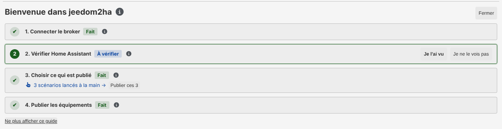
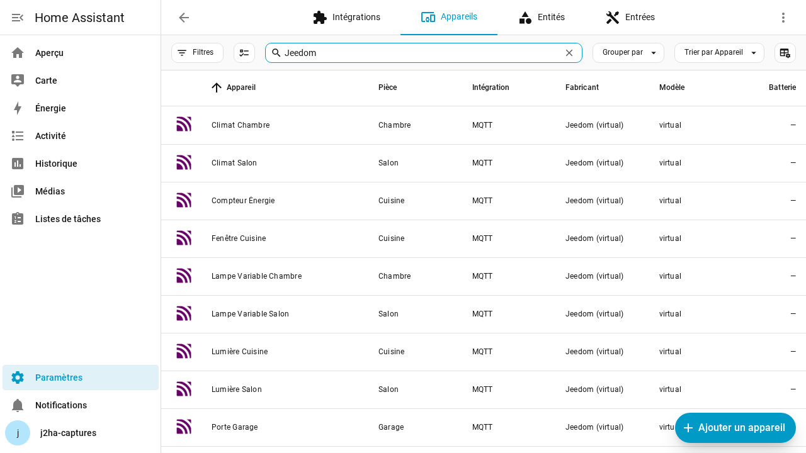
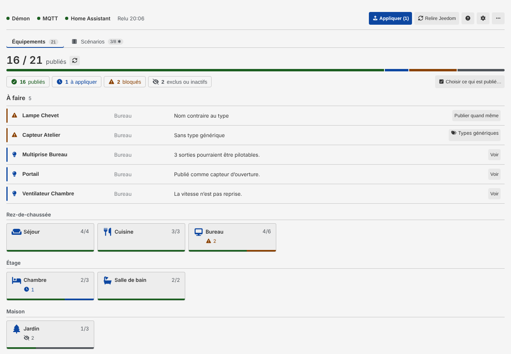
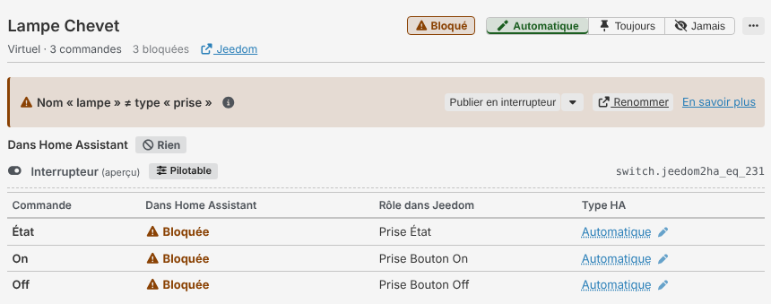

# Premiers pas avec jeedom2ha

**jeedom2ha publie vos équipements Jeedom dans Home Assistant.** Jeedom reste la source : rien n'y est modifié.

Cette page suffit pour démarrer. L'écran n'a pas de phrase d'aide : survolez une icône pour son info-bulle, ou suivez « En savoir plus » vers la [documentation complète](index.md).

---

## Ce qu'il vous faut

- Jeedom 4.5 ou plus récent, sur Debian 12, avec le plugin installé et ses dépendances (page du plugin, bloc « Dépendances »).
- Le **broker MQTT** que Home Assistant utilise déjà : le serveur de messages que Home Assistant écoute aussi (par exemple celui du plugin MQTT Manager de Jeedom, ou Mosquitto).
- Dans Home Assistant, l'intégration **MQTT**, avec la découverte activée (c'est son réglage par défaut).

## Avant de commencer : trois règles à connaître

> **1. Un seul broker MQTT, partagé avec Home Assistant, et une seule installation jeedom2ha par broker.** jeedom2ha et Home Assistant doivent utiliser le même broker. Si une deuxième installation jeedom2ha (une box de test, une sauvegarde restaurée sur une autre machine) se branche sur ce même broker, chacune retire les boutons de scénario de l'autre. Branchez une box de test sur un autre broker.
>
> **2. Certains mots du nom d'un équipement écartent un type.** Le plugin lit aussi le nom de l'équipement. Si le nom contient l'un de ces mots, en entier (majuscules ou non), le type correspondant est écarté et l'équipement est **Bloqué** :
>
> - pour une **lumière** : chauffage, radiateur, thermostat, heater, chaudiere, chaudière, poele, poêle, chauffe-eau, eau, water, cumulus, ballon, piscine, pool, filtration, filtre, pompe, prise, plug, socket, fumée, smoke, incendie, feu, fire, alarme, sirene, sirène, volet, store, cover, blind, shutter, garage, portail ;
> - pour une **prise ou un interrupteur** : lumière, lumiere, light, lampe, ampoule, volet, store, cover, blind, shutter, portail, garage, chauffage, radiateur, thermostat, heater, fumée, smoke, alarme, sirene ;
> - pour un **volet** : lumière, lumiere, light, lampe, ampoule, chauffage, radiateur, thermostat, heater, prise, plug, socket, fumée, smoke, alarme, sirene.
>
> « Lumière garage », « Lampe salle d'eau » ou « Éclairage piscine » ne sont donc pas publiés comme lumières ; « Lampe tableau » l'est (« eau » n'y est pas un mot entier). Que faire : sa fiche propose **« Publier quand même »** (la publication de l'équipement passe sur **« Toujours »**, puis **« Appliquer »** l'envoie), ou **« Renommer l'équipement dans Jeedom, puis Relire Jeedom »** (retirez ce mot du nom, puis cliquez sur « Relire Jeedom »). Corriger le type ne suffit pas dans ce cas : le nom continue d'écarter le type.
>
> **3. La pièce dans Home Assistant est fixée à la création.** Home Assistant range chaque appareil dans la zone de sa pièce Jeedom **une seule fois**, quand il le découvre. Déplacer ensuite l'équipement dans une autre pièce de Jeedom ne le déplace pas dans Home Assistant : changez sa zone dans Home Assistant (la [documentation complète](index.md#annexe--pièces-dans-home-assistant-zone-suggérée) donne les deux façons de faire).

## Le guide de démarrage, en quatre étapes

Ouvrez la page du plugin (**Plugins › Communication › jeedom2ha**). Tant que rien n'est publié, elle affiche **« Bienvenue dans jeedom2ha »** et quatre étapes, une ligne chacune. Une étape n'est « Fait » que si le plugin l'a constaté ; sinon elle dit « À vérifier », avec un bouton.

1. **« Connecter le broker »** — **« Ouvrir la configuration MQTT »**, saisissez l'adresse du broker (« Hôte MQTT »), son port (1883 en général, 8883 avec TLS), l'utilisateur et le mot de passe, puis **« Tester, enregistrer et redémarrer le démon »**. Trois coches s'allument : « Connexion testée », « Réglages enregistrés », « Démon redémarré ». Si le test échoue, rien n'est enregistré et le message dit quoi vérifier. Revenez par **« Retour à la page du plugin »**.
2. **« Vérifier Home Assistant »** — Dans Home Assistant, ouvrez **Paramètres › Appareils et services › MQTT** : l'appareil « Jeedom (jeedom2ha) » doit y apparaître, avec l'entité « État du pont ». Cliquez sur **« Je l'ai vu »**. Sinon, **« Je ne le vois pas »** affiche les trois causes habituelles : l'intégration MQTT n'est pas installée, Home Assistant utilise un autre broker, ou la découverte MQTT est désactivée.
3. **« Choisir ce qui est publié »** — Tout ce que le plugin reconnaît est publié par défaut : **« Tout publier (recommandé) »**, ou **« Choisir… »** pour retirer d'emblée un plugin, une pièce ou un équipement. Les scénarios, eux, ne sont publiés que si vous les choisissez : « Publier ces 3 » prépare ceux que vous lancez à la main.
4. **« Publier les équipements »** — **« Publier dans Home Assistant »** : le plugin lit Jeedom et publie ce qu'il reconnaît, puis propose **« Voir ma maison »**.

« Fermer » cache le guide ; **« Ne plus afficher ce guide »** l'empêche de revenir. Une fois les quatre étapes faites, il ne revient plus de lui-même ; il reste dans le menu **« ⋯ » › « Guide de démarrage »**.

## Où trouver vos équipements dans Home Assistant

Dans Home Assistant, ouvrez **Paramètres › Appareils et services › MQTT** : c'est le même chemin qu'à l'étape 2. Chaque équipement Jeedom publié y est un appareil, sous **son nom Jeedom**, rangé dans la zone de sa pièce Jeedom (« zone » dans Home Assistant, « objet » dans Jeedom). Tous sont « connectés via » l'appareil « Jeedom (jeedom2ha) ».

Dans la fiche d'un équipement, le bloc « Dans Home Assistant » donne l'identifiant de chaque **entité** (une ligne pilotable ou lisible dans Home Assistant), par exemple `light.jeedom2ha_142`, avec une icône pour le copier. Il ne change pas si vous renommez l'équipement.

## Trois questions, pour chaque équipement

**1. Qu'est-ce qui est publié ?** Le chiffre de la maison (publiés sur le total) et ses puces le disent. Chaque équipement porte un seul mot, avec sa couleur et son icône : **Publié** (vert), **À appliquer** (bleu), **Bloqué** (orange), **Exclu**, **Désactivé** ou **Rien à publier** (gris). Le [glossaire des états](index.md#glossaire-des-états) les définit.

**2. Pourquoi pas ?** La liste **« À faire »** rassemble ce qui a besoin de vous. Dans la fiche d'un équipement bloqué, une bande d'une ligne dit la cause en quelques mots (l'info-bulle ⓘ dit pourquoi), avec le bouton qui corrige et « En savoir plus ». Un équipement publié qui pourrait faire mieux porte un **Conseil**, en bleu.

**3. Comment changer ?** Chaque fiche propose l'action qui convient :

- **« Ouvrir les types génériques »** : la voie durable. Dans Jeedom, chaque commande porte un « type générique » qui dit son rôle (« Lumière État », « Lumière Bouton On ») ; corrigez-le, puis **« Relire Jeedom »**.
- **« Ouvrir l'équipement dans Jeedom »** : pour compléter ses commandes, puis « Relire Jeedom ».
- **« Corriger le type… »** : pour régler ici ce que voit Home Assistant, sans toucher à Jeedom (voir plus bas).
- **« Ouvrir la configuration du plugin »** : quand la cause est un réglage du plugin.
- **« Publier quand même »** : quand le plugin hésite, ou quand le nom contredit les types.
- **« Renommer l'équipement dans Jeedom, puis Relire Jeedom »** : quand un mot du nom écarte le type voulu.
- **« Republier »** : quand l'envoi à Home Assistant a échoué.
- **« Automatique | Toujours | Jamais »** : laisser le plugin décider, publier même s'il hésite, ou ne jamais publier. Le réglage attend : l'équipement passe « À appliquer », et **« Appliquer »** l'envoie (le bouton « Appliquer (n) » de la barre d'état envoie tous les réglages en attente d'un coup).

## Relire Jeedom ou Republier tout ?

- **« Relire Jeedom »** (barre d'état) : *j'ai changé quelque chose dans Jeedom* (un équipement, un type générique, un nom, une pièce). Le plugin relit Jeedom, met Home Assistant à jour et applique les réglages en attente.
- **« Republier tout »** (menu « ⋯ ») : *Home Assistant a perdu ses appareils*. Le plugin renvoie ce qui est déjà publié, sans relire Jeedom.

Une modification faite dans Jeedom demande toujours « Relire Jeedom ».

## Corriger un type

Depuis la fiche, **« Corriger le type… »** ou le lien de la colonne **« Type HA »** (« Automatique » tant que le plugin choisit seul) ouvre le panneau « Type dans Home Assistant de « Nom » ». « Pour : … » liste les commandes de l'entité : le type choisi vaut pour toute l'entité. Choisissez un type (« Lumière (light) »…) : l'aperçu « Avant » / « Après » s'affiche, avec **« ID modifié »** si l'identifiant change. Puis **« Enregistrer et publier »** ; un bandeau propose « Annuler » pendant quelques secondes. Si le plugin hésite, « Le type seul ne suffit pas » propose « Publier quand même », et le bouton devient « Enregistrer et publier quand même ». Les types impossibles sont repliés sous « Types impossibles pour cet équipement (N) » ; le lien « Types génériques » mène à la voie durable.

## Choisir ce qui est publié

Le bouton **« Choisir ce qui est publié… »**, au bout des puces, règle au même endroit les plugins, les pièces et les équipements : **« Par pièce »** ou **« Par plugin »**, décochez, le pied compte ce qui sera retiré, puis cliquez sur le bouton qui dit ce qu'il fera. Dans l'en-tête, **« En cas de doute »** (**« Publier | Ne pas publier »**). **« Non exclu » ne veut pas dire « publié »** : un équipement désactivé dans Jeedom, bloqué ou sans rien à publier reste hors de Home Assistant. Pour un seul équipement : « Jamais » dans sa fiche, puis « Appliquer ».

**Les scénarios** ont leur onglet : un interrupteur « Publier » par scénario, puis **« Appliquer »**. Les scénarios déjà publiés le restent ; un nouveau scénario arrive non publié, marqué ✱.

## Quelque chose ne va pas ? « Vérifier l'installation… »

Dans le menu **« ⋯ »** de la barre d'état, **« Vérifier l'installation… »** passe les contrôles dans l'ordre et s'arrête au premier point « À corriger », avec le bouton qui le corrige. Pour Home Assistant, **« Vu »** ou **« Pas vu »**. Pour demander de l'aide, **« Pour le support »** télécharge un **« Diagnostic »** à joindre à votre message sur le forum ; la case **« Pseudonymiser »** remplace vos noms par des alias.

Pour aller plus loin : la [documentation complète](index.md).
