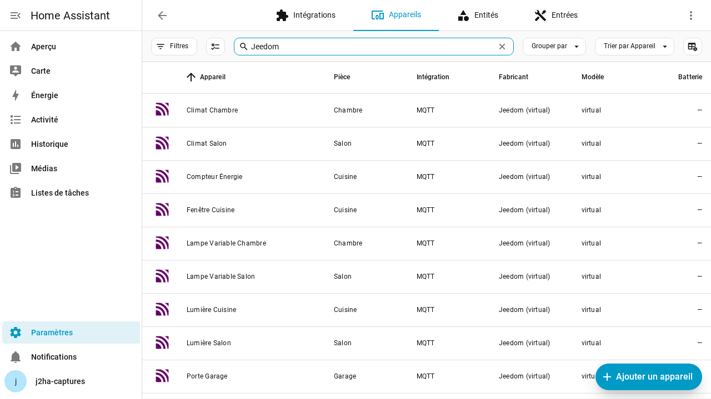

# Premiers pas avec jeedom2ha

**jeedom2ha publie vos équipements Jeedom dans Home Assistant.** Jeedom reste la source : rien n'y est modifié.

Cette page suffit pour démarrer. La [documentation complète](index.md) détaille chaque écran.

---

## Ce qu'il vous faut

- Jeedom 4.5 ou plus récent, avec le plugin installé et ses dépendances (page du plugin, bloc « Dépendances »).
- Le **broker MQTT** que Home Assistant utilise déjà : le serveur de messages que Home Assistant écoute aussi (par exemple celui du plugin MQTT Manager de Jeedom, ou Mosquitto).
- Dans Home Assistant, l'intégration **MQTT**, avec la découverte activée (c'est son réglage par défaut).

## Le guide de démarrage, en quatre étapes

Ouvrez la page du plugin (**Plugins › Communication › jeedom2ha**). Tant que rien n'est publié, elle affiche **« Bienvenue dans jeedom2ha »** et quatre étapes. Chaque étape se coche seule quand elle est faite ; une étape pas encore atteinte affiche « Terminez l'étape N d'abord. ».

1. **« Connecter le broker MQTT »** — Cliquez sur **« Ouvrir la configuration MQTT »**. Dans la configuration du plugin, saisissez l'adresse du broker (« Hôte MQTT »), son port (1883 en général, 8883 avec TLS), l'utilisateur et le mot de passe, puis cliquez sur **« Tester, enregistrer et redémarrer le démon »**. Trois coches s'allument l'une après l'autre : « Connexion testée », « Réglages enregistrés », « Démon redémarré ». Si le test échoue, rien n'est enregistré et le message dit quoi vérifier. Revenez ensuite par **« Retour à la page du plugin »**.
2. **« Vérifier que Home Assistant écoute »** — Dans Home Assistant, ouvrez **Paramètres › Appareils et services › MQTT**. L'appareil « Jeedom (jeedom2ha) » doit y apparaître, avec l'entité « État du pont ». Cliquez sur **« Je l'ai vu »**. Sinon, **« Je ne le vois pas »** affiche les trois causes habituelles : l'intégration MQTT n'est pas installée, Home Assistant utilise un autre broker, ou la découverte MQTT est désactivée.
3. **« Choisir ce qui est publié »** — Par défaut, tout ce que le plugin reconnaît est publié. Cliquez sur **« Tout publier (recommandé) »**, ou sur **« Choisir… »** pour retirer d'emblée un plugin, une pièce ou un équipement. Vous pourrez changer d'avis à tout moment.
4. **« Publier dans Home Assistant »** — Le plugin lit Jeedom et publie ce qu'il reconnaît. Un écran de fin dit combien d'équipements sont dans Home Assistant, donne quelques exemples nommés et propose **« Voir ma maison »** ; si des équipements ne peuvent pas être publiés, un second bouton les liste.

Le guide se ferme par **« Fermer »**. **« Ne plus afficher ce guide »** l'empêche de revenir seul ; il reste disponible dans le menu **« ⋯ » (« Autres actions ») › « Guide de démarrage »**.

## Où trouver vos équipements dans Home Assistant

Dans Home Assistant, ouvrez **Paramètres › Appareils et services**, onglet **Appareils**, et tapez « Jeedom » dans la recherche : chaque équipement Jeedom publié est un appareil, sous **son nom Jeedom**, rangé dans la zone qui porte le nom de sa pièce Jeedom (« zone » dans Home Assistant, « objet » dans Jeedom). Tous sont « connectés via » l'appareil « Jeedom (jeedom2ha) ».

Dans la page du plugin, la fiche d'un équipement rappelle le chemin (**« Où le trouver dans Home Assistant ? »**) et donne l'identifiant de chaque entité, par exemple `light.jeedom2ha_142` (**« copier »** le met dans le presse-papiers). Une **entité** est une ligne pilotable ou lisible dans Home Assistant : un équipement Jeedom peut en donner plusieurs (une prise et sa consommation, par exemple).

## Trois questions, pour chaque équipement

La page du plugin répond toujours aux mêmes trois questions, pour toute la maison, pour une pièce et pour un équipement.

**1. Qu'est-ce qui est publié ?** Chaque équipement porte un seul mot : **Publié**, **À appliquer**, **Bloqué**, **Exclu**, **Désactivé** ou **Rien à publier**. Le lien « Que veulent dire ces mots ? », sous les chiffres de la maison, les explique en une ligne chacun. Dans la fiche d'un équipement, les deux côtés sont face à face : **« Dans Jeedom »** (nom, plugin, pièce, commandes) et **« Dans Home Assistant »** (les entités, leur type en français, par exemple « Lumière (light) », et **Pilotable** ou **Lecture seule**).

**2. Pourquoi pas ?** Un équipement non publié dit pourquoi, en clair, dans sa fiche : ce qui se passe, pourquoi, et comment faire, avec le bouton qui corrige (souvent **« Ouvrir les types génériques »** ou **« Corriger le type… »**). Un équipement publié mais qui pourrait faire mieux (en lecture seule alors que Jeedom a des ordres, par exemple) porte un **Conseil**, construit de la même façon. Le bloc **« À faire »** de la page du plugin rassemble ce qui a besoin de vous.

**3. Comment changer ?** Chaque fiche propose l'action qui convient :

- **« Ouvrir les types génériques »** : la voie durable. Dans Jeedom, chaque commande peut porter un « type générique » qui dit son rôle (par exemple « Lumière État », « Lumière Bouton On ») ; sans lui, le plugin ne peut rien en déduire. Corrigez-le dans Jeedom, puis cliquez sur **« Relire Jeedom »**.
- **« Ouvrir l'équipement dans Jeedom »** : pour compléter ses commandes dans Jeedom, puis **« Relire Jeedom »**.
- **« Corriger le type… »** : pour régler ici ce que voit Home Assistant, sans toucher à Jeedom (voir plus bas).
- **« Ouvrir la configuration du plugin »** : quand la cause est un réglage du plugin (un plugin exclu, par exemple).
- **« Republier »** : quand l'envoi à Home Assistant a échoué.
- Le réglage **« Automatique | Toujours | Jamais »** de l'équipement : laisser le plugin décider, publier même si le plugin hésite, ou ne jamais le publier. Ce réglage est enregistré, puis attend : l'équipement passe « À appliquer », et le bouton **« Appliquer »** de sa fiche l'envoie à Home Assistant.

## Relire Jeedom ou Republier tout ?

Les deux boutons de la barre d'état, en haut de la page du plugin :

- **« Relire Jeedom »** : *j'ai changé quelque chose dans Jeedom* (un équipement, un type générique, un nom, une pièce). Le plugin relit Jeedom, puis met Home Assistant à jour, et applique au passage les réglages en attente.
- **« Republier tout »** : *Home Assistant a perdu ses appareils* (après un redémarrage du broker, par exemple). Le plugin renvoie à Home Assistant ce qui est déjà publié, sans relire Jeedom.

Une modification faite dans Jeedom, même sur un seul équipement, demande toujours « Relire Jeedom » : les gestes « Republier » ne relisent pas Jeedom. Pour renvoyer seulement un équipement ou une pièce, leur menu « ⋯ » propose **« Republier »** et **« Republier la pièce »**.

## Corriger un type

Quand le plugin hésite (une lampe branchée sur une prise, par exemple) ou se trompe de type :

1. Ouvrez l'équipement (cliquez sur sa pièce, puis sur son nom), et cliquez sur **« Corriger le type… »** dans sa fiche, ou sur le lien de la colonne **« Type HA »** de la commande (« auto » tant que le plugin choisit seul).
2. Le panneau rappelle que le plus durable est de corriger les types génériques dans Jeedom, puis propose les types possibles en français (« Automatique », « Lumière (light) », « Interrupteur (switch) »…). Les autres types sont listés à part, grisés, sous « Autres types, non proposés pour cette commande ».
3. Choisissez un type : un aperçu **« Avant » / « Après »** montre ce que deviendra l'équipement dans Home Assistant, et prévient si l'identifiant change (les automatisations qui utilisent l'ancien seront à reprendre). Rien n'est enregistré à ce stade.
4. Cliquez sur **« Enregistrer et publier »**. Un bandeau confirme le changement et propose **« Annuler »** pendant quelques secondes.

La colonne « Type HA » affiche alors « Personnalisé : Lumière (light) ». Pour revenir au choix du plugin, rouvrez le panneau et choisissez « Automatique ».

## Choisir ce qui est publié

Tout ce que le plugin reconnaît est publié par défaut. Pour retirer quelque chose de Home Assistant :

- **un équipement** : réglez-le sur **« Jamais »** dans sa fiche, puis cliquez sur **« Appliquer »** (le réglage n'est envoyé à Home Assistant qu'à ce moment) ;
- **une pièce** : menu « ⋯ » de sa carte, ou de la pièce ouverte, **« Exclure la pièce… »** ; une confirmation dit combien d'entités quitteront Home Assistant ;
- **tous les équipements d'un plugin** : cochez-le dans **« Plugins exclus »**, dans la configuration du plugin, puis cliquez sur **« Enregistrer et relire Jeedom »**.

Un équipement est publié s'il n'est exclu ni lui-même, ni par sa pièce, ni par son plugin. Pour le reprendre : « Automatique » puis « Appliquer » dans sa fiche, « Ne plus exclure la pièce… », ou décochez le plugin puis « Enregistrer et relire Jeedom ».

## Quelque chose ne va pas ? « Vérifier l'installation… »

Dans le menu **« ⋯ » (« Autres actions »)** de la barre d'état, **« Vérifier l'installation… »** passe les contrôles dans l'ordre : le démon tourne, le broker MQTT répond, Home Assistant a été vu sur ce broker, la dernière relecture a réussi, les équipements bloqués. Elle s'arrête au premier point **« À corriger »** et propose le bouton qui le corrige.

Pour demander de l'aide, la partie **« Pour le support »** de la même boîte télécharge un fichier qui décrit votre installation (**« Télécharger le diagnostic support »**), à joindre à votre message sur le forum ; la case **« Pseudonymiser les noms d'équipements »** remplace vos noms par des alias.

Pour aller plus loin : la [documentation complète](index.md).
